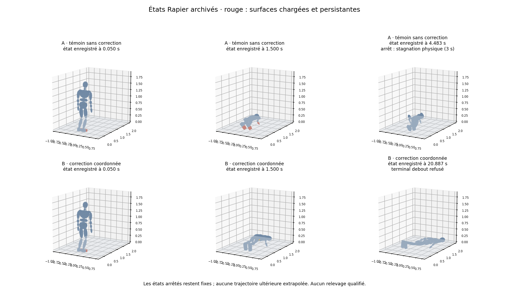
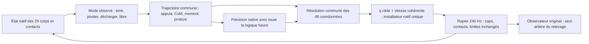

# Coordination du relevage : revue et prototype proposé — 12 octobre 2026

**Recommandation : construire un contrôleur commun qui prévoit les changements
d'appui et décide des commandes des 46 coordonnées ensemble, puis confronte
ses propositions au moteur natif.** Le prochain test utile est une transition
physique courte depuis l'accroupi réel : acquérir les talons, recentrer et tenir
sur les pieds. Ce n'est ni une récupération déjà obtenue, ni une campagne autorisée.

La revue porte sur `527b26bd0281ecae21b5f3c342d2f4db986e97d7`,
branche `investigate/physical-support`. La référence `main` est
`c597959f46f37715035349c8cd0a699b6822111a`. Aucun `AGENTS.md` ni
compétence locale `.agents/skills` trouvé. Deux lectures indépendantes ont été
conduites avec Astra au niveau de raisonnement maximal : audit du contrôleur
source et contradiction de l'architecture locale. Leurs notes sont conservées
avec cette synthèse. La recommandation finale ci-dessous arbitre leurs propositions.

**Cette étape : zéro simulation, zéro appel de politique tierce, zéro apprentissage,
zéro installation, zéro modification de contrôleur.** Aucun registre physique
n'est ouvert ou renouvelé. Les seuils, l'anatomie, les contacts, les gains et les
plafonds restent intacts ; récupération inactive par défaut et non qualifiée.
La notification de déconnexion à 19:40 UTC a été suivie de lectures réussies à
19:41 UTC du HEAD, de `env.py` et d'une source officielle en ligne. Cela prouve
l'accès de cette session à cet instant, pas la restauration de la session parente.

## Le mécanisme manquant

Le défaut n'est pas une simple désynchronisation temporelle. Le code possède
déjà une horloge commune, une interpolation coordonnée et des servomoteurs.
Mais il ne décide pas conjointement **quels contacts devront porter ensuite,
comment les acquérir et quelles commandes rendent ce transfert réalisable**.

Trois niveaux ont été confondus dans plusieurs pistes :

| Niveau | Ce que nous avons | Ce que cela ne prouve pas |
|---|---|---|
| Géométrie et rythme | Programmes articulaires continus, limites et collisions inspectées | Réactions au sol, équilibre dynamique, suivi moteur |
| Coordination cinématique | A/B avec correction commune des 46 coordonnées ; suivi articulaire amélioré | Orientation et déplacement de la racine libre, décharge des contacts passifs |
| Dynamique exécutée | Rapier natif, limites de couple, contacts et vitesses mesurés | Existence d'une trajectoire de relevage dans la famille recherchée |

L'A/B apporte un contre-exemple particulièrement clair : B atteint 99 % du
chemin articulaire mesuré, mais termine avec le bassin à **0,108 m** et le
torse presque horizontal. Il n'a jamais obtenu le talon postérieur porteur.
Une fonction de progrès fondée seulement sur les angles peut donc annoncer
presque la fin alors que le corps reste au sol. Le vérificateur debout original
a correctement refusé cette histoire. [Preuves A/B](rust-getup-ab-results-2026-10-12.md).

*Image préexistante, issue de poses natives enregistrées. Aucune nouvelle
simulation ni nouvelle capture du navigateur pour cette revue.*

## Ce que fait réellement get_up_control

Le checkout source est épinglé à
`5ad52fbe1b5b7c56522a1aa10ccf17fb81c0d79e`. SLOW emploie un acteur SAC à
deux couches de 1024 unités. Il reçoit **118 valeurs** : état physique,
deux cibles et paramètre de force. Ses **21 sorties conjointes** corrigent les
angles cibles. L'acteur agit à **40 Hz** ; le PD est recalculé à **800 Hz**.
Le retour global appris peut ainsi modifier bras, tronc et jambes en fonction
de l'état courant. Il n'observe pas explicitement les forces de contact.
[Architecture SAC](https://github.com/tianxintao/get_up_control/blob/5ad52fbe1b5b7c56522a1aa10ccf17fb81c0d79e/SAC.py),
[boucle SLOW](https://github.com/tianxintao/get_up_control/blob/5ad52fbe1b5b7c56522a1aa10ccf17fb81c0d79e/env.py#L296-L344).

L'export local a conservé **une réalisation de ce contrôleur**, ensuite retargetée
en 75 clés sur 20,883 s. Il a transféré un mouvement, pas la fonction qui corrige
ses écarts. Le suivi natif a bien son propre PD et son allocation bornée ; le
qualifier de boucle sans retour serait faux. L'A/B ultérieur ajoute un retour
cinématique global, distinct du retour appris de SLOW.
[Installateur natif](../rust/crates/sim/src/recovery/support_probe/offline_trajectory.rs#L329),
[audit source détaillé](evidence/coordination-architecture-2026-10-12/getup-audit.md).

Les poids source ne sont pas directement réutilisables. Le XML fourni a 21 axes,
des pieds rigides sans avant-pied articulé, 16 corps hors monde et 19 primitives.
L'export archivé indique 40,844 kg, contre 72,2 kg et 25 segments ici.
La somme des caps source à pleine puissance vaut 920 Nm, sans plafond agrégé
supplémentaire trouvé ; ici l'enveloppe reste **760 Nm**. Ces chiffres ne
constituent pas une comparaison de force spécifique ou d'inertie équivalente.
Le source ne possède pas notre limite de consigne de 1 rad/s.
[Modèle source épinglé](https://github.com/tianxintao/get_up_control/blob/5ad52fbe1b5b7c56522a1aa10ccf17fb81c0d79e/data/humanoid_high_freq.xml).

L'[article](https://arxiv.org/html/2205.00307v2) établit la méthode d'apprentissage
dans son environnement, pas une qualification selon nos critères. Des écarts
article/code existent ; la note d'audit les sépare. Aucun réentraînement natif
ni comparaison causale isolant chaque différence de modèle n'est disponible.
L'absence du réseau est donc une différence majeure, **pas une cause unique démontrée**.

## Défauts locaux concrets et portée des preuves

1. **Les mains peuvent perdre leur tâche d'appui trop tôt.**
   `supported_transfer` vérifie la charge et le support en excluant les membres
   libérés. La logique de retrait des mains ne l'emploie pas : elle regarde les
   deux pieds et 80 % du poids. Surtout, l'entrée en Stand peut quitter le bloc
   qui maintient les mains, avant une preuve équivalente de décharge. Une future
   transition doit conserver leurs tâches jusqu'à la preuve explicite de
   transfert. C'est un défaut structurel lisible ; le dernier candidat numérique
   n'a pas été exécuté, donc sa chute ne peut lui être attribuée.
   [Garde de transfert](../rust/crates/sim/src/recovery.rs#L267),
   [entrée Stand](../rust/crates/sim/src/recovery.rs#L1076),
   [mains](../rust/crates/sim/src/recovery.rs#L1242).

2. **La règle finale de caps compte plus que les poids de phase.**
   Pendant la récupération, le bloc final remplace les caps calculés auparavant
   par une fonction de la demande, de la réserve et du plafond anatomique,
   normalisée à 760 Nm. Les réserves actuelles concernent les jambes en
   Stand/Handoff, pas un problème commun mains/tibias/tronc. Régler seulement les
   poids antérieurs peut être sans effet sur les caps finaux.
   [Allocation finale](../rust/crates/sim/src/lib.rs#L923),
   [réserves](../rust/crates/sim/src/recovery.rs#L634).

3. **Un couple calculé n'est pas une consigne moteur équivalente.**
   L'audit natif a montré qu'une conversion analytique prédisait du freinage
   alors que le moteur couplé accélérait l'avant-pied. Une autre consigne au même
   cap freinait réellement. Le signe d'une ligne d'impulsion ne suffit pas à
   donner le couple généralisé sur l'enfant. Un QP de dynamique inverse peut
   proposer une solution ; sa livraison reste à mesurer dans Rapier.
   [Expérience causale](rust-native-actuation-audit-2026-10-11.md).

4. **La continuité des appuis doit porter sur la matière.**
   Le candidat numérique rejeté déplaçait d'environ 0,48 m des points de semelle
   annotés comme plantés. Il quittait les mains avant la faisabilité du modèle
   statique pieds seuls. Le LP emploie des points virtuels et un diamant de
   friction conservateur ; ses refus ne prouvent pas l'impossibilité native.
   Le reçu versionné donne 151,47 Nm au recouvrement, et non les 196,88 Nm du
   texte initial : cette incohérence documentaire est corrigée sans recalcul.
   [Audit corrigé](intermediate-transfer-numeric-audit-2026-10-12.md).

5. **Le planner complet n'existe pas encore.**
   Le module présent n'exporte que l'observation des impulsions, sous
   fonctionnalité expérimentale et `cfg(test)`. Le prédicteur vérifié porte sur
   quatre sous-pas au maximum, soit 16,67 ms. Il ne clone pas la logique future
   du contrôleur. L'allonger sans réexécuter cette logique ne créerait pas un
   contrôle prédictif de transfert.
   [Module](../rust/crates/sim/src/recovery/planner/mod.rs),
   [prédicteur](../rust/crates/sim/src/recovery/native_predictor.rs).

Le bilan linéaire CCD a été clarifié sans changer la physique. Le bilan angulaire
exhaustif et sa borne numérique restent non certifiés. Les moments mesurés
peuvent être suivis comme diagnostics ; ils ne deviennent pas un certificat de
conservation. Les anciens registres restent fermés.
[Clôture P1](rust-recovery-p1-closure-2026-10-11.md).

## Comparaison et décision

| Option | Intérêt | Décision |
|---|---|---|
| Nouveau clip, gains ou allocation seuls | Petit changement | Ne traite pas le défaut de transfert ; ne pas prolonger B/C par réglages |
| IK commun avec simple erreur CoM | Peu coûteux | Déjà partiellement essayé ; insuffisant comme nouvelle hypothèse |
| Dynamique inverse instantanée de type TSID | Résout ensemble accélérations, contacts et efforts | Utile pour proposer/expliquer ; adaptation moteur et anticipation restent nécessaires |
| Trajectoire avec contacts + retour global évalué dans Rapier | Traite préparation, acquisition et décharge dans le vrai modèle | **Choix recommandé**, avec route limitée et première transition courte |
| Politique résiduelle réentraînée dans le modèle natif | Reprend le principe utile de SLOW | Alternative sérieuse, mais environnement d'apprentissage et budget inconnus ; pas le plus petit test causal |
| Recherche libre de centaines de paramètres et topologies | Grande variété | Trop difficile à attribuer avant de vérifier une transition exécutée |

TSID fournit bien une formulation commune accélérations/forces et des limites
d'actionnement ; cela suppose un modèle de dynamique inverse et des contacts
déclarés. Son `Contact6d` utilise quatre points et une tâche de mouvement à six
dimensions : ce n'est pas une représentation immédiate de notre appui initial
presque linéaire sur des pieds articulés.
[Formulation officielle](https://github.com/stack-of-tasks/tsid/blob/v1.10.0/src/formulations/inverse-dynamics-formulation-acc-force.cpp#L244-L379),
[contact officiel](https://github.com/stack-of-tasks/tsid/blob/v1.10.0/src/contacts/contact-6d.cpp#L109-L120).
Il n'est donc pas proposé d'installer TSID ou de remplacer Rapier.

Les modèles centroidaux permettent de prévoir CoM et moment avec la géométrie
complète, mais leur faisabilité dépend aussi de l'effort disponible. Leurs forces
sont ici des propositions, pas des réactions imposées.
[Dai, Valenzuela, Tedrake](https://dspace.mit.edu/entities/publication/eafd7d09-bc5d-4c2f-9ee1-4c5a9334fad7).
Les changements de contact rendent en outre le problème hybride et non lisse ;
les sensibilités d'un mode ne valent pas automatiquement après un impact.
[Notes primaires de Tedrake](https://underactuated.mit.edu/contact.html).

## Architecture construisible

**État et action.** L'état prédit comprend le monde natif, ses caches, la mémoire
du contrôleur, l'horloge, les ancres et l'état d'allocation. L'action contient
uniquement les 46 références articulaires et leurs vitesses cohérentes.
Le bassin, le CoM et le moment cinétique sont des états et des objectifs,
jamais des actions de racine. Conserver d'abord l'installateur, les gains et la
règle d'allocation existants pour isoler la coordination.

**Modes de contact.** Un patch matériel peut être maintenu, en pivot, en décharge
ou libre. En maintien, suivre son point local, sa charge et sa dérive.
En pivot, autoriser le remplacement **observé** du patch porteur : immobiliser
toute la semelle empêcherait le mouvement recherché. Une annotation ne crée pas
de contact. Ne pas traiter deux points presque colinéaires comme un pied plat
à six contraintes. Un déplacement de 48 cm d'un point déclaré collant reste un
défaut ; il ne devient pas un pivot par changement d'étiquette.

**Observation.** Séparer les impulsions de tout le sous-pas, utiles au bilan,
des contacts persistants encore présents, utiles à l'appui actuel. Une impulsion
CCD passée ne maintient pas une main disparue au sol. Garder le chemin des
observateurs de qualification original ; publier les diagnostics supplémentaires
avec leur durée et leur frontière de mesure.

**Résolution.** Les 46 coordonnées participent au même problème. Les priorités
sont : enveloppe physique/commande, appuis retenus et collisions, acquisition
ou décharge du prochain appui, CoM/vitesse et moment compatibles, puis posture.
Une tâche de soutien irréalisable est un refus explicite ; aucune pénalité faible
ne doit permettre de l'abandonner discrètement pour mieux suivre le clip.
La racine flottante reste présente dans le modèle de mouvement, non commandée.

**Anticipation.** Utiliser quatre à six clés communes sur un horizon couvrant
préparation, pivot/décharge, acquisition et maintien. Sa durée dérive des
déplacements à 1 rad/s et des persistances originales ; ordre de grandeur
0,5–2 s, soit 120–480 pas, contre quatre aujourd'hui. Un horizon qui ne couvre
pas cette séquence est refusé comme test du transfert. Le modèle analytique
initialise des cibles ; les propositions sont évaluées par le moteur natif.

Le problème recherché est une trajectoire de références articulaires \(p\)
avec mémoire \(s\), soumise à la récurrence native
\(X_{k+1}=F_{Rapier}(X_k,\operatorname{install}(\operatorname{decide}(X_k,p,s_k)))\).
Les caps et l'intégrité s'appliquent à chaque état/commande évalué. Le coût suit
le prochain appui, le CoM, sa vitesse et le moment ; le suivi du clip est
secondaire. Cette écriture n'impose aucune équation fictive de mouvement au bassin.

**Algorithme proposé.** Résolution séquentielle bornée, avec région de confiance :
proposer un mouvement coordonné depuis la géométrie et les tâches ; identifier
localement la réponse des commandes moteur dans un monde copié ; corriger le
plan ; vérifier un rollout complet avant d'accepter la correction. La réponse
locale porte sur les sorties du corps entier, pas seulement une vitesse de pied.
Réduire ou réidentifier la région quand le mode change ou que la prédiction se
dégrade ; ne pas supposer une réponse monotone. L'acceptation dépend des sorties
natives, pas du seul statut « QP résolu ». Une carte locale insuffisante produit
un échec du prototype, pas une commande prétendument certifiée.

La planification emploie un petit nombre de tâches et un solveur interne à
46 coordonnées ; elle ne cherche pas 46 actions indépendantes à chaque pas.
Elle ne fige pas pour autant les bras ou le tronc à leur posture actuelle.
Le résidu de référence, les durées et le transfert ont chacun un rôle explicite.

Concrètement, le contrôleur à 60 Hz utilise une carte locale de réponse native
des commandes vers les vitesses du CoM/tronc, les vitesses de points matériels,
les charges et les vitesses articulaires. Un problème de moindres carrés borné
calcule une correction commune de vitesse de cible ; son intégrale définit la
correction de position, avec bornes et slew inclus dans le problème. La carte
est réidentifiée au plus à 10 Hz par perturbations natives positives/négatives
des 46 axes, puis des plans coordonnés sont comparés sur l'horizon long.
Les perturbations admissibles restent dans le compilateur de commandes ; un
axe à sa borne utilise une différence unilatérale documentée. Les contacts
prévus, le mode, les cibles et les charges mesurées participent à la décision.
Une carte de réponse traverse mal l'acquisition d'un contact : le rollout
non linéaire tranche, et une carte périmée ne certifie jamais le transfert.

**Propriété unique.** Extraire une fonction pure de décision :
`decide(observation, plan, memory) -> (motor_intent, next_memory)`.
Le rollout réexécute cette fonction et l'allocation à chaque sous-pas selon la
même cadence que l'histoire réelle. Il n'appelle pas récursivement son propre
planificateur. Sa prévision est conditionnelle au plan candidat ; après une
nouvelle décision, la suite est recalculée. Aucun état prédit n'est copié dans
les corps réels. La première intégration sous la même commande doit retrouver
exactement la réponse native, comme dans le contrat court déjà établi.

| Brique à écrire, sous expérimental inactif | Interface proposée / réutilisation |
|---|---|
| `support_state.rs` | `observe -> SupportState` : segments, points matériels, impulsions horodatées, charges persistantes, dérive, mode |
| `contact_transition.rs` | `request_transition -> Hold/Unload/Acquire/Reject` ; exclusion des membres de `supported_transfer`, mains comprises |
| `whole_body_tasks.rs` | `assemble -> bounded_problem` ; conventions natives, tous les membres, racine flottante comme état |
| `native_plan_preview.rs` | `preview(snapshot, plan, memory, budget) -> predicted_history` ; copie complète, reconfiguration à chaque pas |
| `coordinated_runtime.rs` | `decide`, horloge et propriétaire unique ; installateur commun, aucune seconde écriture concurrente |
| `transition_history.rs` | Témoin/candidat, registre, contacts/couples/états ; adaptateur au terminal original pour le relevage ultérieur |

Ces modules et cet algorithme **ne sont pas livrés par cette revue**. La note
ne remplace pas leur implémentation, les tests de propriété ou une mesure de coût.
L'ordre de développement est précis : contrats/mémoire → observation des patches
→ solveur commun → prévision complète → histoire comparée. Estimation de travail
initiale : **3–5 jours d'ingénierie**, à réviser si la carte native ou la référence
reste bloquée ; aucune promesse de temps réel, notamment dans WASM.

## Plus petit prototype qui tranche une question utile

**Hypothèse : depuis `landed-crouch-left`, une coordination du corps entier peut
obtenir des appuis postérieurs réellement chargés et un recentrage durable,
sans main/tibia et avant la remontée.** Ce choix utilise une entrée physique
existante ; il n'initialise pas le mannequin à la pose virtuelle de 19,208 s.

Le corridor géométrique connu sert seulement d'initialisation : léger recul du
bassin avec pieds inclinés, puis aplatissement et recul supplémentaire. Le
contrôleur peut mobiliser tronc, bras, hanches, genoux et pieds ensemble.
Aucune position de bassin n'est installée, aucune semelle n'est collée au sol.

Avant lancement : construire les clés numériques, compiler toute l'interpolation
native, définir les patches et pivots, les tâches, la cadence et les plafonds
d'itération. Geler modèle, profil, fixture, référence, code, binaire et critères.
Le budget de préparation proposé est **40 heures actives sur cinq jours au
maximum**, avec au plus **20 000 inspections statiques**. Un prérequis manquant
ferme cette version ; il ne crée pas une autorisation de simuler pour chercher au hasard.

Comparer **A**, cette même nouvelle référence avec le servo local/allocation,
à **B**, avec coordination et anticipation. Changer seulement la boucle commune,
pas la référence, la règle de caps ou les seuils entre A et B. Le B historique
sert de contexte, pas de témoin causal de cette nouvelle référence.
Conserver le même état initial et tout préfixe effectivement rejoué dans chaque
histoire ; chaque sous-pas compte.

Le diagnostic local exige, avant 2 s puis pendant la persistance originale :
appuis postérieurs des deux pieds identifiés dans les contacts natifs, support
admis portant au moins 80 % du poids, aucune dépendance à main/tibia/tête/tronc,
CoM et capture dans le support réel avec la marge originale de 3 mm, calme des
25 corps selon les valeurs du contrat. Concrètement : charge minimale 3 N,
\`loadPersistenceS=0.05\`, \`stablePersistenceS=0.55\`, vitesses linéaires
≤0,22 m/s et angulaires ≤0,65 rad/s. Les 0,30 s de settle debout restent une
condition distincte, non réutilisée pour raccourcir ce maintien. Le talon
postérieur reprend le diagnostic déjà employé : point sur le hindfoot avec
coordonnée locale z < −0,02 m. Aucun segment non-pied ne doit fournir d'appui
persistant ≥3 N ; toutes ses impulsions, même inférieures, restent rapportées.
Cela borne la dépendance mesurée aux autres segments, sans prétendre prouver
une force exactement nulle. Le diagnostic de talon s'ajoute à ce test
local ; il ne remplace pas le terminal de récupération. Tous les refus
d'intégrité, limites et plafonds restent applicables.

**Budget de physique futur proposé, non autorisé ici :**

- Au plus quatre histoires continues de 4 s : A, B, puis B répété et B à 60°
  uniquement si B franchit le diagnostic local. Aucun réglage entre histoires.
- Au plus **300 000 sous-pas natifs au total**, dont 3 840 réservés aux quatre
  histoires et 296 160 au maximum aux prévisions/identifications et vérifications.
  Les copies sont des simulations et consomment ce même compteur.
- Contrôle commun à 60 Hz ; planification/identification native au plus à 10 Hz,
  40 appels par histoire B au maximum, appel initial compris. Chaque appel
  admet au plus quatre prévisions de 480 pas et 93 sondes de quatre pas
  (témoin et directions ± des 46 axes). Pour les trois histoires B possibles :
  230 400 pas longs + 44 640 pas courts ; 21 120 pas restent réservés aux
  vérifications techniques, soit 296 160 au total. Toute économie reste dans
  ce même plafond, sans augmenter ces nombres d'appels. Servo natif à 240 Hz.
  Plafond mural **2 heures**, un
  processus mono-thread, sans compilation concurrente. Le compteur ou l'heure
  qui expire en premier arrête le lot, même au milieu d'une recherche.
- Toute intégration d'un test, refus, préfixe ou essai de neutralité est réservée
  avant exécution. Un timeout/crash ne rend pas la réservation disponible.
  Pas de nouvelle seed, autre route ou renouvellement après un progrès partiel.

Ce plafond est une **borne proposée**, pas un coût prédit ni la garantie d'assez
d'itérations. Le nombre de variables, les appels et la répartition exacte par
histoire devront tenir dans ce plafond avant toute autorisation de lancement.
La valeur vient de la nécessité d'inclure les prévisions longues ; annoncer
seulement quatre histoires masquerait leur coût.

| Issue | Conclusion permise |
|---|---|
| A et B réussissent ce transfert | La nouvelle référence suffit déjà pour cette entrée ; bénéfice de B non établi |
| B seul réussit, puis se répète | Contribution causale utile de la coordination pour ce transfert |
| B réussit à 0° mais échoue à 60° | Fragilité de repère/marge ; pas de promotion |
| Géométrie, prédiction ou budget bloque | Prototype non concluant ; ni impossible mécanique, ni permission de relâcher les critères |
| Échec physique sous commandes admissibles | Famille/contrôleur testés rejetés ; première divergence à conserver |

Ce **diagnostic court** n'attribue aucune récupération : il lit et rapporte
le compteur original sans le modifier. Un déclenchement inattendu de
l'observateur impose de vérifier l'histoire et tous ses critères, pas de
supprimer le compteur. Le relevage, le handoff, le maintien et les scénarios
finaux restent à réaliser avec leurs critères originaux et un budget distinct
explicitement décidé. La réussite locale ne l'ouvre pas automatiquement.

Si la route pieds seuls échoue, la route mains/tibias reste une candidate,
**pas une nécessité démontrée**. Elle doit inclure l'acquisition contrôlée depuis
la fixture : l'ancien essai aux mains arrivait trop vite et touchait la tête.
Un beau transfert depuis un appui mains/tibias virtuel ne résoudrait pas cette
entrée. La contre-revue préférait initialement une référence complète mains/tibias ;
la transition courte est retenue ici parce qu'aucun préfixe admissible ne livre
aujourd'hui cette entrée intermédiaire.

## Preuves attendues et limites de cette livraison

À chaque essai futur : même état initial/empreintes ; trace par sous-pas des
commandes, cap installé, livraison vectorielle, états des 25 corps, accélération
CoM, moment diagnostique, contacts matériels, glissement, impulsions CCD et
contacts persistants distincts ; premier écart prédiction/réalisation ; refus
et hash du dernier pas, même si l'observateur public n'est pas atteint.
Images et courte vidéo doivent venir de ces états archivés, avec légende
« transfert local », « échec » ou « relevage qualifié » selon le verdict réel.

Cette revue livre une décision, des interfaces et un protocole proposé, pas un
correctif moteur validé. Les seules modifications hors nouvelle documentation
corrigent l'incohérence 196,88/151,47 Nm et ajoutent des liens de navigation.
Vérifications de livraison : lecture des sources épinglées, notes indépendantes,
cohérence JSON, liens locaux et diff. **Aucun test physique ni suite complète
n'a été exécuté.** L'échec d'articulation hybride et les quatre échecs TypeScript
historiques ne sont pas déclarés résolus.

- [Audit source indépendant](evidence/coordination-architecture-2026-10-12/getup-audit.md)
- [Contre-revue indépendante, objections conservées](evidence/coordination-architecture-2026-10-12/counterreview.md)
- [Reçu de revue et budget proposé](evidence/coordination-architecture-2026-10-12/review.json)
- [Dernier candidat numérique rejeté, visuel statique](media/intermediate-transfer-numeric-2026-10-12/unsupported-handoff.png)
