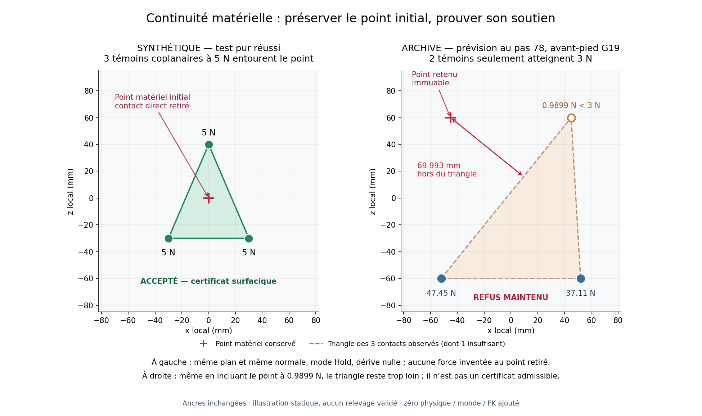

# Continuité matérielle : diagnostic et correction statique — 15 octobre 2026

**La cause interne exacte de la disparition à 78 reste indéterminée. La correction
est implémentée et vérifiée sans physique ; elle conserve le refus de cette
archive.** Un remplacement de points peut désormais être reconnu comme
équivalent lorsqu'une surface chargée de la même face couvre encore le point
matériel d'origine. Une charge totale positive et une faible dérive ne suffisent
pas à obtenir ce certificat.

Ce travail répond à la délégation du parent après le
[résultat clos A36](coordination-transfer-native-results-2026-10-15.md), commit
`da4575170c6ae9b0858c0851a6f1ed15fe1ce858`. Il n'ouvre aucune histoire, n'exécute
aucun sous-pas natif, ne reconstruit aucun monde et ne calcule aucune FK.

## Ce que les traces démontrent

L'[examen complet des données disponibles](evidence/coordination-contact-continuity-2026-10-15/forensics.md)
sépare les branches et leurs horloges : 130 sous-pas historiques, 90 observations
de support complètes contenant 689 contacts, et 24 tranches de mondes bruts
pendant la parité technique. Les sous-pas intermédiaires de prévision n'avaient
que des diagnostics et des points XZ ; leurs normales et impulsions individuelles
ne sont pas reconstituées artificiellement.

- À 78, le point gauche retenu reste **69,992785 mm hors du triangle chargé**
  des trois autres points. Deux seulement portent au moins 3 N ; le troisième
  porte 0,989888 N. La charge totale de 85,552933 N ne couvre donc pas l'obligation
  conservée au coin initial.
- Le même coin disparaît déjà des contacts chargés au pas **28**, puis revient
  au **29**, dans les deux préfixes. Une absence chargée peut être transitoire.
  Cela ne prouve ni un retour après 78 ni l'innocuité d'une tolérance temporelle.
- Les indices et caractéristiques des manifolds bruts ne changent pas pendant
  la parité aux horloges 36–40. Aucun monde brut n'est conservé à 78 : disparition
  géométrique, désélection, impulsion nulle ou autre filtrage restent possibles.
- Des points **non sélectionnés** conservent des impulsions historiques positives
  dans les mondes techniques. Les réintroduire dans le support courant serait
  une erreur ; la correction continue de les exclure.

La dérive gauche de 0,186918 mm et la hauteur du point de −3,929819 mm n'établissent
pas pourquoi ce point est absent de l'observation chargée. Elles ne prouvent ni
décollement du pied entier ni simple renouvellement normal du manifold Rapier.
Les identifiants et indices de solveur restent locaux à une frontière de calcul,
distincts de l'identité matérielle du corps.

## Règle implémentée

L'appariement direct chargé conserve sa tolérance et ses prédicats. Le certificat
supplémentaire `EquivalentLoadedSurface` est limité au maintien `Hold` d'un
segment de pied sur le sol statique plat du prototype. Il ne s'applique pas à
un pivot ponctuel, un déchargement, une main ou un tibia.

1. À l'acquisition, figer le point local, l'ancre monde et un plan matériel
   prouvé par des contacts chargés coplanaires non colinéaires. Un ancien import
   sans cette référence conserve seulement la voie d'appariement direct ; il ne
   peut fabriquer un plan après la perte.
2. Lorsque le point direct manque, exiger au moins trois contacts courants du
   même segment, appartenant à la face acquise et portant **chacun au moins les
   3 N de `MIN_LOAD_N`**. Ce choix conservateur évite qu'un coin presque déchargé
   agrandisse la surface certifiée ; il n'est pas présenté comme une loi physique.
3. Vérifier la cohérence local/monde, les normales, l'orientation de la face,
   la proximité au sol et l'inclusion du point initial dans un triangle de ces
   témoins. La tolérance de plan/enveloppe est **1 µm pour l'arrondi**, sans
   dilatation de 12 mm du polygone.
4. Conserver l'ancre, le plan, l'horloge d'acquisition et le garde original de dérive de
   **10 mm**. La distance de contact de 12 mm n'est pas augmentée. Aucun déplacement
   d'ancre ni accumulation de petits réancrages n'est autorisé.
5. Recalculer le certificat sur l'observation courante avant la proposition de
   commande. Le cache porte l'horloge, l'identité du patch et du segment ; son
   import JSON est désactivé. Il ne constitue jamais une admission native.

Cette preuve de couverture ne fabrique ni charge ponctuelle ni capacité dynamique.
Les gardes de charge globale, de capture, de stabilité, de continuation et les
reçus natifs restent séparés. Le point de contrôle matériel reste exactement
celui acquis ; le problème de commande ne remplace pas son ancre par un centroïde.

À 78, le nouveau certificat refuse faute de trois témoins admissibles. Même en
renforçant **uniquement dans un test synthétique** le témoin faible, le point
reste hors enveloppe et le refus subsiste. Aucun seuil n'a été choisi pour
faire réussir cette archive.

Cette figure utilise uniquement les coordonnées du test pur et de l'archive ;
son [reçu de provenance](evidence/coordination-contact-continuity-2026-10-15/continuity-proof-receipt.json)
identifie les sources. Elle ne représente pas une nouvelle simulation.

La règle se trouve dans
[material_continuity.rs](../rust/crates/sim/src/recovery/planner/material_continuity.rs)
et ses données dans
[support_state.rs](../rust/crates/sim/src/recovery/planner/support_state.rs).
Les consommateurs de tâches, de transfert et de commandes utilisent cette
preuve sans modifier les caps de couple, les références anatomiques ou la physique.

## Diagnostic ajouté pour une éventuelle exécution future

L'observateur conserve désormais une télémétrie en lecture seule : handles et
générations, collections brutes/actives, caractéristiques et indices locaux,
normales XYZ, points géométriques et ancres du solveur, séparations courantes,
impulsions et motifs d'exclusion. Les points désélectionnés et leurs caches
restent explicitement distincts des contacts chargés utilisés par le contrôleur.

La classification partagée avec l'observateur conserve ses prédicats et sa
formule de charge. Chaque ligne de prévision archivera l'observation de support
déjà calculée, au lieu de ne garder que les points XZ de la proposition précédente.
Cela ajoute des octets, **aucune observation ou intégration supplémentaire**.

Les anciennes archives restent inchangées et ne gagnent pas rétroactivement
ces champs. Le coût des nouveaux payloads et leur parité native n'ont pas été
mesurés : les parités du précédent essai concernent le binaire précédent.

## Vérifications et contre-revue

**82 tests purs distincts passent**, couvrant continuité matérielle, observations,
calendrier d'appui, transfert, propositions de commandes et admission de l'adaptateur.
Le premier passage comptait 79 succès et trois échecs : les nouvelles fixtures
synthétiques avaient transporté des impulsions CCD archivées à une ancienne
horloge. Le garde a correctement refusé. Ces impulsions non pertinentes ont été
retirées des fixtures, puis les trois tests concernés ont passé. Les journaux
initiaux sont conservés ; aucun garde n'a été relâché.

Les [journaux du premier passage](evidence/coordination-contact-continuity-2026-10-15/first-pure-tests/receipt.json)
et du [retest des trois fixtures](evidence/coordination-contact-continuity-2026-10-15/fixture-fix-pure-tests/receipt.json)
identifient chaque test et binaire. La compilation des tests, le contrôle de la
bibliothèque de production et la compilation **debug `--no-run`** du pilote
passent. Le nouveau pilote n'a jamais été exécuté ; le binaire release de
l'essai clos reste inchangé.

Les tests comprennent le remplacement équivalent, le coin hors enveloppe, la
colinéarité, la face retournée ou changée, les points incohérents, les normales
incompatibles, les charges nulles/presque nulles, les impulsions CCD sans contact
courant, le changement d'ancre, le glissement cumulé et l'absence de permission
native. Une table de 48 cas compare la nouvelle classification aux prédicats
originaux. Les quatre commandes archivées A36 restent identiques bit à bit.

La [contre-revue indépendante](evidence/coordination-contact-continuity-2026-10-15/implementation-review.md)
a fait renforcer deux limites de cache : liaison à l'horloge/patch/segment et
choix du seuil direct selon la preuve recalculée. Elle ne revendique aucune
validation physique. Les échecs historiques de la suite globale Rust/TypeScript
restent distincts ; cette suite n'est pas déclarée corrigée ou réexécutée.

Le [contrôle de publication](evidence/coordination-contact-continuity-2026-10-15/publication-check.json)
recalcule 76 empreintes, vérifie les liens du rapport et relit les journaux des
82 tests distincts. Il n'exécute ni tests supplémentaires ni simulation.

## Budget inchangé et prochaine décision

Le [registre du périmètre statique](evidence/coordination-contact-continuity-2026-10-15/static-scope-and-budget.md)
conserve les comptes suivants, sans remboursement :

| Compte global | État |
| --- | --- |
| Sous-pas débités/réservés | **138 940 / 300 000** |
| Sous-pas effectivement connus | **2 238**, dont 130 exacts pour A36 ; historique global non certifié exact |
| Solde arithmétique non engagé | **161 060**, sans autorisation de lancement |
| Temps physique documenté | **32,328294294 s** |
| Temps prudent, provision historique incluse | **106,328294294 s / 7 200 s** |
| Reliquat mural prudent | **7 093,671705706 s**, sans renouvellement |
| Préparation engagée | **68 089 / 144 000 s**, 75 911 s non engagées |

Ce travail utilise la fenêtre de préparation déjà engagée jusqu'à **17:12:53 UTC**,
sans nouvelle réserve. Les engagements ne sont pas assimilés à une mesure de
travail effectivement exécuté. Les registres clos, le binaire physique et les
preuves historiques sont conservés ; les sources corrigées constituent une
version nouvelle, distincte des manifests historiques vérifiables dans Git.
L'[audit final indépendant](evidence/coordination-contact-continuity-2026-10-15/final-budget-and-integrity.md)
vérifie les 42 pièces immuables et l'absence de nouvelle autorisation physique.

Si une décision future exige de distinguer les causes à 78, le prochain protocole
causal proposé serait **une seule histoire diagnostique**, plafonnée à **568
sous-pas natifs** : 52 de parité neuve, 36 de préfixe et une prévision de 480 au
maximum. Le plafond mural proposé est **120 secondes tout compris**, démarrage
et arrêt inclus. Il conserverait le candidat et tous les arrêts, archiverait
les deux frontières de contact, et fermerait au premier refus sans essai de
variante. Il n'est ni autorisé, ni réservé, ni lancé par ce document.

Ce diagnostic ne vaudrait pas continuation réelle. Un futur candidat admis
devra toujours aller jusqu'au relevage complet en au plus 25 secondes après impact,
puis une seconde réelle de stabilité et la qualification distincte des 24
poses/cycles/impacts. Aucun succès local n'abrège cet objectif. A36 reste une
entrée analytique intégrée, pas une transition depuis un impact qualifiée.
La récupération publique demeure désactivée.
