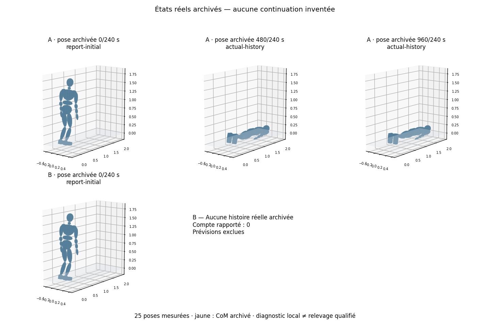

# Coordination : dernière paire close, prévisions refusées

**Décision : fermer cette famille et ne pas exécuter la continuation complète.**
La vérification native passe ; A tombe sans acquérir les talons ; les quatre
prévisions de B refusent la cinquième commande avant leur dix-septième sous-pas.
B ne produit aucune histoire réelle. Le prototype est construit et testable,
mais ne démontre ni transfert local ni relevage. Aucun nouveau calcul physique
n’est autorisé par les crédits restants de ces registres clos.

Objectif causal : depuis la même fixture et la même référence, déterminer si
la coordination avec choix prédictif acquiert les talons et stabilise le
recentrage là où la référence seule échoue. Les deux dernières places de la
famille initiale sont A puis B ; elles ne permettent aucune répétition après
ce lot. Un succès local ne qualifie ni la continuation debout ni un relevage.

## Contrat avant lancement

- Nouvelle paire : 16 pas de vérification + 1 920 réels + 76 800 prédictifs,
  soit **78 736 pas maximum**. Toutes les copies sont comptées.
- Famille : 3 988 pas antérieurement réservés + cette paire = **82 724/300 000** ;
  quatre emplacements d’histoire consommés au maximum, chacun borné à 4 s.
- Temps : **7 100 s** natifs, enveloppe supervisée démarrage/arrêt compris
  **7 137 s**. La borne familiale conservatrice reste sous 7 200 s.
- Préparation réservée : **28 489/144 000 s**, inspections **9 173/20 000**.
- Modèle, anatomie, masses, friction, collisions, gains, caps et seuils locaux
  conservés. Récupération désactivée par défaut. Aucun appui artificiel du bassin.
- Référence géométrique documentée jusqu’à 8 s, mais aucune continuation réelle
  au-delà de 4 s autorisée dans ce lot. La fixture ne suit pas un impact simulé.

Le [contrat figé](evidence/coordination-local-pair-2026-10-13/launch-contract.json),
l’[audit cumulatif](evidence/coordination-local-pair-2026-10-13/cumulative-budget-audit.md)
et le [préflight de continuation](evidence/coordination-local-pair-2026-10-13/continuation-preflight.md)
précisent les consommations, limites et critères de décision.

## TODO et preuves

- [x] Revue cumulative des quatre anciens registres, sans réouverture.
- [x] Critères physiques inchangés et continuation géométrique archivée relue.
- [x] Registre strict de la dernière paire et comptage incomplet explicite.
- [x] Supervision avec arrêt de groupe, signaux et limite murale externe.
- [x] Worker dédié reconstruit, tests purs et contrôles de production terminés.
- [x] Neuf prérequis appuyés par les preuves actuelles ; manifeste et binaire gelés.
- [x] Gel publié et SHA distant vérifié, puis unique lancement du registre distinct.
- [x] Registre clos ; décision causale A/B, premier refus et consommations archivés.
- [x] Mesures et vidéo issues exclusivement des états enregistrés.
- [ ] Rapport Library, validation et dernier push vérifié.

Les modifications de ce jalon portent sur l’admission, la mémoire comparée,
le comptage durable et l’arrêt des processus. Elles ne changent pas les actions
physiques. Le gel `65925ef032197639f6ebd6c8e897084a5735cacf` a été publié et
vérifié sur le distant avant l’unique lancement du 13 octobre à 11:10:50 UTC.
Le registre est `closed-native-failure` depuis 11:11:02 UTC. Aucun worker ne reste actif.

Préflight statique réussi sans worker. Manifeste `2fbcb3db0cd1bccf14082e772b1efba63e567fe7fce35ed8cccbbbf2ac2cdde9`.
Binaire dédié `c1c8a12825428758643a7f6e2fafb0a2710f7dca787c1daee07c27ec59849e9c`.
Les 14 tests Rust purs, le contrôle de production, la compilation release sans lancement,
89 tests de registre, 43 du lanceur, 47 du superviseur réutilisé, sept du builder
et six essais OS inertes passent. La suite globale Rust/TypeScript n’est pas relancée.

## Résultats et portée causale

| Opération | Sous-pas natifs exécutés | Résultat |
| --- | ---: | --- |
| Vérification copie/exécution A et B | 16 | Parité complète des états exposés et mémoires testées |
| A, référence commune seule | 960, soit 4 s | Aucun talon porteur, aucun intervalle stable ; chute |
| B, quatre prévisions figées | 64, soit 4 × 16 | Refus du solveur au tick 4, avant le sous-pas 17 |
| B, réalisation | 0 selon reçu et journaux indépendants | Aucune proposition admissible |

A termine avec le bassin à **0,1333 m** et le torse à **0,1020 m** du sol.
Ses 960 diagnostics restent négatifs. Les critères locaux et l’intégrité du
modèle restent inchangés ; l’échec de A est physique, pas un succès articulaire
assimilé à un relevage.

Les quatre facteurs 0, 0,5, 1 et 1,5 échouent au même stade de faisabilité
initiale des tâches dures. Après 512 cycles, la violation maximale de la borne
supérieure de l’axe 36 (`leftAnkle.x`, vitesse en rad/s) vaut respectivement **0,14751 ; 0,18736 ; 0,19783 ;
0,19810**, pour une tolérance fixée à **1e−8**. Ce sont les valeurs du solveur,
pas des déplacements de pied ni des couples mesurés. Le diagnostic brut indique
« infaisable ou non convergé dans le budget fixé ». L’audit arithmétique
postérieur tranche pour ces problèmes enregistrés : **les contraintes sont
effectivement incompatibles**. Deux vérifications indépendantes, utilisant
des fractions exactes des nombres f64 archivés, établissent huit contradictions
(quatre facteurs, deux pieds). La marge de contradiction est de **0,04387 à
0,06393 m/s**, après combinaison des lignes matérielles et des bornes, pour
une allowance de tolérance au plus **1,51e−8 m/s**. Aucun solveur, monde, FK
ou sous-pas supplémentaire n’est nécessaire à ce certificat. Davantage
d’itérations ne rendrait pas ces problèmes admissibles.

Le drapeau agrégé `integrity_ok=false` ferme l’admission dès ce refus logiciel.
Il ne prouve ni une casse anatomique native, ni l’impossibilité physique des
appuis. Le champ agrégé `diagnostic_present=false` accompagne le même refus :
les seize échantillons de chacune des quatre copies existent bien. À l’inverse,
`support_feasible=true` dans A ne signifie pas que son diagnostic local passe. Les quatre prévisions n’atteignent que 66,67 ms sur les deux secondes
requises. La parité vérifiée sur un préfixe court n’établit donc pas la
faisabilité du contrôleur au tick suivant. La comparaison A/B n’obtient aucune
réalisation de B et ne mesure pas un bénéfice causal de sa correction.

## Mesures, vidéo et archives

- [Vidéo A, durée exacte de quatre secondes](evidence/coordination-local-pair-2026-10-13/rendered/A-actual-history.mp4).
- [Mesures A, tous les sous-pas réels](evidence/coordination-local-pair-2026-10-13/rendered/A-measurements.csv).
- [Reçu du rendu et politique d’échantillonnage](evidence/coordination-local-pair-2026-10-13/rendered/render-receipt.json).
- [Index des archives compressées sans perte](evidence/coordination-local-pair-2026-10-13/archive-index.json).
- [Résultat du lanceur](evidence/coordination-local-pair-2026-10-13/native-run/run-result.json) et [registre clos](evidence/coordination-local-pair-2026-10-13/budget/ledger.json).

La vidéo maintient les poses enregistrées sur leurs intervalles temporels,
sans interpolation ni prolongation de la pose finale. Le CSV conserve chaque
ligne mesurée ; les poses issues seulement du rapport ont leurs mesures
absentes laissées vides. B ne possède aucune vidéo d’histoire réelle. Le rendu
n’exécute aucune simulation, FK ou requête de collision. Les neuf sources
volumineuses sont conservées et compressées en seize fragments vérifiés par
hash après décompression ; leur restitution concatène les fragments dans
l’ordre, sans séparateur.

## Comptabilité conservée

Ce lot réserve **3 856 pas**, dont **1 040 exécutés** selon les journaux durables
et les reçus indépendants : 16 + 960 + 64 + 0. Chaque intégration journalisée a
une admission et une terminaison. Le registre parent conserve volontairement
`actualNativeStepsExact=false` et **[1 040, 2 000]** : la réservation B de 960
est restée non rapportée lorsque le premier échec de prévision l’a clos. La
réconciliation postérieure ne réécrit pas cette pièce ni ne rembourse de pas.

La fenêtre de première réservation à clôture vaut **12,321321 s**. Elle ne
mesure pas exactement tout le démarrage et l’arrêt ; la borne murale familiale
conservatrice et la supervision restent conformes au plafond de deux heures.

La famille cumule **7 844 pas réservés sur 300 000**, et ses quatre emplacements
d’histoire sont débités. Les anciens registres clos et les trois anciens
binaires ont les mêmes empreintes. Les 347 entrées du manifeste sont également
inchangées après calcul. Les sous-pas historiquement inconnus gardent leur
statut ; les 1 040 de ce lot ne doivent pas être présentés comme un total exact
pour toute la famille.

## Décision sur l’histoire complète

La continuation géométrique jusqu’à huit secondes a été examinée avant le
calcul ; elle ne constitue pas une exécution dynamique. Aucun état réel de B
stabilisé ne rejoint cette continuation. **Ne pas lancer l’histoire complète** :
le motif d’arrêt « prévisions inutilisables » est atteint. Les quatre places
initiales sont consommées ; ni nouvelle variante, ni répétition, ni changement
de cap/friction/anatomie n’est ajouté.

Le prochain travail utile est l’audit hors physique de **l’origine de cette
incompatibilité** : unités, assemblage, ancres matérielles, compensation de
la racine libre, bornes de vitesse et validité de la linéarisation instantanée.
L’existence d’une solution à ces quatre problèmes précis est désormais
tranchée négativement ; il reste à expliquer quel choix de formulation les
rend contradictoires et quelle correction reste fidèle au contrat physique.
Ce résultat ne justifie ni davantage d’itérations ni un relâchement des seuils.
Toute nouvelle expérience physique nécessite un protocole et un budget
distincts approuvés par le propriétaire via le parent.

La fixture `landed-crouch-left` est une pose native stockée, peu accroupie, avec
vitesses initiales nulles ; ce lot ne crée pas d’impact ni de phase de settle.
Le relevage ≤25 s après impact, la seconde stable réelle, le passage final au
contrôleur normal et la qualification des 24 poses/cycles/impacts restent
non démontrés. Récupération et pas correctifs restent désactivés par défaut.

## Revues indépendantes après exécution

- [Certificat causal des contraintes incompatibles](evidence/coordination-local-pair-2026-10-13/postrun-causal-review.md).
- [Audit physique, moteurs et parité](evidence/coordination-local-pair-2026-10-13/postrun-physical-audit.md).
- [Réconciliation des budgets sans réécriture](evidence/coordination-local-pair-2026-10-13/postrun-budget-audit.md).
- [Décision sur la continuation complète](evidence/coordination-local-pair-2026-10-13/postrun-continuation-decision.md).
- [Validation indépendante des fichiers livrables](evidence/coordination-local-pair-2026-10-13/postrun-artifact-validation.json).
