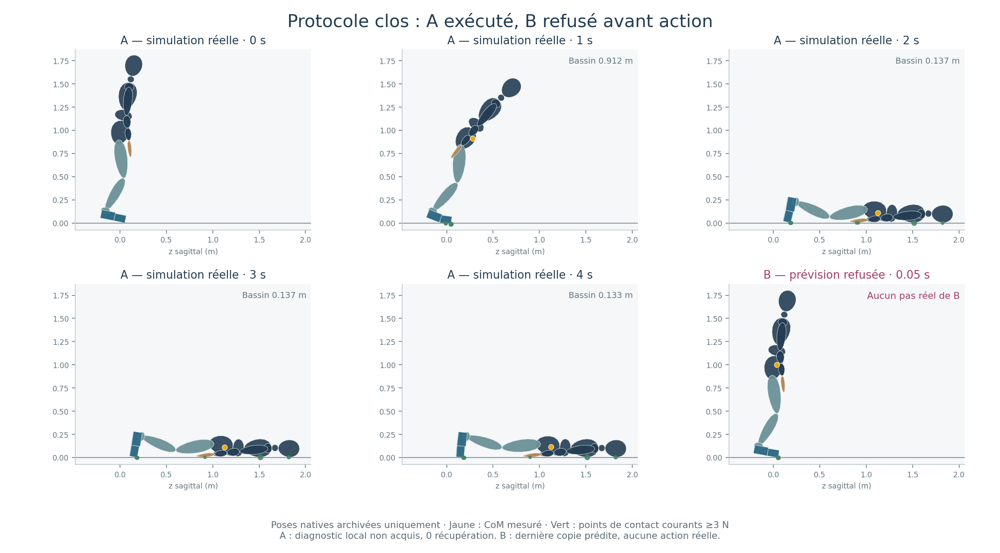

# Coordination : prototype implémenté, essai clos sur un refus numérique

Mise à jour après clôture : [correction numérique testée des quatre refus](coordination-numeric-correction-2026-10-12.md), sans nouveau sous-pas physique. Les résultats physiques ci-dessous restent ceux du lot initial.

Le prototype commun est construit et testé. **Il ne démontre pas l'acquisition
des talons ni un relevage.** La parité native fonctionne ; l'histoire témoin A
échoue physiquement au diagnostic local ; les quatre prévisions coordonnées B
s'arrêtent au premier solveur d'appui, avant toute correction réelle.
Le protocole est clos sans variante supplémentaire ni renouvellement.

L’entrée est la fixture native `landed-crouch-left`, avec les poses et vitesses
stockées (vitesses initiales nulles), sans settle caché. Ce lot ne simule pas
un nouvel impact et ne représente pas à lui seul les 24 cas de qualification.

[Vidéo de A, quatre secondes réelles archivées](evidence/coordination-prototype-2026-10-12/continuation-A-actual-history.mp4).

## Résultats exécutés

| Opération | Sous-pas exécutés | Résultat |
|---|---:|---|
| Parité A et B : copie/réalisation | 16 | États, contacts et moteurs identiques sur les quatre pas de chaque paire |
| A, référence commune seule | 960 (4 s) | Intégrité conservée, aucun diagnostic local réussi |
| B, quatre prévisions figées | 48 (4 × 12) | Refus avant la treizième intégration, lors de la première acquisition des avant-pieds |
| B, réalisation | 0 | Aucune proposition admissible, donc aucune correction appliquée |
| B répété et B à 60° | 0 | Conditions d'admission non atteintes |

Dans les 960 états de A, la charge arrière mesurée de chaque talon reste nulle,
la persistance talon reste nulle et aucun intervalle stable n'est acquis.
Le CoM final est à **0,116 m** du sol ; des segments hors pieds portent.
Le maximum de la somme des caps installés est **760 Nm**, dans le contrat
existant. Le suivi de référence seul ne maintient donc pas ce transfert.
Voir [diagnostic A](evidence/coordination-prototype-2026-10-12/native-run/A-diagnostic-analysis.json)
et [résultat A](evidence/coordination-prototype-2026-10-12/native-run/001-A.json).

Pour B, le facteur 0 franchit la résolution f64, puis le vérificateur refuse les
vitesses réellement représentables dans les commandes f32. Les facteurs 0,5,
1 et 1,5 atteignent la limite de 512 itérations externes du solveur. Ces refus
surviennent avant l'installation de la commande coordonnée. Ils ne prouvent
ni une violation physique d'anatomie, ni l'infaisabilité des appuis : ils montrent
que cette implémentation numérique ne produit pas la commande certifiée requise.
Le message global `integrity_ok=false` agrège ce refus d'admission logiciel ;
il ne doit pas être interprété comme une nouvelle casse anatomique observée.

La ligne exacte de contrainte fautive, ses résidus et tous les essais f32 ne
sont pas enregistrés au point du refus. Il serait injustifié d'attribuer déjà
l'échec à une seule cause précise, telle qu'un arrondi ou un mauvais gain.
L'[analyse indépendante](evidence/coordination-prototype-2026-10-12/failure-review.md)
sépare les faits prouvés des hypothèses numériques.

## Ce qui a changé

Le propriétaire expérimental, explicitement associé à chaque `Simulation`,
coordonne les 46 références articulaires à 60 Hz. Il observe le CoM, les
vitesses, les contacts actuels et les points matériels acquis ; sa racine
flottante reste observée et non actionnée. Le solveur impose des contraintes
d'appui et des bornes communes, compile q/dq, puis utilise l'installateur
`ForceBased` et l'allocation existants. Les copies reproduisent ce même chemin
avec leur mémoire, leurs horloges et leurs ancres propres.

La revue a corrigé une incohérence du plan : une identification valable 24 pas
ne peut être supposée valable 480 pas, ni réidentifiée récursivement sans
modifier le coût. Ce prototype reconstruit donc les tâches géométriques à
60 Hz et compare quatre facteurs globaux figés par prévision native, au plus
à 10 Hz. L'infrastructure d'identification courte reste séparée et testée.
Aucune force idéale de solveur n'est présentée comme un couple effectivement
livré par `ForceBased`.

Le registre durable réserve les sous-pas avant exécution, vérifie les
empreintes, le processus et son unique thread, conserve les consommations
partielles, impose l'accusé de réception après chaque prévision et ferme
l'admission au premier refus. Aucun ancien registre clos n'a été rouvert.
Le code est isolé des commandes de production par les configurations
expérimentales ; récupération et pas correctifs restent désactivés par défaut.

## Continuation entière et décision

La référence complète contient six clés sur huit secondes : entrée native,
abaissement des talons, recentrage, maintien local, extension et une seconde
terminale constante. Ses 1 921 états passent l'inspection géométrique native
à 0° et 60°, avec moins de 0,4 micromètre de dérive des points retenus dans
cette construction. Les racines de ces inspections sont des résultats de FK,
jamais des commandes de bassin. Les rendus géométriques sont explicitement
étiquetés et ne prouvent aucune charge ou stabilité dynamique.

**Décision : ne pas lancer cette histoire complète.** A tombe ; B ne franchit
pas son admission numérique et aucun état réel stabilisé ne rejoint la
continuation. Les huit secondes n'ont pas été exécutées. Le relevage avant
25 secondes après impact, la seconde de stabilité réelle, le handoff et les
24 poses/cycles/impacts restent non qualifiés.

Le prochain prérequis est un diagnostic numérique complet du problème refusé,
puis une production certifiée de commandes f32 admissibles, vérifiée hors
physique sur des cas figés. Ce constat n'autorise aucun nouveau calcul physique,
réglage de couple, modification de friction ou ajout anatomique. Toute nouvelle
expérience doit avoir son protocole et son budget approuvés séparément.

## Budget, tests et reproductibilité

- Préparation ouverte à 20:14 UTC ; clôture de préparation à 20:52:31 UTC.
  Débit conservateur : 7 789 secondes actives (2 h 09 min 49 s), dont une réserve
  non remboursée ; plafond approuvé 40 h. Inspections réservées : 6 923 / 20 000 ;
  5 768 inspections géométriques explicitement réalisées et archivées.
- Physique ouverte à 20:53:12,695 UTC et fermée à 20:53:20,626 UTC : **7,93 s**
  jusqu'à la clôture, sous le plafond de deux heures.
- **1 024 sous-pas réalisés connus ; 3 856 réservés sur 300 000**. La réservation
  de B reste débitée même si sa réalisation compte zéro. Aucun crédit inutilisé
  ne permet de relancer ce protocole clos.
- **40 tests Rust ciblés + 78 tests du registre + 25 tests du lanceur passent**.
  `cargo check --lib --locked` du chemin de production et compilation optimisée
  du worker réussissent. Les avertissements de compilation sont archivés.
- La suite globale Rust/TypeScript n'a pas été relancée ni déclarée corrigée ;
  ses échecs historiques restent distincts de ces contrôles.

Le [résultat du protocole](evidence/coordination-prototype-2026-10-12/native-run/run-result.json),
le [registre](evidence/coordination-prototype-2026-10-12/budget/ledger.json),
le [manifeste figé](evidence/coordination-prototype-2026-10-12/frozen-manifest.json)
et l'[audit budgétaire](evidence/coordination-prototype-2026-10-12/budget-final-review.md)
constituent les reçus d'exécution. Les grandes traces sont compressées sans
perte, avec vérification du SHA-256 après décompression ; les originaux restent
présents dans l'environnement.

Le code figé a été publié et vérifié à
[`b6e711d3dc58909979295df81437e6a5579c41db`](https://github.com/berenif/LaboratoireHumain/commit/b6e711d3dc58909979295df81437e6a5579c41db),
après le jalon de revue
[`90a9c30c9499cb022163882603fa4b832430cd4c`](https://github.com/berenif/LaboratoireHumain/commit/90a9c30c9499cb022163882603fa4b832430cd4c).
La branche est `investigate/physical-support` ; main reste au SHA
`c597959f46f37715035349c8cd0a699b6822111a`, sans merge ni force-push.

La comparaison source SLOW est conservée dans le
[plan corrigé](coordination-prototype-2026-10-12.md#comparaison-slow) : son retour
global appris ne se réduit pas à sa trajectoire. Ses poids à 21 axes ne sont
pas directement qualifiés pour nos 46 coordonnées et notre actionnement.
Aucun logiciel tiers, entraînement ou service externe n'a été exécuté.
