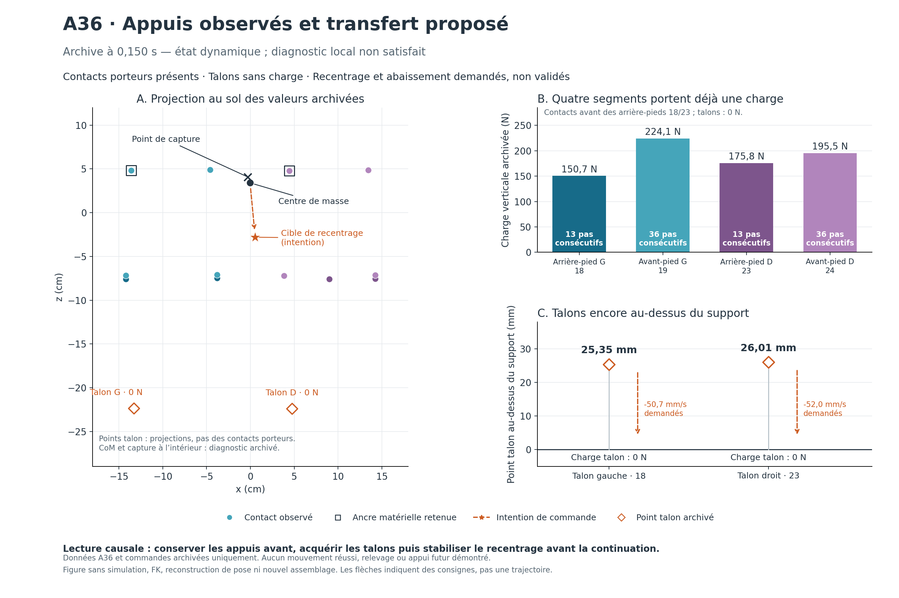

# Candidat A36 figé et vérifiable — 15 octobre 2026

Le transfert talons/recentrage, son raccord vers debout et leur admission native
sont implémentés. Le pilote dédié est compilé en release ; le superviseur et le
manifeste sont figés et vérifiés. **Aucun nouveau mouvement physique n'a été
calculé.** L'acquisition des talons et le relevage restent à démontrer.

La reprise après interruption a conservé le travail, les preuves et les
compteurs. Une sauvegarde préalable de 1 068 012 octets porte le SHA-256
`9e6888b3177aa8601ef82cee8df733bd2f9484f43eb9d8fb68e00093b9ecace8`.
L'[audit de reprise](evidence/coordination-transfer-resume-2026-10-15/integrity-audit.md)
vérifie 14 fichiers protégés : cinq registres clos, quatre anciens binaires et
cinq manifests. Il contrôle aussi 1 183 entrées historiques, dont 1 157 versions
de sources Rust dans leurs commits. La notification de déconnexion à 09:42 UTC
n'a pas interrompu les commandes : l'accès et la compilation étaient confirmés
à 09:43 UTC. Aucun processus physique n'a été relancé.

## Décisions et corrections

Le [candidat](coordination-transfer-candidate-2026-10-13.md) utilise A36, un état
réellement intégré mais dynamique et peu fléchi. Il conserve les avant-pieds,
demande l'abaissement des deux talons et le recentrage, puis construit son
raccord depuis les dernières q/dq installées lorsque le diagnostic local est
effectivement acquis. Les 46 commandes passent par l'installateur `ForceBased`
existant. Ni les ancres de contact, ni les charges, ni le succès original ne
sont fabriqués à partir des intentions.

La continuation est finie et contrôlée jusqu'au relais natif ordinaire. Une
prévision refusée arrête le protocole. Le reçu complet permet de terminer la
seconde de stabilité par fenêtres de 24 pas, sans relancer artificiellement
une prévision de moins de 120 pas. Le checkpoint extérieur final doit être
identique à celui prévu avant de déclarer l'histoire achevée.

La [contre-revue](evidence/coordination-transfer-resume-2026-10-15/review.md)
a fait compléter les mémoires privées de pas et de chute, ancres, swing,
temporisations, références CoM, modèle, profil, handles et filtres. Les
projections exhaustives empêchent d'oublier silencieusement un nouveau champ
des structures concernées. Les identités gardent les octets exacts dans un
format à longueurs explicites ; aucun hash ne remplace la comparaison native.
Les interactions actives hors de ce protocole statique sont refusées.

Le superviseur débite durablement les deux réserves avant le lancement, les
lie au PID avant l'envoi et conserve une borne d'incertitude si un appel est
interrompu. Une opération unique, un claim exclusif et les échéances communes
interdisent répétition et renouvellement. Le worker reste vivant jusqu'à EOF
pour permettre l'audit final du processus.

La comparaison avec SLOW reste celle de la
[revue d'architecture](coordination-architecture-review-2026-10-12.md) : une
trajectoire a été adaptée, pas le retour global appris à 21 axes. Le port direct
de cet acteur vers 46 coordonnées et un autre actionnement n'est pas validé.
Un réentraînement natif demanderait une définition et une validation distinctes
des observations, actions, contacts et récompenses. Cette préparation n'exécute
aucun logiciel tiers, entraînement ou service externe ; elle rend testable une
alternative commune avec prévisions natives bornées.

## Preuves disponibles

| Vérification | Résultat et portée |
| --- | --- |
| Pilote Rust | 7 tests purs PASS, aucun monde ou pas natif |
| Parité et mémoires privées Rust | 13 PASS : 10 de projection/admission, 2 de pas, 1 de mouvement ; 7 sont des régressions relancées après modification de leur projection |
| Superviseur Python | 45 PASS : 42 purs et 3 avec processus Python inertes ; aucun binaire physique exécuté |
| Compilation | Production `cargo check --lib --locked` et cible release dédiée `--no-run` PASS |
| Manifeste réel | 345 fichiers et 14 preuves historiques PASS ; aucun accord, claim ou processus natif créé |
| Assemblage A36 historique | Une seule inspection le 13 octobre : quatre commandes f32, erreur QP nulle ; aucun nouvel assemblage le 15 octobre |

Les anciens tests de politique, raccord, adaptateur et reçus restent conservés
dans les [preuves du candidat](evidence/coordination-transfer-candidate-2026-10-13/).
Ils ne sont pas présentés comme une suite globale réexécutée. Les échecs
historiques Rust/TypeScript ne sont pas déclarés résolus. Les journaux bruts
conservent aussi les échecs préparatoires et les avertissements ; leurs octets
ne sont pas nettoyés pour satisfaire une règle d'espacement Git.



Les talons restent à 25,35 et 26,01 mm au-dessus du support, avec 0 N. La figure
sépare observations, ancres retenues et consignes. Son
[script et reçu](evidence/coordination-transfer-resume-2026-10-15/visual/render-receipt.json)
n'utilisent ni simulation, ni FK, ni reconstruction de pose. Le résidu matériel
heuristique de 0,03229946 m/s est conservé ; il ne mesure pas un glissement réel.

## Artefacts figés et commande sûre

- [Manifeste](evidence/coordination-transfer-native-proposal-2026-10-13/manifest.json),
  SHA-256 `4f3708fd50cd4dabf473b7a6bff528ee11ad798cf25dfbeaf0f6141c156818f7`.
- Binaire dédié `coordination_transfer_worker-8daed3b7e6b04b70`,
  SHA-256 `63e0e035d38d02f762c69b9dacb65d61e179c72ced50f5facd0bc29c64b9e8b5`,
  4 664 920 octets, compilé sans exécution. Il reste un artefact local de build.
- [Reçu de gel](evidence/coordination-transfer-native-proposal-2026-10-13/freeze-receipt.json)
  et [inspection réelle](evidence/coordination-transfer-resume-2026-10-15/frozen-manifest-inspection.json).
- [Autorisation modèle](evidence/coordination-transfer-native-proposal-2026-10-13/authorization-template.json)
  explicitement `approved=false`, sans date ni preuve d'accord.

Cette commande a été vérifiée et ne lance aucun worker :

```sh
python3 docs/evidence/coordination-transfer-native-proposal-2026-10-13/run_transfer.py \
  --manifest /workspace/LaboratoireHumain/docs/evidence/coordination-transfer-native-proposal-2026-10-13/manifest.json
```

Elle retourne `static-preflight-passed`, `authorizationVerified=false` et
`nativeSteps=0`. Le manifeste utilise les chemins de cet environnement et lie
le binaire exact. Une reconstruction ou un déplacement nécessite un nouveau
gel explicite ; aucune autorisation éventuelle ne s'y transpose automatiquement.

## Décision physique restante et budget

La préparation globale reste ouverte : **57 289/144 000 s engagées**, dont la
fenêtre non remboursable du 15 octobre 09:27:54–12:27:54 UTC. Il reste 86 711 s
non engagées. Ces engagements ne prétendent pas mesurer autant de travail
exécuté. Les fenêtres précédentes sont expirées et conservées ; l'interruption
n'a ajouté aucun calcul ni supprimé aucune consommation.

La préparation du candidat a utilisé **un assemblage archivé, zéro FK, zéro
monde et zéro sous-pas natif** ; cette reprise a ajouté zéro assemblage. Les
quatre emplacements de l'ancienne famille physique restent clos.

Le [protocole distinct prêt à décider](evidence/coordination-transfer-native-proposal-2026-10-13/future-native-protocol.md)
propose **une seule histoire**, **131 096 sous-pas natifs tous usages** et
**7 200 s murales** : 52 pas techniques, jusqu'à 6 244 pas réels préfixe inclus,
et 260 prévisions de 480 pas au maximum. La durée réelle maximale conservatrice
est 26,017 s, distincte des anciennes histoires de quatre secondes : succès
original avant 25 s, puis une seconde réelle supplémentaire et fin du tick.
L'accord nouveau doit couvrir explicitement cette continuation complète.

Avant cette autorisation distincte du parent, aucun calcul physique n'est
permis. Après autorisation, la parité neuve et la première prévision peuvent
refuser immédiatement le candidat ; ce refus ferme le protocole. Aucun succès
local ne vaut relevage. A36 provient d'une scène analytique et non d'un impact
qualifié ; même une continuation réussie laisserait à faire le relevage depuis
impact et la qualification des 24 poses/cycles/impacts. La récupération reste
désactivée. Le coût mémoire et temporel des identités longues reste à mesurer
dans cette même enveloppe, sans prolongation automatique.

La publication Library reste bloquée par l'accès officiel précédemment en
échec, sans contournement ni nouvel ID/version revendiqué. Les fichiers Git et
leurs empreintes constituent les livrables transmissibles au parent.
