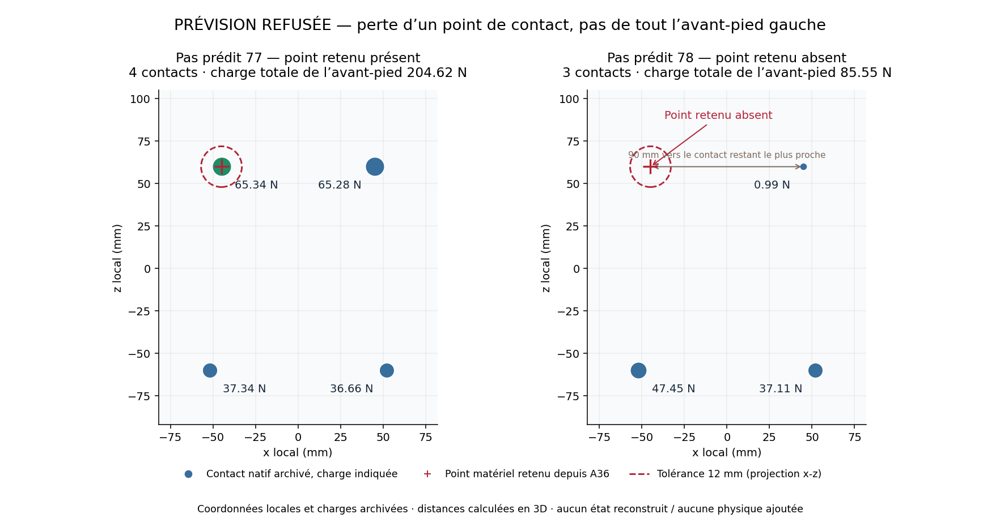

# Transfert A36 : prévision refusée, essai clos — 15 octobre 2026

**Le prototype est implémenté et l'essai unique a été exécuté. La parité native
passe, mais la première prévision refuse la perte d'un point d'appui retenu.
Aucun transfert réel après A36, acquisition des talons ou relevage n'est
démontré.** Le protocole est fermé sans relance ni modification du candidat.

Ce résultat succède au [gel du candidat](coordination-transfer-freeze-2026-10-15.md)
et à la [réconciliation du budget](coordination-transfer-budget-decision-2026-10-15.md).
L'autorisation explicite du parent a permis un nouveau gel à **7 100 secondes**,
une seule histoire et **131 096 sous-pas tous usages**, dans le reliquat global.
Elle n'a rouvert aucune famille historique. Le commit de lancement vérifié était
`c30986ac5584f11a4532a98c1cb5b8ecca2c24a7`.

## Ce qui a été construit et vérifié

Le [candidat documenté](coordination-transfer-candidate-2026-10-13.md) conserve
le solveur commun de tâches à 60 Hz et l'actionnement `ForceBased` existant,
avec 46 références articulaires et leurs vitesses cohérentes. Il observe les
contacts matériels chargés à 240 Hz, retient les avant-pieds, demande les
talons et le recentrage, puis prévoit un raccord fini depuis les dernières
commandes installées vers le contrôleur debout original. Les prévisions
natives bornées doivent admettre chaque fenêtre réelle avant son exécution.

La revue a notamment imposé une identité complète des mémoires privées, une
comparaison copie/réel, un reçu terminal compatible avec la seconde de stabilité
et une comptabilité durable avant chaque lancement. Le raccord complet existe
dans le code ; cet essai ne l'a pas atteint. La référence SLOW extraite ne
constitue toujours pas un port du retour d'état appris à 21 axes vers les
46 coordonnées de ce corps. Aucun logiciel tiers, entraînement ou service
externe n'a été exécuté dans cette préparation.

Les **49 tests du superviseur** passent : 46 tests purs et trois processus
Python inertes. Ils vérifient notamment les nouvelles échéances, sans lancer
le binaire physique. Les tests Rust ciblés et la compilation release antérieurs
sont décrits dans le rapport de gel ; la suite globale Rust/TypeScript n'a pas
été réexécutée et ses échecs historiques ne sont pas déclarés corrigés.

Le changement entre les deux gels concerne la supervision temporelle, pas
le binaire physique. L'audit après essai vérifie encore les **345 fichiers de
l'ancien manifeste, les 358 du nouveau et les 14 pièces historiques protégées**.
Les masses, la friction, les collisions, l'anatomie, les plafonds de couple et
les critères de succès restent ceux du contrat. La récupération publique reste
désactivée. Aucun bassin assisté, reset de sauvetage, verrouillage ou seuil
relâché n'a été ajouté.

## Exécution et frontière du résultat

La supervision du processus unique 5506 commence le **15 octobre 2026 à
14:21:07,491954 UTC**.
Le registre est fermé à 14:21:17,868896 UTC, après **10,376937300003192 secondes**
monotones. Le résultat est `closed-refused` ; le processus est terminé et le
claim exclusif conservé. Le code de sortie 1 correspond à ce refus contrôlé.

| Calcul réellement effectué | Sous-pas natifs |
| --- | ---: |
| Préfixe technique jusqu'à A36 | 36 |
| Deux comparaisons copie/réel de quatre pas par branche | 16 |
| Préfixe de l'histoire principale jusqu'à A36 | 36 |
| Première prévision, 480 pas demandés | 42 |
| **Total exact, réconcilié avec les admissions natives** | **130** |

Les deux comparaisons techniques sont exactement égales à l'entrée, sur les
quatre états intégrés, au checkpoint final et dans le périmètre du candidat.
Cette preuve courte n'établit pas une fidélité de prévision sur deux secondes.

La première prévision part de l'horloge 36 et atteint 78, soit **0,175 seconde
prédite après A36**. L'observation 78 est refusée avant la commande suivante.
Aucun horizon complet n'est admis : **l'histoire principale n'exécute aucun
pas de transfert après son préfixe A36**. Les contreparties techniques restent
distinctes de cette histoire. La trace native contient 130 états après
intégration et un endpoint répété ; celui-ci n'est pas un sous-pas supplémentaire.

## Cause observée du refus

Le point matériel retenu de l'avant-pied gauche, **segment 19, patch 0**, sort
de la liste des contacts chargés à 78. Il portait 65,341455 N à 77. Le contact
restant le plus proche est à **90,000026 mm**, au-delà de la tolérance fixe
de correspondance de 12 mm. Les dérives tangentielles gauche/droite sont
**0,186918 / 0,202653 mm**, sous la limite de 10 mm : ce second motif du message
générique n'est donc pas celui qui a échoué.

L'avant-pied gauche porte encore **85,552933 N** à 78 par trois autres contacts.
Les archives ne permettent pas de départager déchargement de ce point,
changement de sélection du manifold ou autre filtrage par l'observateur.
Elles ne prouvent pas la perte d'appui de tout le pied. La
[contre-revue causale](evidence/coordination-transfer-native-7100-2026-10-15/native-run-once/forecast-refusal-review.md)
conserve les observations, calculs et limites de cette interprétation.

Les régions talonnières ciblées restent à **0 N** sur les 42 pas prédits ; leurs
points cibles finissent à **20,945 / 21,435 mm** du support. Le CoM reste dans
le support, mais la capture en sort dès l'observation 45. À 78, la vitesse CoM
en Z vaut +0,106784 m/s alors que la dernière demande cinématique était environ
−0,149923 m/s. Cet écart confirme qu'une intention de tâche n'est pas une
garantie de mouvement sous `ForceBased`.

Les horloges sont distinguées : poses et vitesses du snapshot à 78, dernière
décision validée à 77, cache de contacts du snapshot à 76. Le diagnostic utilise
les contacts natifs à 78. Le champ générique `integrity_ok=false` vient ici du
refus du protocole ; il ne démontre ni corruption d'archive ni divergence de
parité. Les compteurs, empreintes et comparaisons techniques passent.

## Budgets fermés et preuves conservées

Le débit de cette autorisation reste **131 096 pas**, dont **130 966 non exécutés
et non remboursés**. Avec les 7 844 historiques, le cumul débité vaut
**138 940 / 300 000**. Le solde arithmétique de 161 060 n'autorise aucune
nouvelle histoire. Le temps documenté cumulé est 32,328294294 secondes ; avec
la provision historique de 74 secondes, le rapprochement prudent vaut
106,328294294 secondes. Ni l'arrêt anticipé ni ce solde ne renouvellent
l'autorisation.

La préparation est engagée à **68 089 / 144 000 secondes**. La dernière fenêtre
finie va de 14:12:53 à 17:12:53 UTC ; ce débit conservateur ne prétend pas
mesurer autant de travail exécuté. Les registres et fenêtres antérieurs sont
conservés. Les revues, compressions et rendus après arrêt ajoutent **zéro
sous-pas natif, zéro FK et zéro inspection de nouveau monde**.

Les fichiers bruts locaux sont conservés. Le résultat natif de 135 076 766 octets
et la trace de 17 505 466 octets sont publiés sous forme gzip sans perte, avec
vérification des empreintes après décompression. L'
[index d'archives](evidence/coordination-transfer-native-7100-2026-10-15/archive-index.json)
donne tailles, empreintes brutes et compressées. Les journaux indépendants
d'admission et les six événements du registre chaînés par empreinte sont joints.

| Pièce | Référence |
| --- | --- |
| Autorisation et protocole figés | [Protocole](evidence/coordination-transfer-native-7100-2026-10-15/protocol.md), [provenance parent](evidence/coordination-transfer-native-7100-2026-10-15/parent-authorization-provenance.json) |
| Résultat et registre clos | [Résultat](evidence/coordination-transfer-native-7100-2026-10-15/native-run-once/run-result.json), [registre](evidence/coordination-transfer-native-7100-2026-10-15/native-run-once/physical-ledger.json) |
| Contrôle indépendant | [Audit après essai](evidence/coordination-transfer-native-7100-2026-10-15/postrun-budget-audit.md) |
| Mesures réelles | [CSV](evidence/coordination-transfer-native-7100-2026-10-15/rendered/actual-measurements.csv), branches techniques et principales identifiées |
| Vidéo réelle principale | [Préfixe seul](evidence/coordination-transfer-native-7100-2026-10-15/rendered/main-history.mp4), 0,145833 s entre les états archivés 1 et 36 |
| Captures | [A36 réel](evidence/coordination-transfer-native-7100-2026-10-15/rendered/actual-entry-a36.png), [endpoint de prévision](evidence/coordination-transfer-native-7100-2026-10-15/rendered/prediction-endpoint.png) |
| Reproductibilité des médias | [Reçu des rendus](evidence/coordination-transfer-native-7100-2026-10-15/rendered/render-receipt.json), [reçu du diagnostic de contact](evidence/coordination-transfer-native-7100-2026-10-15/rendered/contact-point-loss-receipt.json) |

La vidéo tient les poses stockées sur leurs intervalles natifs, sans interpolation
ni prolongation après l'endpoint. Elle n'illustre pas un transfert réussi.
Les images de prévision sont explicitement étiquetées et exclues du CSV réel.

Identités du gel exécuté :

- Binaire inchangé : `63e0e035d38d02f762c69b9dacb65d61e179c72ced50f5facd0bc29c64b9e8b5`.
- Manifeste : `80b41aaf7d2f2aa72e91891f97e7ea40d6cf6f3e8538f3f62d0afcba352342b9`.
- Autorisation : `217b8d849369ad084cf7da22c94c820b9472c6d97b6b0e96cd12b674517fd203`.
- Résultat natif brut : `7da774742c4ef54420efbbbb4991de4afbe640a203463ebe6841e507e00bb19e`.

## Décision

Le candidat figé est **inadmissible sous son obligation de maintien du point
matériel**. Le diagnostic attendu est disponible et l'arrêt prévu est appliqué.
Aucune correction de seuil ou de physique, variante ou répétition n'a suivi.
Une éventuelle proposition suivante devrait distinguer identité d'un point
chargé, maintien physique du support et capacité du contrôleur à freiner le CoM,
puis justifier un parcours complet sous une nouvelle décision explicite.

Ce résultat ne prouve ni impossibilité anatomique ni nécessité générale
d'appuis mains/genoux. A36 est un état intégré, dynamique et peu fléchi, issu
d'une scène analytique ; la transition impact → A36 n'est pas qualifiée.
Le relevage avant 25 secondes après impact, sa seconde réelle de stabilité
et les 24 poses/cycles/impacts restent à démontrer. La récupération demeure
désactivée.

La publication Library reste bloquée par l'accès officiel précédemment en
échec, sans contournement ni nouvel ID/version revendiqué. Les fichiers du
dépôt, leurs empreintes et les médias constituent les livrables transmissibles
au parent.
