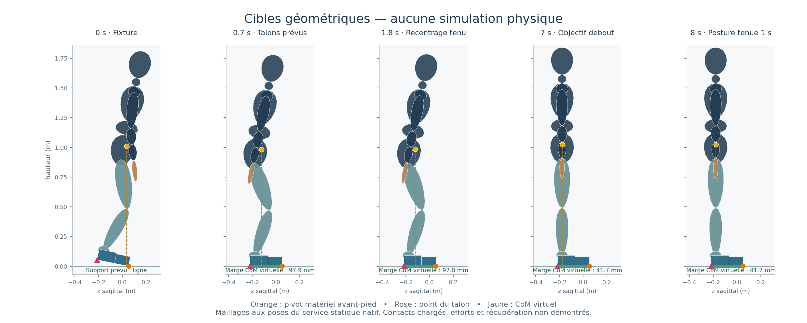

# Nouvelle continuation géométrique à six clés

**Une nouvelle référence numérique de huit secondes est construite depuis
`landed-crouch-left`.** Elle conserve les mêmes points matériels des avant-pieds
pendant l'abaissement des talons, recentre puis étend les jambes, et termine par
une seconde de posture constante. Les 1 921 états de sa grille passent le
compilateur et le service géométrique natifs **à 0° et à 60°**. C'est une
préparation géométrique, pas une récupération ni une preuve de charge. Aucun
script de cette livraison n'intègre un monde physique.

[Animation géométrique, 8,1 s](continuation-geometric-route.mp4) — 81 poses
archivées, rendu sagittal uniquement ; aucune nouvelle FK, requête native ou
intégration. [Reçu du rendu](continuation-render-receipt.json).

## Entrées et conventions

Les trois textes obligatoires ont été lus :
[synthèse](../../coordination-architecture-review-2026-10-12.md),
[audit source](../coordination-architecture-2026-10-12/getup-audit.md),
[contre-revue](../coordination-architecture-2026-10-12/counterreview.md).
Le modèle canonique, la fixture exacte, le profil v24 et le contrat sont présents.
Leurs empreintes figurent dans [le reçu initial](continuation-seed.json).
Aucun ancien programme rejeté n'est réutilisé. Le répertoire historique local
`evidence/` est absent ; ses reçus légers versionnés restent disponibles.

Le profil documentaire est celui de `recovery_contract::pinned_profile()` : v24
emploie le gain de vitesse CoM 4 et active récupération/pas correctifs. Le défaut
v25 emploie 5 et les désactive. Aucun profil ni défaut n'est modifié ici.

La fixture nommée « landed-crouch-left » est une pose initiale peu fléchie : bassin
à 0,976323655 m, root pitch 0,20 rad, hanches 0,34, genoux 0,66 et chevilles
0,32 rad. Toutes ses vitesses stockées sont nulles. `whole_history.rs` passe ces
25 poses directement à `Simulation::build` puis prend l'instantané initial :
aucun settle physique caché n'est exécuté. Son CoM géométrique est à 1,010284789 m,
cohérent avec ces poses, et non près du sol comme l'entrée source SLOW. La FK f64
reconstruit les positions à `4.44e-16 m` près.

Les coordonnées sont celles de `measurement::coordinates`, avec repères
articulaires natifs et quaternion relatif normalisé
`[tan(qx/2),tan(qy/2),tan(qz/2),1]`, pas des angles Euler. La racine n'est jamais
une coordonnée moteur.

## Famille nouvelle et points matériels

Le [programme commun](continuation-candidate-program.json) comporte six clés :

| Temps | Cible | Hanche / genou / cheville x, bilatéral |
|---|---|---|
| 0 s | Fixture native | 0,34 / 0,66 / 0,32 |
| 0,70 s | Pieds horizontaux, talons proches du sol | 0,54 / 0,66 / 0,32 |
| 1,25 s | Recentrage terminé | 0,52 / 0,62 / 0,30 |
| 1,80 s | Même cible après 0,55 s | 0,52 / 0,62 / 0,30 |
| 7 s | Objectif articulaire debout | 0 / 0 / 0 |
| 8 s | Même cible après une seconde | 0 / 0 / 0 |

Les bras rejoignent leur repos natif pendant le premier intervalle. Le programme
contient toutes les coordonnées et vitesses, avec root et axes absents à zéro.
Cette famille sagittale limite volontairement la recherche de référence ; elle
ne réduit pas les 46 axes disponibles au solveur commun. Les tangentes des clés
sont nulles. La vitesse maximale de cible est 0,428572 rad/s et le delta maximal
entre commandes vaut 0,001785636 rad.

Les pivots sont les sommets **8** des deux avant-pieds, identifiés par leurs
triangles/barycentres. Leurs positions mondiales initiales sont conservées.
Ce sont des **ancres géométriques de surface**, pas des contacts natifs chargés.
Les talons utilisent ensuite le sommet **0** de chaque hindfoot, de coordonnée
locale z ≈ −0,075 m. À partir de 0,70 s, les quatre corps de semelle conservent
leur orientation mondiale. Aucun changement d'ancre ne masque un glissement.
Les annotations ne créent aucune force ni contrainte de contact.

La racine de chaque inspection est résolue depuis cette conservation matérielle.
Elle n'apparaît pas dans le programme moteur. Le chemin conserve d'abord le pitch
root à 0,20 rad, puis le ramène à zéro pendant l'extension. Le root debout résolu
est `p≈[0,0.991000000,-0.178502421]`, différent du root canonique archivé : c'est
un résultat de FK, jamais une consigne de bassin à installer.

Une proposition `hanche=.42, genou=.66, cheville=.24` a été écartée : elle plaçait
le CoM 2,75 mm derrière l'extrémité arrière de la semelle. Les six clés du tableau
sont les seules qui définissent le programme livré. Aucun réglage physique n'a
été effectué.

## Grille entière à 0° et 60°

Les [1 921 inspections FK](continuation-route-frames.jsonl) couvrent chaque
sous-pas de 0 à 1 920. Le service `serve_trajectory_geometry`, appelé avec le
**programme compilé natif** et `programSubstep`, inspecte ensuite la même grille
f32, avec seuils et exclusions inchangés. À 60°, les racines archivées sont
simplement tournées avant chaque requête ; les coordonnées moteur restent
identiques.

| Mesure | 0° | 60° |
|---|---:|---:|
| Refus géométriques natifs | 0 / 1 921 | 0 / 1 921 |
| Hauteur minimale native des maillages | 0,999659 mm | 0,999674 mm |
| Dérive maximale des points de pivot | 0,382419 µm | 0,343296 µm |
| Dérive maximale des talons retenus après 0,70 s | 0,372997 µm | 0,336634 µm |
| Intégrations physiques | 0 | 0 |

Les [reçus à 0°](continuation-native-audit.json) et
[à 60°](continuation-native-audit-60deg.json) figent le SHA du programme, du
binaire et des traces compressées. Le même programme porte l'empreinte
`f14de3871ef9aba18083b36d10eeb56c8587c66a73b1ab2ec54e01830e06e59d`.

La marge CoM dans l'enveloppe **virtuelle** des pieds vaut au moins 41,731 mm après
0,70 s, et les talons sont à environ 1 mm du sol. Ces calculs utilisent des
sommets de semelle coplanaires, pas des charges résolues. Au départ, l'appui
prévu est presque une ligne et le CoM est environ 14,63 mm derrière elle :
l'acquisition n'a pas de certificat d'équilibre statique continu. La vitesse
maximale du CoM de la référence est environ 0,3435 m/s ; ce n'est pas une vitesse
physique mesurée. Charges, réactions, friction utilisable, efforts articulaires,
capture et moment pendant le pivot restent à évaluer dans le chemin natif
ultérieurement admis. Une référence géométrique ne certifie pas qu'un moteur
reproduira la racine inspectée, ni que les talons seront porteurs à 0,70 s.

## Interfaces et vérification pure

[`continuation.rs`](../../../rust/crates/sim/src/recovery/planner/continuation.rs)
extrait la fixture par la convention native et compile toute la continuation.
Il exige acquisition et début du maintien local **avant** 2 s, au moins 132 pas
de maintien local avec frontières distinctes, puis une continuation et 240 pas
de posture finale dans les 6 000 pas. Le rapprochement des coordonnées initiales
source et natives autorise explicitement `1e-6 rad` d'arrondi ; les seuils
anatomiques, vitesse et slew restent inchangés. Cette comparaison ne vérifie pas
à elle seule le raccord de la première commande exécutée : le runtime doit
partir de sa commande native précédente et dériver son q/dq cohérent, sans aucune
écriture de pose corporelle. Le type produit reste `CommandPreparation`, sans
permission physique ni attribution de récupération.

Le choix de calendrier inclut debout **et** la seconde supplémentaire dans les
25 s. Le terminal historique reste distinct : settle 0,30 s, handoff, `Ordinary`,
observation stable et compteur original. Les tests Rust sont purement numériques ;
l'un compile le programme concret avec la fixture native. Leur résultat final
est conservé par le contrôle principal, sans intégration cachée.

[`continuation-tasks.json`](continuation-tasks.json) extrait des archives 481
lignes à 60 Hz : CoM cible, vitesse centrale dérivée, orientations des pieds et
root pour objectif de posture, points matériels et phase prévue. Il fournit
aussi segments, triangles, barycentres, points locaux et ancres mondiales.
Il ne contient aucune action root. Ses grandeurs mondiales se tournent avec le
heading ; ses modes prévus ne remplacent pas les modes observés. L'export
compte **zéro nouvelle FK**.

## Registres et portée

Les deux inspections initiales ont été réservées localement avant calcul et
importées comme consommation initiale du registre global, sans token global
rétroactif fictif. La suite utilise le token
`d9649c8e-c891-4b5c-8045-8171437911ac`, vérifié avant chaque inspection et lié au
[journal local](continuation-geometry-ledger.json). Elle compte **1 924 FK**
(3 explorations et 1 921 états), **3 842 inspections natives**, soit **5 766**
inspections nouvelles ; total avec les deux premières : **5 768**. Le plafond
réservé de la suite est 6 921. Les réservations globales ne sont pas remboursées ;
les anciens budgets restent clos. Aucun autre calcul FK n'est prévu ici.

Le reçu initial `continuation-seed.json` garde le verdict incomplet exact lors
de sa création ; il ne décrit pas la nouvelle route. Les preuves actuelles sont
le programme, les reçus de route/natifs, les tâches et leurs empreintes. La
décision d'ouverture physique relève du gate principal après tous ses prérequis.
Aucun succès de récupération n'est revendiqué ici.
