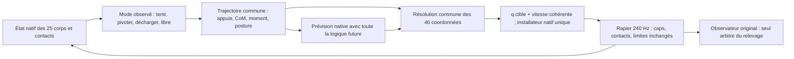

# LaboratoireHumain — rapport complet du prototype de coordination

12 octobre 2026. Résultat : refus numérique documenté, aucun relevage qualifié.

État livré : `3fe8396c5250f7a9bb5d0bd773043ff0e10059fe`, branche `investigate/physical-support`. Code expérimental figé : `b6e711d3dc58909979295df81437e6a5579c41db`.

Ce document réunit le résultat actuel puis ses revues et annexes. Les textes de préparation conservent leur chronologie ; le résultat actuel prévaut sur leurs tâches alors ouvertes.


---

Source versionnée : [docs/coordination-prototype-result-2026-10-12.md](https://github.com/berenif/LaboratoireHumain/blob/3fe8396c5250f7a9bb5d0bd773043ff0e10059fe/docs/coordination-prototype-result-2026-10-12.md).

# Coordination : prototype implémenté, essai clos sur un refus numérique

Le prototype commun est construit et testé. **Il ne démontre pas l'acquisition
des talons ni un relevage.** La parité native fonctionne ; l'histoire témoin A
échoue physiquement au diagnostic local ; les quatre prévisions coordonnées B
s'arrêtent au premier solveur d'appui, avant toute correction réelle.
Le protocole est clos sans variante supplémentaire ni renouvellement.

L’entrée est la fixture native `landed-crouch-left`, avec les poses et vitesses
stockées (vitesses initiales nulles), sans settle caché. Ce lot ne simule pas
un nouvel impact et ne représente pas à lui seul les 24 cas de qualification.


[Vidéo de A, quatre secondes réelles archivées](https://github.com/berenif/LaboratoireHumain/blob/3fe8396c5250f7a9bb5d0bd773043ff0e10059fe/docs/evidence/coordination-prototype-2026-10-12/continuation-A-actual-history.mp4).

## Résultats exécutés

| Opération | Sous-pas exécutés | Résultat |
|---|---:|---|
| Parité A et B : copie/réalisation | 16 | États, contacts et moteurs identiques sur les quatre pas de chaque paire |
| A, référence commune seule | 960 (4 s) | Intégrité conservée, aucun diagnostic local réussi |
| B, quatre prévisions figées | 48 (4 × 12) | Refus avant la treizième intégration, lors de la première acquisition des avant-pieds |
| B, réalisation | 0 | Aucune proposition admissible, donc aucune correction appliquée |
| B répété et B à 60° | 0 | Conditions d'admission non atteintes |

Dans les 960 états de A, la charge arrière mesurée de chaque talon reste nulle,
la persistance talon reste nulle et aucun intervalle stable n'est acquis.
Le CoM final est à **0,116 m** du sol ; des segments hors pieds portent.
Le maximum de la somme des caps installés est **760 Nm**, dans le contrat
existant. Le suivi de référence seul ne maintient donc pas ce transfert.
Voir [diagnostic A](https://github.com/berenif/LaboratoireHumain/blob/3fe8396c5250f7a9bb5d0bd773043ff0e10059fe/docs/evidence/coordination-prototype-2026-10-12/native-run/A-diagnostic-analysis.json)
et [résultat A](https://github.com/berenif/LaboratoireHumain/blob/3fe8396c5250f7a9bb5d0bd773043ff0e10059fe/docs/evidence/coordination-prototype-2026-10-12/native-run/001-A.json).

Pour B, le facteur 0 franchit la résolution f64, puis le vérificateur refuse les
vitesses réellement représentables dans les commandes f32. Les facteurs 0,5,
1 et 1,5 atteignent la limite de 512 itérations externes du solveur. Ces refus
surviennent avant l'installation de la commande coordonnée. Ils ne prouvent
ni une violation physique d'anatomie, ni l'infaisabilité des appuis : ils montrent
que cette implémentation numérique ne produit pas la commande certifiée requise.
Le message global `integrity_ok=false` agrège ce refus d'admission logiciel ;
il ne doit pas être interprété comme une nouvelle casse anatomique observée.

La ligne exacte de contrainte fautive, ses résidus et tous les essais f32 ne
sont pas enregistrés au point du refus. Il serait injustifié d'attribuer déjà
l'échec à une seule cause précise, telle qu'un arrondi ou un mauvais gain.
L'[analyse indépendante](https://github.com/berenif/LaboratoireHumain/blob/3fe8396c5250f7a9bb5d0bd773043ff0e10059fe/docs/evidence/coordination-prototype-2026-10-12/failure-review.md)
sépare les faits prouvés des hypothèses numériques.

## Ce qui a changé

Le propriétaire expérimental, explicitement associé à chaque `Simulation`,
coordonne les 46 références articulaires à 60 Hz. Il observe le CoM, les
vitesses, les contacts actuels et les points matériels acquis ; sa racine
flottante reste observée et non actionnée. Le solveur impose des contraintes
d'appui et des bornes communes, compile q/dq, puis utilise l'installateur
`ForceBased` et l'allocation existants. Les copies reproduisent ce même chemin
avec leur mémoire, leurs horloges et leurs ancres propres.

La revue a corrigé une incohérence du plan : une identification valable 24 pas
ne peut être supposée valable 480 pas, ni réidentifiée récursivement sans
modifier le coût. Ce prototype reconstruit donc les tâches géométriques à
60 Hz et compare quatre facteurs globaux figés par prévision native, au plus
à 10 Hz. L'infrastructure d'identification courte reste séparée et testée.
Aucune force idéale de solveur n'est présentée comme un couple effectivement
livré par `ForceBased`.

Le registre durable réserve les sous-pas avant exécution, vérifie les
empreintes, le processus et son unique thread, conserve les consommations
partielles, impose l'accusé de réception après chaque prévision et ferme
l'admission au premier refus. Aucun ancien registre clos n'a été rouvert.
Le code est isolé des commandes de production par les configurations
expérimentales ; récupération et pas correctifs restent désactivés par défaut.

## Continuation entière et décision

La référence complète contient six clés sur huit secondes : entrée native,
abaissement des talons, recentrage, maintien local, extension et une seconde
terminale constante. Ses 1 921 états passent l'inspection géométrique native
à 0° et 60°, avec moins de 0,4 micromètre de dérive des points retenus dans
cette construction. Les racines de ces inspections sont des résultats de FK,
jamais des commandes de bassin. Les rendus géométriques sont explicitement
étiquetés et ne prouvent aucune charge ou stabilité dynamique.

**Décision : ne pas lancer cette histoire complète.** A tombe ; B ne franchit
pas son admission numérique et aucun état réel stabilisé ne rejoint la
continuation. Les huit secondes n'ont pas été exécutées. Le relevage avant
25 secondes après impact, la seconde de stabilité réelle, le handoff et les
24 poses/cycles/impacts restent non qualifiés.

Le prochain prérequis est un diagnostic numérique complet du problème refusé,
puis une production certifiée de commandes f32 admissibles, vérifiée hors
physique sur des cas figés. Ce constat n'autorise aucun nouveau calcul physique,
réglage de couple, modification de friction ou ajout anatomique. Toute nouvelle
expérience doit avoir son protocole et son budget approuvés séparément.

## Budget, tests et reproductibilité

- Préparation ouverte à 20:14 UTC ; clôture de préparation à 20:52:31 UTC.
  Débit conservateur : 7 789 secondes actives (2 h 09 min 49 s), dont une réserve
  non remboursée ; plafond approuvé 40 h. Inspections réservées : 6 923 / 20 000 ;
  5 768 inspections géométriques explicitement réalisées et archivées.
- Physique ouverte à 20:53:12,695 UTC et fermée à 20:53:20,626 UTC : **7,93 s**
  jusqu'à la clôture, sous le plafond de deux heures.
- **1 024 sous-pas réalisés connus ; 3 856 réservés sur 300 000**. La réservation
  de B reste débitée même si sa réalisation compte zéro. Aucun crédit inutilisé
  ne permet de relancer ce protocole clos.
- **40 tests Rust ciblés + 78 tests du registre + 25 tests du lanceur passent**.
  `cargo check --lib --locked` du chemin de production et compilation optimisée
  du worker réussissent. Les avertissements de compilation sont archivés.
- La suite globale Rust/TypeScript n'a pas été relancée ni déclarée corrigée ;
  ses échecs historiques restent distincts de ces contrôles.

Le [résultat du protocole](https://github.com/berenif/LaboratoireHumain/blob/3fe8396c5250f7a9bb5d0bd773043ff0e10059fe/docs/evidence/coordination-prototype-2026-10-12/native-run/run-result.json),
le [registre](https://github.com/berenif/LaboratoireHumain/blob/3fe8396c5250f7a9bb5d0bd773043ff0e10059fe/docs/evidence/coordination-prototype-2026-10-12/budget/ledger.json),
le [manifeste figé](https://github.com/berenif/LaboratoireHumain/blob/3fe8396c5250f7a9bb5d0bd773043ff0e10059fe/docs/evidence/coordination-prototype-2026-10-12/frozen-manifest.json)
et l'[audit budgétaire](https://github.com/berenif/LaboratoireHumain/blob/3fe8396c5250f7a9bb5d0bd773043ff0e10059fe/docs/evidence/coordination-prototype-2026-10-12/budget-final-review.md)
constituent les reçus d'exécution. Les grandes traces sont compressées sans
perte, avec vérification du SHA-256 après décompression ; les originaux restent
présents dans l'environnement.

Le code figé a été publié et vérifié à
[`b6e711d3dc58909979295df81437e6a5579c41db`](https://github.com/berenif/LaboratoireHumain/commit/b6e711d3dc58909979295df81437e6a5579c41db),
après le jalon de revue
[`90a9c30c9499cb022163882603fa4b832430cd4c`](https://github.com/berenif/LaboratoireHumain/commit/90a9c30c9499cb022163882603fa4b832430cd4c).
La branche est `investigate/physical-support` ; main reste au SHA
`c597959f46f37715035349c8cd0a699b6822111a`, sans merge ni force-push.

La comparaison source SLOW est conservée dans le
[plan corrigé](https://github.com/berenif/LaboratoireHumain/blob/3fe8396c5250f7a9bb5d0bd773043ff0e10059fe/docs/coordination-prototype-2026-10-12.md#comparaison-slow) : son retour
global appris ne se réduit pas à sa trajectoire. Ses poids à 21 axes ne sont
pas directement qualifiés pour nos 46 coordonnées et notre actionnement.
Aucun logiciel tiers, entraînement ou service externe n'a été exécuté.


---

Source versionnée : [docs/coordination-prototype-2026-10-12.md](https://github.com/berenif/LaboratoireHumain/blob/3fe8396c5250f7a9bb5d0bd773043ff0e10059fe/docs/coordination-prototype-2026-10-12.md).

# Prototype de coordination : préparation et décision

**Protocole clos : prototype implémenté, refus numérique de B.** Voir le [rapport de résultat](https://github.com/berenif/LaboratoireHumain/blob/3fe8396c5250f7a9bb5d0bd773043ff0e10059fe/docs/coordination-prototype-result-2026-10-12.md). Total exécuté : 1 024 sous-pas ; aucune récupération qualifiée.

Base inspectée : `e3b4ed3b2ddaac5450c2846ec12c736a1287082e` sur
`investigate/physical-support`. `main` reste à `c597959`.
Autorisation : « Yes, review, corrige implement dans un contexte neuf ».
Début de préparation : 2026-10-12 20:14 UTC. Les anciens registres restent clos.

## Corrections de la proposition

Le problème comporte déjà une synchronisation articulaire, un installateur
ForceBased et des gardes de transfert. La nouvelle hypothèse concerne la décision
commune de tâches, la conservation des appuis matériels et leur remplacement.
Les caps, gains, masses, friction, collisions et anatomie ne changent pas.

1. **Préparation et admission sont distinctes.** Une référence articulaire valide
   ne prouve ni contact ni soutien. Une continuation chiffrée vers debout, avec
   les patches/pivots, les limites, le retrait d'appuis et le maintien de 1 s, doit
   être admise avant de lancer l'histoire locale. Des inconnues restent des
   refus ; elles ne deviennent pas des cases cochées.
2. **Commandes totales bornées.** Le solveur agit sur 46 vitesses de cibles,
   intégrées en positions. Le budget de vitesse de 1 rad/s porte sur référence
   plus correction, avec bornes anatomiques. Une tâche d'appui contradictoire
   ou un solveur non convergé refuse la commande ; aucune pénalité de posture
   ne peut acheter l'abandon d'un appui.
3. **Sondes correspondant à l'action réelle.** La différence finie doit compiler
   les positions et vitesses cohérentes puis recalculer l'allocation native à
   chaque pas. Modifier seulement `target_vel` à caps fixes mesure une autre
   action. Une sonde à une borne devient unilatérale et conserve son amplitude
   effective dans le reçu.
4. **Prévision complète.** Copier le monde physique seul n'est pas copier le
   contrôleur. Mémoire, horloge, ancres, allocation et observation doivent suivre
   la même fonction de décision future. Les journaux `thread_local` des anciens
   probes doivent être isolés ; leurs copies ne peuvent alimenter l'histoire
   réelle. Une interface de prévision ne vaut pas une parité native vérifiée.
5. **Horizon dérivé.** La stabilité locale exige déjà 132 pas (0,55 s), auxquels
   s'ajoutent acquisition et persistance de charge. Un horizon de 120 pas ne
   peut donc certifier toute la transition. Maximum inchangé : 480 pas. Le
   compilateur de programme complet garde son minimum de 8 s : un horizon court
   doit extraire une fenêtre d'un programme complet, pas relâcher ce contrat.
6. **Mesures distinctes.** Les impulsions CCD du sous-pas servent aux bilans.
   Les contacts persistants présents servent au soutien actuel. L'ancienneté
   de charge d'un segment n'est pas celle de son talon nouvellement posé.
   Une tâche matérielle conserve son point local et son ancre mondiale ; un
   pivot autorise des patches nouveaux observés, jamais une fausse conservation.

## Budget et arrêts

Préparation : au plus 40 h actives sur cinq jours et 20 000 inspections statiques.
Physique : au plus A, B, répétition B et B à 60°, chacun 960 sous-pas (4 s).
Les deux dernières histoires sont conditionnées au diagnostic local de B.
A et B partagent référence et allocation. Aucun réglage entre histoires.

Budget total : `3840 + 3*40*(4*480 + 93*4) + 21120 = 300000` sous-pas.
Les 21 120 pas de vérification ne constituent pas des histoires supplémentaires.
Chaque intégration, y compris copie, préfixe ou test technique, doit être réservée
durablement avant exécution. Un crash ne rembourse rien. Au plus 40 appels
d'identification/prévision par B (<=10 Hz), quatre prévisions longues et 93 sondes
courtes par appel. Décision commune à 60 Hz, Rapier à 240 Hz. Plafond mural 2 h,
un processus mono-thread, aucune compilation simultanée aux calculs physiques.

Arrêt : soutien irréalisable, prédiction inutilisable, intégrité violée, absence
du diagnostic avant son échéance, prérequis absent ou plafond atteint. Les outils
historiques `run-getup-ab.py` et `whole_history` ne sont pas les exécutants de ce
budget : ils conservent leurs anciennes durées. Aucun renouvellement automatique.

## Livrable logiciel visé et TODO

- [x] Lire rapport et deux revues, vérifier branche/base et absence d'instructions locales.
- [x] Ouvrir uniquement la préparation ; zéro intégration physique.
- [x] Implémenter observation des patches, preuve de retrait et diagnostic local.
- [x] Implémenter solveur commun borné, compilation q/dq et refus explicites.
- [x] Implémenter registre durable et tester ses plafonds sans physique.
- [x] Préparer et vérifier la continuation numérique complète.
- [x] Compiler et tester les propriétés pures avant toute admission physique.
- [x] Vérifier la parité native puis clôturer au refus prévu, avec preuves et publication.
- [x] Décider sur la continuation entière sans la lancer hors budget.

Le checkout neuf ne contient pas le répertoire historique non versionné
`evidence/`. Les rapports et les reçus versionnés sont lisibles, mais ne fournissent
pas tous les programmes/états natifs référencés par ces chemins. La préparation
doit rester reproductible avec les fichiers effectivement présents.

## Qualification inchangée

Le diagnostic local n'est pas un relevage. Le terminal original exige debout
avant 25 s après impact, stabilité réelle de 1 s, puis une qualification distincte
des 24 poses/cycles/impacts. Récupération et pas correctifs restent désactivés par
défaut. Une réussite locale n'autorise pas une histoire complète hors budget.
La comparaison SLOW reste une étude de port/réentraînement, sans exécution de
son logiciel ou de sa politique ni ouverture d'un service externe.

## Architecture exécutable corrigée avant le gel

La carte de réponse native proposée expire après 24 sous-pas, alors qu'une
prévision dure jusqu'à 480 sous-pas. La réidentifier récursivement dans chaque
branche rendrait le coût annoncé faux. Le prototype reconstruit donc les tâches
géométriques communes à 60 Hz, avec la vitesse observée de la racine flottante,
et évalue à au plus 10 Hz quatre facteurs de retour globaux figés : 0, 0,5, 1 et
1,5. Il n'emploie aucune sonde courte : les 93 sondes étaient un plafond, pas une
obligation. L'infrastructure d'identification reste testée séparément et ne sert
pas de carte supposée valide pendant deux secondes.

Les 46 références q/dq restent l'unique commande. Le solveur borne l'anatomie,
la vitesse et l'écart à la référence (0,12 rad), puis impose les contraintes des
points matériels observés. La bande de vitesse de tâche de 0,005 m/s est une
contrainte du contrôleur, pas un assouplissement des critères physiques. Les
patches acquis ne changent jamais d'identité ou d'ancre pour masquer un glissement.
A et B partagent exactement les commandes initiales avant acquisition des patches,
le programme, les caps et l'allocation ForceBased existante. Les gardes originales
de stagnation, perte d'appui et handoff mesuré sont conservées.

La prévision copie état physique et mémoire explicite du contrôleur et appelle
le même noyau natif. L'admission physique exige d'abord une comparaison complète
de quatre sous-pas réels et quatre copiés pour A puis B (16 sous-pas réservés).
Ce reçu doit confirmer états, compteurs, cibles et sémantique des moteurs.
Les réservations du registre précèdent toute intégration ; après une prévision,
le worker attend l'accusé du registre avant de reprendre l'histoire réelle.

La nouvelle continuation contient six clés et dure huit secondes. Les 1 921
états à 240 Hz ont été inspectés statiquement dans le modèle natif, à 0° et 60°.
Tous passent les bornes de coordonnées ; la dérive des points retenus reste
inférieure à 0,4 micromètre dans cette construction géométrique. Ceci prouve
une cible cohérente, aucunement la faisabilité des charges, des couples ou du
transfert en dynamique. Les images et la vidéo portent cette distinction.

## Comparaison SLOW

La source épinglée contient une politique résiduelle entraînée utilisant l'état
global et la référence, pas seulement une succession d'angles
([environnement](https://github.com/tianxintao/get_up_control/blob/5ad52fbe1b5b7c56522a1aa10ccf17fb81c0d79e/env.py),
[apprentissage SAC](https://github.com/tianxintao/get_up_control/blob/5ad52fbe1b5b7c56522a1aa10ccf17fb81c0d79e/SAC.py)).
Ses 21 axes, son état d'entrée et son actionnement ne correspondent pas aux 46
coordonnées et moteurs ForceBased de ce dépôt. Réutiliser le principe du retour
global est faisable ; porter directement les poids n'est pas établi. Un
réentraînement demanderait un environnement natif fidèle, le contrat d'action,
une distribution d'impacts et une évaluation distincte. Aucun logiciel tiers,
entraînement ou service externe n'a été exécuté pour cette comparaison.

## Vérifications et frontière des preuves

40 tests Rust ciblés passent (solveur, compilation q/dq, appuis, continuation,
observations natives sans intégration, tâches géométriques, copie de mémoire et
propriétaire). Le chemin de production passe `cargo check --lib --locked`.
La suite globale Rust/TypeScript, avec ses échecs historiques, n'a pas été
relancée ni déclarée réparée. Le binaire autonome est compilé sans exécuter
les tests physiques historiques.

Les journaux CCD sont collectés dans l'exécution réelle, isolés des prévisions.
La parité vérifie néanmoins les contacts, états et moteurs natifs complets.
Un succès local mémorise un intervalle de 132 pas admissible débutant avant 2 s ;
il ne certifie pas que la posture terminale de l'histoire reste stable. Le
raccord physique à la continuation, le handoff et le relevage entier demeurent
des preuves distinctes à produire, jamais déduites du rendu géométrique.


---

Source versionnée : [docs/evidence/coordination-prototype-2026-10-12/failure-review.md](https://github.com/berenif/LaboratoireHumain/blob/3fe8396c5250f7a9bb5d0bd773043ff0e10059fe/docs/evidence/coordination-prototype-2026-10-12/failure-review.md).

# Revue du refus natif — 12 octobre 2026

Le prototype est **arrêté sur un refus numérique de production de commande**, avant toute application du contrôle coordonné dans l'histoire réelle B. Ce résultat ne démontre ni une impossibilité anatomique, ni une impossibilité physique du mouvement. La continuation physique complète de 8 s reste refusée ; le protocole est clos, sans retouche ni relance.

Cette revue lit les preuves déjà produites et le code gelé au commit `b6e711d3dc58909979295df81437e6a5579c41db`. Les sommes SHA-256 des fichiers de solveur, compilateur, propriétaire de commande, tâches géométriques, worker et preview lus concordent avec le [manifeste gelé](https://github.com/berenif/LaboratoireHumain/blob/3fe8396c5250f7a9bb5d0bd773043ff0e10059fe/docs/evidence/coordination-prototype-2026-10-12/frozen-manifest.json). Travail effectué : lecture du code, extraction et comparaison de JSON existants. Aucun solveur, test, FK, inspection géométrique ou sous-pas physique supplémentaire n'a été exécuté. Seule cette note est ajoutée.

## Ce que le lot a effectivement exécuté

| Étape | Intégrations natives | Résultat établi |
|---|---:|---|
| Vérification A/B, copie et réel | 16 | Parité exacte des quatre premiers pas de chaque mode |
| A, référence commune sans correction coordonnée | 960 | 4 s complètes, aucun refus d'intégrité original, diagnostic local jamais satisfait |
| Première planification B, quatre copies | 48 = 4 × 12 | Chaque copie s'arrête à 50 ms, avant la treizième intégration |
| Histoire réelle B | 0 | Aucun candidat sélectionné ; aucune commande B appliquée |
| B répété, B à 60°, continuation de 8 s | 0 | Non exécutés |

Total connu : **1 024 intégrations**, pour **3 856 réservées**, conformément au [résultat du lot](https://github.com/berenif/LaboratoireHumain/blob/3fe8396c5250f7a9bb5d0bd773043ff0e10059fe/docs/evidence/coordination-prototype-2026-10-12/native-run/run-result.json). Les réservations restent consommées. Les 64 réservations locales du premier planning sont cohérentes avec quatre copies ayant chacune réservé quatre ticks : trois ticks intégrés, puis le tick refusé avant son premier sous-pas. Les 1 920 pas du permis de planning et les 960 pas du permis B ne sont pas des pas réellement exécutés.

Le [rapport de vérification](https://github.com/berenif/LaboratoireHumain/blob/3fe8396c5250f7a9bb5d0bd773043ff0e10059fe/docs/evidence/coordination-prototype-2026-10-12/native-run/000-native-verification.json.gz) certifie uniquement les quatre premiers pas. Ceux-ci appartiennent au préfixe commun sans appui matériel acquis par le propriétaire coordonné ; le premier solveur avec contraintes d'appui intervient au pas 12. Cette vérification ne constitue donc pas une observation de parité dans le régime coordonné actif, et ne certifie pas un horizon de 2 s.

## Localisation exacte du refus B

Le [premier planning](https://github.com/berenif/LaboratoireHumain/blob/3fe8396c5250f7a9bb5d0bd773043ff0e10059fe/docs/evidence/coordination-prototype-2026-10-12/native-run/002-B-planning-000.json.gz) possède quatre cas inutilisables, sans échelle sélectionnée. Le [journal B](https://github.com/berenif/LaboratoireHumain/blob/3fe8396c5250f7a9bb5d0bd773043ff0e10059fe/docs/evidence/coordination-prototype-2026-10-12/native-run/002-B.states.jsonl.gz) contient exactement quatre groupes de douze états, tous nommés `preview-0-*`, et aucune ligne d'histoire réelle. Les snapshots physiques et moteurs natifs des quatre groupes sont strictement identiques à chacun de leurs douze pas.

Au dernier pas intégré, les avant-pieds gauche et droit ont chacun douze pas de charge persistante. Au début de la commande suivante, le propriétaire acquiert deux patches `Hold` sur les segments 19 et 24, puis tente sa première résolution contrainte. Toutes les erreurs portent `check: ownership`, `tick: 3`, `substep: 0`. Elles surviennent avant l'appel d'intégration du treizième pas, et avant l'installation de la commande candidate.

| Échelle | Refus archivé | Conclusion prouvée |
|---:|---|---|
| 0 | `Emitted rates violate a hard task or total command bound` | La solution continue f64 est acceptée, puis au moins une des quatre commandes f32 d'essai est refusée par la vérification des contraintes |
| 0,5 | `Common task solve did not converge within fixed iteration budget` | La boucle extérieure de résolution atteint sa limite de 512 itérations sans satisfaire son critère d'arrêt |
| 1 | Même refus | Même portée |
| 1,5 | Même refus | Même portée |

L'échelle 0 **n'est pas le témoin A** : `enabled` reste vrai, les contraintes dures, le solveur et l'objectif de posture restent actifs. Cette échelle annule les poids de correction CoM/orientation. La famille de quatre candidats ne permet pas de substituer silencieusement A à un planning refusé.

## Cause établie et limites de l'explication numérique

Pour l'échelle 0, [`whole_body_controller.rs`](https://github.com/berenif/LaboratoireHumain/blob/3fe8396c5250f7a9bb5d0bd773043ff0e10059fe/rust/crates/sim/src/recovery/planner/whole_body_controller.rs) appelle `problem.solve()`, stocke les taux f64, puis compile et vérifie successivement les quatre commandes futures. Le message observé ne peut provenir que de `problem.verify_rates()`. La résolution f64 avait donc accepté ses contraintes et sa convergence ; `runtime::command()` avait réussi pour la commande examinée, y compris ses contrôles de finitude, d'anatomie et de vitesse totale. Le refus établit une **discordance entre les taux f64 acceptés et les taux effectivement représentés par la commande f32**, sous le même problème de contraintes. Il ne constitue pas un refus anatomique du compilateur.

[`coordinated_runtime.rs`](https://github.com/berenif/LaboratoireHumain/blob/3fe8396c5250f7a9bb5d0bd773043ff0e10059fe/rust/crates/sim/src/recovery/planner/coordinated_runtime.rs) arrondit la position à f32, puis calcule la vitesse depuis la différence entre les positions f32 divisée par le pas natif. Les taux réellement émis peuvent donc différer des taux optimisés. [`whole_body_tasks.rs`](https://github.com/berenif/LaboratoireHumain/blob/3fe8396c5250f7a9bb5d0bd773043ff0e10059fe/rust/crates/sim/src/recovery/planner/whole_body_tasks.rs) réapplique une tolérance numérique de `1e-8` aux contraintes et bornes. Le mécanisme de désaccord de représentation est établi par ce chemin de code ; **la ligne fautive, le dépassement exact et le rang de la commande parmi les quatre ne sont pas archivés**. Il serait injustifié d'affirmer une erreur mesurée de telle amplitude, ou d'attribuer le refus à un talon, une articulation ou une borne précise.

Pour les trois autres échelles, le message terminal provient exclusivement de la sortie de la boucle extérieure après 512 itérations. Les projections internes sont revenues `Ok` ; une erreur de projection dure aurait produit un autre message. Ces cas ne prouvent donc pas l'infaisabilité des contraintes. De plus, les quatre copies ont le même état physique, les mêmes patches et les mêmes bornes dures ; l'échelle modifie leurs objectifs souples. L'acceptation du vecteur f64 de l'échelle 0 constitue ainsi une preuve de faisabilité numérique du système dur commun à la tolérance du solveur. Elle ne prouve pas l'existence d'une commande f32 acceptable sur les quatre pas, ni la faisabilité dynamique de ce mouvement.

Le solveur emploie un gradient projeté, une borne globale de courbure par somme des normes des lignes pondérées, un démarrage à la projection de zéro, et un seuil de résidu `1e-6`. Une progression trop lente liée à cette borne, au conditionnement ou aux contraintes actives est une explication plausible de l'épuisement des itérations. **Aucun résidu final, historique de convergence, nombre de cycles de projection ni valeur de courbure n'est archivé pour ces échecs** : leur rôle exact demeure une hypothèse. La revue ne résout pas de nouveau le problème et ne propose aucun réglage à appliquer au lot clos.

## Attention à la mémoire archivée et aux indicateurs agrégés

Le propriétaire n'est pas perdu lors de l'erreur : `Simulation::configure_motors()` restaure `coordination` après `owner.configure()`, même lorsque celui-ci retourne une erreur. Le rapport conserve donc une mémoire **partiellement mise à jour**, pas seulement l'état de la dernière commande installée.

À l'échelle 0, `terminalOwner.rates` contient le candidat f64 obtenu avant le refus ; son maximum absolu vaut environ `0,970556 rad/s`. En revanche, `last.commandSubstep` vaut toujours 11, `last.solver` est nul et `nextSubstep` reste 12. Aux trois autres échelles, la résolution ayant échoué avant l'affectation, les taux mémoire sont ceux du préfixe précédent. Aucun de ces champs ne permet de présenter le candidat refusé comme une commande appliquée. Le compte rendu de résolution est écrit seulement après la validation des quatre commandes, ce qui explique la perte des détails d'échec.

Les quatre booléens de l'`outcome` du planning sont affectés ensemble depuis `best.is_some()`. Leur valeur fausse signifie ici « aucune prédiction admissible », **pas quatre diagnostics indépendants d'intégrité physique, d'infaisabilité d'appui, de prédiction et d'absence de mesure**. Des diagnostics locaux existent bien pour les 48 pas des copies. Le `integrity_ok:false` final agrège un refus logiciel d'ownership ; il ne doit pas être décrit comme une violation physique mesurée. La même prudence s'applique à `support_feasible:true` du témoin A : ce champ ne certifie pas le transfert recherché.

Les copies déclarent `ccdJournalCollected:false`. Elles archivent contacts courants, charges persistantes et états/moteurs, mais aucune impulsion CCD journalière ; aucune certification du bilan angulaire n'est revendiquée. Leurs charges d'appui ne doivent pas être confondues avec des intégrales d'impulsion CCD.

## Portée du diagnostic local et décision de continuation

Les douze pas B sont beaucoup trop courts pour qualifier un intervalle de 132 pas. À 50 ms, la fraction de poids soutenue par les pieds est environ 0,6554, les charges de talon sont nulles, le CoM et le point de capture sont hors du support mesuré. Ce sont des observations du préfixe ; le délai d'acquisition de 2 s n'est pas arrivé à échéance. **Le refus B n'est donc pas un échec démontré du diagnostic de transfert à son échéance.**

Le [témoin A](https://github.com/berenif/LaboratoireHumain/blob/3fe8396c5250f7a9bb5d0bd773043ff0e10059fe/docs/evidence/coordination-prototype-2026-10-12/native-run/001-A.json), lui, a effectivement parcouru 960 pas : les deux charges de talon sélectionnées par le diagnostic restent nulles sur toutes les lignes ; aucune ligne ne satisfait simultanément les conditions locales et aucun intervalle stable ne commence. Le compteur original de récupération reste nul. Ce constat est valable pour cette référence commune exécutée sans correction ; il ne démontre pas qu'un contrôleur coordonné fonctionnel aurait échoué. L'amplitude de correction de B n'a jamais été comparée physiquement à A après acquisition des appuis.

Le résultat n'autorise **ni la répétition B, ni B à 60°, ni l'histoire physique complète de 8 s**, et encore moins une récupération debout qualifiée en moins de 25 s avec sa stabilité supplémentaire. La route géométrique préparée conserve sa portée cinématique ; elle ne remplace pas une exécution physique réussie. Le verrouillage du lot est approprié malgré le budget natif restant.

Un préalable à un éventuel travail ultérieur distinct serait une instrumentation purement numérique : conserver le problème complet, le vecteur f64 et ses certificats, chaque q/dq f32 essayé, la première ligne ou borne refusée et son résidu ; conserver aussi les derniers résidus/itérés et statistiques de projection en cas de non-convergence. Cela permettrait d'étudier le compilateur et le solveur sans modifier les forces, les limites anatomiques ou les critères de réussite. **Cette note n'effectue ni cette instrumentation, ni un nouveau calcul, ni une réouverture du protocole.**

Les liens des grandes preuves désignent leurs archives gzip sans perte ; les
SHA des originaux et des archives sont dans `native-run/archive-index.json`.
Décompresser rétablit exactement les fichiers cités par les reçus natifs.


---

Source versionnée : [docs/evidence/coordination-prototype-2026-10-12/budget-final-review.md](https://github.com/berenif/LaboratoireHumain/blob/3fe8396c5250f7a9bb5d0bd773043ff0e10059fe/docs/evidence/coordination-prototype-2026-10-12/budget-final-review.md).

# Audit final du budget — 12 octobre 2026

**Le lot est clos, avec 1 024 sous-pas intégrés documentés et 3 856 sous-pas définitivement réservés.** Aucun plafond n’a été atteint. L’arrêt provient du refus des quatre prévisions de B. Cet audit lit seulement les preuves archivées : aucune simulation, FK, inspection de monde ni modification du registre.

| Opération | Réservés | Réalisés inscrits au registre | Réalisés dans les rapports | Statut au registre |
|---|---:|---:|---:|---|
| Vérification A/B, copies et originaux | 16 | 16 | 16 | `completed` |
| Histoire A | 960 | 960 | 960 | `completed` |
| Histoire B réelle | 960 | Non renseigné | 0 | `reserved`, dans un protocole clos |
| Premier appel de planification B | 1 920 | 48 | 4 × 12 = 48 | `failed-reported` |
| **Total** | **3 856** | **1 024 connus** | **1 024** | **`closed-native-failure`** |

Le [rapport B final](https://github.com/berenif/LaboratoireHumain/blob/3fe8396c5250f7a9bb5d0bd773043ff0e10059fe/docs/evidence/coordination-prototype-2026-10-12/native-run/002-B.json), produit après le résultat de planification refusé, indique `actualNativeSteps=0`, `predictionNativeSteps=48`, `workerActualAllOperations=1024` et `workerReservedAllOperations=3856`. Son résultat n’a pas été admis séparément par le parent : le registre conserve donc la réservation B en attente, sans nombre réalisé. **Cet audit rapproche le zéro archivé ; il ne l’inscrit pas rétroactivement au registre.** Le zéro n’ajoute rien au total connu, d’où l’accord numérique des deux sommes malgré cette différence de statut.

Les **2 832 pas réservés mais non intégrés documentés** restent débités : 960 pour B et 1 872 pour ses prévisions. `consumedLocalReservations=64` dans le [rapport de prévision](https://github.com/berenif/LaboratoireHumain/blob/3fe8396c5250f7a9bb5d0bd773043ff0e10059fe/docs/evidence/coordination-prototype-2026-10-12/native-run/002-B-planning-000.json) compte les réservations internes par ticks de quatre pas, y compris les ticks refusés avant intégration. Ce nombre n’est ni 64 intégrations ni un débit supplémentaire aux 1 920 déjà réservés. Chaque branche rapporte exactement 12 intégrations, soit 0,05 s. Aucune sonde courte, aucun second appel B, aucune répétition B ni histoire à 60° n’a été lancée.

La vérification de parité sur 16 pas a été admise avant A. A achève ses 960 pas, soit 4 s, mais son diagnostic local échoue. B reste à son état initial réel : les quatre prévisions sont refusées au tick 3, avant le pas suivant, pour violation d’une contrainte de commande ou non-convergence du solveur dans son nombre d’itérations fixé. Aucun `continue-history` n’apparaît dans le [journal de protocole](https://github.com/berenif/LaboratoireHumain/blob/3fe8396c5250f7a9bb5d0bd773043ff0e10059fe/docs/evidence/coordination-prototype-2026-10-12/native-run/protocol.ndjson). Le [résultat du lanceur](https://github.com/berenif/LaboratoireHumain/blob/3fe8396c5250f7a9bb5d0bd773043ff0e10059fe/docs/evidence/coordination-prototype-2026-10-12/native-run/run-result.json) est `failed-closed` ; stderr confirme l’abandon demandé par le parent. Ce lot n’établit donc pas une comparaison causale A/B complète, un relevage ou une impossibilité anatomique.

La première réservation native date de **20:53:12.695276 UTC** ; l’échéance commune demeure **22:53:12.695276 UTC**. La fermeture est enregistrée à **20:53:20.625705 UTC**, soit **7,930429 s** après activation. Les quatre permis présents dans le protocole partagent cette échéance et le PID 10913. L’admission des preuves natives et le reçu d’échec n’ont renouvelé ni les délais ni les crédits. Le plafond total reste 300 000 sous-pas, dont 21 120 pour les vérifications techniques ; seuls 16 de ces derniers ont été réservés.

La préparation conserve un débit de **7 789 s sur 144 000 s** et de **6 923 inspections sur 20 000**, avec 5 768 inspections déclarées réalisées, antériorité de deux inspections comprise. Son début déclaré est 20:14 UTC le 12 octobre et son échéance calendaire le 17 octobre à 20:14 UTC. Les réservations inutilisées n’ont pas été remboursées.

Vérifications documentaires effectuées : digest interne du registre valide ; trois hashes de reçus inscrits au registre concordants ; manifeste de preuve native valide ; **82 fichiers gelés sur 82 inchangés**. Les traces contiennent 16 lignes de vérification, 960 lignes A et 48 lignes B ; les dernières correspondent aux prévisions, pas à une histoire réelle B de 48 pas.

Empreintes SHA-256 de l’état audité :

- [Registre clos](https://github.com/berenif/LaboratoireHumain/blob/3fe8396c5250f7a9bb5d0bd773043ff0e10059fe/docs/evidence/coordination-prototype-2026-10-12/budget/ledger.json) : `2afa69b3ae9c8ab8343f7dabdf46b955c8ac7b88aa259404958e25d49a72ef07` — identique avant et après cet audit.
- [Rapport B non admis](https://github.com/berenif/LaboratoireHumain/blob/3fe8396c5250f7a9bb5d0bd773043ff0e10059fe/docs/evidence/coordination-prototype-2026-10-12/native-run/002-B.json) : `4312ead48bc75bcc9316e36facf44083afa397efad2c21e5b546d393c3a80108`.
- [Résultat du lanceur](https://github.com/berenif/LaboratoireHumain/blob/3fe8396c5250f7a9bb5d0bd773043ff0e10059fe/docs/evidence/coordination-prototype-2026-10-12/native-run/run-result.json) : `4e1ec85d3359514c180abb029dc21003e1858911ebf7c8d36be4180acf60edcb`.

**Aucune réserve restante n’autorise une reprise : ce protocole est fermé.** Toute histoire complète ou qualification reste hors de ce lot clos.


---

Source versionnée : [docs/evidence/coordination-prototype-2026-10-12/continuation-review.md](https://github.com/berenif/LaboratoireHumain/blob/3fe8396c5250f7a9bb5d0bd773043ff0e10059fe/docs/evidence/coordination-prototype-2026-10-12/continuation-review.md).

# Nouvelle continuation géométrique à six clés

**Une nouvelle référence numérique de huit secondes est construite depuis
`landed-crouch-left`.** Elle conserve les mêmes points matériels des avant-pieds
pendant l'abaissement des talons, recentre puis étend les jambes, et termine par
une seconde de posture constante. Les 1 921 états de sa grille passent le
compilateur et le service géométrique natifs **à 0° et à 60°**. C'est une
préparation géométrique, pas une récupération ni une preuve de charge. Aucun
script de cette livraison n'intègre un monde physique.


[Animation géométrique, 8,1 s](https://github.com/berenif/LaboratoireHumain/blob/3fe8396c5250f7a9bb5d0bd773043ff0e10059fe/docs/evidence/coordination-prototype-2026-10-12/continuation-geometric-route.mp4) — 81 poses
archivées, rendu sagittal uniquement ; aucune nouvelle FK, requête native ou
intégration. [Reçu du rendu](https://github.com/berenif/LaboratoireHumain/blob/3fe8396c5250f7a9bb5d0bd773043ff0e10059fe/docs/evidence/coordination-prototype-2026-10-12/continuation-render-receipt.json).

## Entrées et conventions

Les trois textes obligatoires ont été lus :
[synthèse](https://github.com/berenif/LaboratoireHumain/blob/3fe8396c5250f7a9bb5d0bd773043ff0e10059fe/docs/coordination-architecture-review-2026-10-12.md),
[audit source](https://github.com/berenif/LaboratoireHumain/blob/3fe8396c5250f7a9bb5d0bd773043ff0e10059fe/docs/evidence/coordination-architecture-2026-10-12/getup-audit.md),
[contre-revue](https://github.com/berenif/LaboratoireHumain/blob/3fe8396c5250f7a9bb5d0bd773043ff0e10059fe/docs/evidence/coordination-architecture-2026-10-12/counterreview.md).
Le modèle canonique, la fixture exacte, le profil v24 et le contrat sont présents.
Leurs empreintes figurent dans [le reçu initial](https://github.com/berenif/LaboratoireHumain/blob/3fe8396c5250f7a9bb5d0bd773043ff0e10059fe/docs/evidence/coordination-prototype-2026-10-12/continuation-seed.json).
Aucun ancien programme rejeté n'est réutilisé. Le répertoire historique local
`evidence/` est absent ; ses reçus légers versionnés restent disponibles.

Le profil documentaire est celui de `recovery_contract::pinned_profile()` : v24
emploie le gain de vitesse CoM 4 et active récupération/pas correctifs. Le défaut
v25 emploie 5 et les désactive. Aucun profil ni défaut n'est modifié ici.

La fixture nommée « landed-crouch-left » est une pose initiale peu fléchie : bassin
à 0,976323655 m, root pitch 0,20 rad, hanches 0,34, genoux 0,66 et chevilles
0,32 rad. Toutes ses vitesses stockées sont nulles. `whole_history.rs` passe ces
25 poses directement à `Simulation::build` puis prend l'instantané initial :
aucun settle physique caché n'est exécuté. Son CoM géométrique est à 1,010284789 m,
cohérent avec ces poses, et non près du sol comme l'entrée source SLOW. La FK f64
reconstruit les positions à `4.44e-16 m` près.

Les coordonnées sont celles de `measurement::coordinates`, avec repères
articulaires natifs et quaternion relatif normalisé
`[tan(qx/2),tan(qy/2),tan(qz/2),1]`, pas des angles Euler. La racine n'est jamais
une coordonnée moteur.

## Famille nouvelle et points matériels

Le [programme commun](https://github.com/berenif/LaboratoireHumain/blob/3fe8396c5250f7a9bb5d0bd773043ff0e10059fe/docs/evidence/coordination-prototype-2026-10-12/continuation-candidate-program.json) comporte six clés :

| Temps | Cible | Hanche / genou / cheville x, bilatéral |
|---|---|---|
| 0 s | Fixture native | 0,34 / 0,66 / 0,32 |
| 0,70 s | Pieds horizontaux, talons proches du sol | 0,54 / 0,66 / 0,32 |
| 1,25 s | Recentrage terminé | 0,52 / 0,62 / 0,30 |
| 1,80 s | Même cible après 0,55 s | 0,52 / 0,62 / 0,30 |
| 7 s | Objectif articulaire debout | 0 / 0 / 0 |
| 8 s | Même cible après une seconde | 0 / 0 / 0 |

Les bras rejoignent leur repos natif pendant le premier intervalle. Le programme
contient toutes les coordonnées et vitesses, avec root et axes absents à zéro.
Cette famille sagittale limite volontairement la recherche de référence ; elle
ne réduit pas les 46 axes disponibles au solveur commun. Les tangentes des clés
sont nulles. La vitesse maximale de cible est 0,428572 rad/s et le delta maximal
entre commandes vaut 0,001785636 rad.

Les pivots sont les sommets **8** des deux avant-pieds, identifiés par leurs
triangles/barycentres. Leurs positions mondiales initiales sont conservées.
Ce sont des **ancres géométriques de surface**, pas des contacts natifs chargés.
Les talons utilisent ensuite le sommet **0** de chaque hindfoot, de coordonnée
locale z ≈ −0,075 m. À partir de 0,70 s, les quatre corps de semelle conservent
leur orientation mondiale. Aucun changement d'ancre ne masque un glissement.
Les annotations ne créent aucune force ni contrainte de contact.

La racine de chaque inspection est résolue depuis cette conservation matérielle.
Elle n'apparaît pas dans le programme moteur. Le chemin conserve d'abord le pitch
root à 0,20 rad, puis le ramène à zéro pendant l'extension. Le root debout résolu
est `p≈[0,0.991000000,-0.178502421]`, différent du root canonique archivé : c'est
un résultat de FK, jamais une consigne de bassin à installer.

Une proposition `hanche=.42, genou=.66, cheville=.24` a été écartée : elle plaçait
le CoM 2,75 mm derrière l'extrémité arrière de la semelle. Les six clés du tableau
sont les seules qui définissent le programme livré. Aucun réglage physique n'a
été effectué.

## Grille entière à 0° et 60°

Les [1 921 inspections FK](https://github.com/berenif/LaboratoireHumain/blob/3fe8396c5250f7a9bb5d0bd773043ff0e10059fe/docs/evidence/coordination-prototype-2026-10-12/continuation-route-frames.jsonl) couvrent chaque
sous-pas de 0 à 1 920. Le service `serve_trajectory_geometry`, appelé avec le
**programme compilé natif** et `programSubstep`, inspecte ensuite la même grille
f32, avec seuils et exclusions inchangés. À 60°, les racines archivées sont
simplement tournées avant chaque requête ; les coordonnées moteur restent
identiques.

| Mesure | 0° | 60° |
|---|---:|---:|
| Refus géométriques natifs | 0 / 1 921 | 0 / 1 921 |
| Hauteur minimale native des maillages | 0,999659 mm | 0,999674 mm |
| Dérive maximale des points de pivot | 0,382419 µm | 0,343296 µm |
| Dérive maximale des talons retenus après 0,70 s | 0,372997 µm | 0,336634 µm |
| Intégrations physiques | 0 | 0 |

Les [reçus à 0°](https://github.com/berenif/LaboratoireHumain/blob/3fe8396c5250f7a9bb5d0bd773043ff0e10059fe/docs/evidence/coordination-prototype-2026-10-12/continuation-native-audit.json) et
[à 60°](https://github.com/berenif/LaboratoireHumain/blob/3fe8396c5250f7a9bb5d0bd773043ff0e10059fe/docs/evidence/coordination-prototype-2026-10-12/continuation-native-audit-60deg.json) figent le SHA du programme, du
binaire et des traces compressées. Le même programme porte l'empreinte
`f14de3871ef9aba18083b36d10eeb56c8587c66a73b1ab2ec54e01830e06e59d`.

La marge CoM dans l'enveloppe **virtuelle** des pieds vaut au moins 41,731 mm après
0,70 s, et les talons sont à environ 1 mm du sol. Ces calculs utilisent des
sommets de semelle coplanaires, pas des charges résolues. Au départ, l'appui
prévu est presque une ligne et le CoM est environ 14,63 mm derrière elle :
l'acquisition n'a pas de certificat d'équilibre statique continu. La vitesse
maximale du CoM de la référence est environ 0,3435 m/s ; ce n'est pas une vitesse
physique mesurée. Charges, réactions, friction utilisable, efforts articulaires,
capture et moment pendant le pivot restent à évaluer dans le chemin natif
ultérieurement admis. Une référence géométrique ne certifie pas qu'un moteur
reproduira la racine inspectée, ni que les talons seront porteurs à 0,70 s.

## Interfaces et vérification pure

[`continuation.rs`](https://github.com/berenif/LaboratoireHumain/blob/3fe8396c5250f7a9bb5d0bd773043ff0e10059fe/rust/crates/sim/src/recovery/planner/continuation.rs)
extrait la fixture par la convention native et compile toute la continuation.
Il exige acquisition et début du maintien local **avant** 2 s, au moins 132 pas
de maintien local avec frontières distinctes, puis une continuation et 240 pas
de posture finale dans les 6 000 pas. Le rapprochement des coordonnées initiales
source et natives autorise explicitement `1e-6 rad` d'arrondi ; les seuils
anatomiques, vitesse et slew restent inchangés. Cette comparaison ne vérifie pas
à elle seule le raccord de la première commande exécutée : le runtime doit
partir de sa commande native précédente et dériver son q/dq cohérent, sans aucune
écriture de pose corporelle. Le type produit reste `CommandPreparation`, sans
permission physique ni attribution de récupération.

Le choix de calendrier inclut debout **et** la seconde supplémentaire dans les
25 s. Le terminal historique reste distinct : settle 0,30 s, handoff, `Ordinary`,
observation stable et compteur original. Les tests Rust sont purement numériques ;
l'un compile le programme concret avec la fixture native. Leur résultat final
est conservé par le contrôle principal, sans intégration cachée.

[`continuation-tasks.json`](https://github.com/berenif/LaboratoireHumain/blob/3fe8396c5250f7a9bb5d0bd773043ff0e10059fe/docs/evidence/coordination-prototype-2026-10-12/continuation-tasks.json) extrait des archives 481
lignes à 60 Hz : CoM cible, vitesse centrale dérivée, orientations des pieds et
root pour objectif de posture, points matériels et phase prévue. Il fournit
aussi segments, triangles, barycentres, points locaux et ancres mondiales.
Il ne contient aucune action root. Ses grandeurs mondiales se tournent avec le
heading ; ses modes prévus ne remplacent pas les modes observés. L'export
compte **zéro nouvelle FK**.

## Registres et portée

Les deux inspections initiales ont été réservées localement avant calcul et
importées comme consommation initiale du registre global, sans token global
rétroactif fictif. La suite utilise le token
`d9649c8e-c891-4b5c-8045-8171437911ac`, vérifié avant chaque inspection et lié au
[journal local](https://github.com/berenif/LaboratoireHumain/blob/3fe8396c5250f7a9bb5d0bd773043ff0e10059fe/docs/evidence/coordination-prototype-2026-10-12/continuation-geometry-ledger.json). Elle compte **1 924 FK**
(3 explorations et 1 921 états), **3 842 inspections natives**, soit **5 766**
inspections nouvelles ; total avec les deux premières : **5 768**. Le plafond
réservé de la suite est 6 921. Les réservations globales ne sont pas remboursées ;
les anciens budgets restent clos. Aucun autre calcul FK n'est prévu ici.

Le reçu initial `continuation-seed.json` garde le verdict incomplet exact lors
de sa création ; il ne décrit pas la nouvelle route. Les preuves actuelles sont
le programme, les reçus de route/natifs, les tâches et leurs empreintes. La
décision d'ouverture physique relève du gate principal après tous ses prérequis.
Aucun succès de récupération n'est revendiqué ici.


---

Source versionnée : [docs/evidence/coordination-prototype-2026-10-12/owner-final-review.md](https://github.com/berenif/LaboratoireHumain/blob/3fe8396c5250f7a9bb5d0bd773043ff0e10059fe/docs/evidence/coordination-prototype-2026-10-12/owner-final-review.md).

# Revue finale du propriétaire expérimental — 12 octobre 2026

Relecture contradictoire de `whole_body_controller.rs`, des raccordements dans
`lib.rs` et `recovery.rs`, de l'installateur réutilisé et de l'observateur original.
Aucun code modifié, aucun test, pas physique, FK ou inspection géométrique
exécuté par ce réviseur. Cette note décrit l'arbre de travail avant le gel ; le
gel doit ensuite identifier ses fichiers et son binaire exacts.

**Aucun nouveau défaut bloquant identifié dans ce périmètre après les
corrections. Ce constat logiciel n'est pas une admission physique du transfert
ni une qualification du relevage.** Les restrictions et les vérifications
natives prévues restent nécessaires.

## Corrections vérifiées

- Le préfixe sans patch utilise maintenant la même branche pour A et B : même
  position nominale, vitesse dérivée de la différence effective des positions
  f32 et même mise à jour de mémoire. Les taux calculés dans le bloc de préfixe
  ne sont pas émis tant que les patches sont absents. Le premier solveur commun
  intervient à une frontière de quatre sous-pas, après acquisition observée.
- Les nouvelles ancres sont en mode `Hold`. Cette famille ne prévoit aucun
  remplacement matériel : la disparition de la correspondance provoque un
  refus. Le changement automatique d'ancre qui pouvait masquer un déplacement
  sous l'étiquette pivot a été supprimé de ce propriétaire.
- Les références doivent couvrir la grille complète, avec deux côtés
  déterminés, des quaternions finis/unitaires et les quatre segments matériels
  attendus. La valeur du retour choisi doit appartenir aux quatre propositions
  gelées. Les sommes d'horloge des commandes utilisent des additions vérifiées.

## Propriété des commandes et actionnement

`Simulation::configure_motors` retire temporairement le propriétaire, le fait
configurer les moteurs, le réinsère et retourne immédiatement. Le hook
`offline_trajectory_before_step` constate ensuite la présence de ce propriétaire
et n'installe aucun autre programme. La logique de décision ne lance ni
prévision ni intégration ; la sélection des prévisions reste externe.

Le problème comporte les 46 taux articulaires. Les points retenus produisent
trois contraintes dures par point ; aucune pondération de posture ne peut les
acheter. Le twist mesuré du bassin est une donnée du modèle géométrique, pas
une commande de racine. Les quatre commandes f32 sont vérifiées avec leurs
taux réellement émis avant de les installer. Une correction matérielle
irréalisable retourne un refus ; sa bande ne doit pas être élargie après coup.

A et B utilisent le même installateur existant `OwnedRequests`. La diff de cet
installateur change sa visibilité, pas son calcul. Il conserve le modèle moteur
`ForceBased`, les gains du profil, les plafonds anatomiques et la normalisation
au budget agrégé, avec contrôle de la somme effectivement installée. La formule
de demande ressort/amortisseur ne devient pas une preuve de couple réellement
livré. Aucune modification de masse, friction, collision, segment ou force de
bassin n'apparaît dans les changements lus.

## Observateurs et arrêt

L'intégration continue d'employer `advance_tick_observed` et ses inspections
originales après chaque sous-pas. L'observateur de récupération, le test de
station debout, le settle, le handoff et la seconde de stabilité ne sont pas
remplacés. Le propriétaire met en place ses commandes et son statut de phase,
mais ne modifie ni `settle_substeps`, ni `stable_substeps`, ni le compteur de
récupérations. Un observateur ayant supprimé la récupération ne provoque pas
un redémarrage : la configuration suivante refuse de continuer.

Au handoff observé, le propriétaire est retiré et l'ancien chemin reprend.
Un statut Handoff artificiel sans les données mesurées correspondantes échoue
dans la garde originale. Le relevage automatique et les pas correctifs restent
désactivés par défaut ; le raccordement est limité à la compilation
expérimentale de test.

La garde de perte d'appui conserve sa durée originale. La garde de stagnation
emploie ici la progression articulaire mesurée du nouveau programme, avec un
arrêt au plafond temporel ; elle n'accorde aucune récupération sur ce progrès.
Le diagnostic de talon reste séparé, avec sa persistance propre et les appuis
réellement présents. La persistance du segment permet au contrôleur de retenir
une tâche, mais n'accorde pas rétroactivement douze sous-pas à un talon nouveau.

## Preuves disponibles et limites

Le reçu `whole_body_controller-tests.log`, lu sans relancer les tests, indique
trois tests réussis : moteurs identiques au premier pas de commande A/B sans
intégration, refus d'une référence malformée, et préservation de la garde du
handoff. Cela ne prouve pas l'identité de deux histoires physiques, la capacité
du solveur à satisfaire la première situation chargée, ni l'acquisition d'un
talon. Le test de parité natif réservé et l'histoire bornée sont nécessaires
pour ces questions.

Les constantes `0.005 m/s` de bande de tâche et `0.012 m` de correspondance
matérielle appartiennent à la proposition géométrique gelée. Elles ne remplacent
aucun seuil physique du diagnostic local ou du terminal original. Toutes les
dérives matérielles doivent rester visibles dans les traces, même lorsqu'une
correspondance locale est encore acceptée. Les 46 références bornées ne
garantissent pas que les moteurs suivront ces vitesses.

La construction `scene` installe uniquement la fixture initiale avant toute
intégration. La lecture du chemin ne révèle aucun settling caché ni reset
ultérieur. Cette revue ne couvre pas à elle seule la validité de toute la
continuation géométrique, le registre global, les critères de choix des
prévisions ou leurs reçus de parité : leurs preuves séparées restent à joindre.


---

Source versionnée : [docs/evidence/coordination-prototype-2026-10-12/independent-review.md](https://github.com/berenif/LaboratoireHumain/blob/3fe8396c5250f7a9bb5d0bd773043ff0e10059fe/docs/evidence/coordination-prototype-2026-10-12/independent-review.md).

# Revue indépendante du prototype de coordination — 12 octobre 2026

**Verdict sur le point de départ : préparation possible, lancement physique bloqué tant que les prérequis ci-dessous ne sont pas livrés.** Le budget annoncé est arithmétiquement cohérent. Il ne démontre ni l'existence d'une référence admissible, ni la fidélité d'une prévision longue, ni un coût d'exécution compatible avec deux heures. Un arrêt avant physique est un résultat correct de cette étape.

Lecture du HEAD `e3b4ed3b2ddaac5450c2846ec12c736a1287082e`, branche `investigate/physical-support`, de la [synthèse](https://github.com/berenif/LaboratoireHumain/blob/3fe8396c5250f7a9bb5d0bd773043ff0e10059fe/docs/coordination-architecture-review-2026-10-12.md), de la [contre-revue précédente](https://github.com/berenif/LaboratoireHumain/blob/3fe8396c5250f7a9bb5d0bd773043ff0e10059fe/docs/evidence/coordination-architecture-2026-10-12/counterreview.md) et de l'[audit SLOW](https://github.com/berenif/LaboratoireHumain/blob/3fe8396c5250f7a9bb5d0bd773043ff0e10059fe/docs/evidence/coordination-architecture-2026-10-12/getup-audit.md). Les constats de code ci-dessous décrivent ce HEAD, avant les changements parallèles du prototype. Aucun test, intégration physique, politique tierce, entraînement ou programme scientifique tiers exécuté pour cette revue. Seule cette note est écrite par son auteur. Une seconde lecture indépendante a vérifié l'arithmétique et les anciens lanceurs, également sans exécution.

## 1. Objections qui bloquent une expérience interprétable

| Point | Défaut concret au HEAD inspecté | Condition minimale de levée |
|---|---|---|
| Référence | Le corridor accroupi → talons → recentrage est une intention ; la synthèse demande encore les clés numériques, pivots, tâches et préscreen complet. | Une référence numérique et ses empreintes, inspectée sur toute l'interpolation, avec entrée native et continuation préparée. Un JSON qui déclare seulement la route prête ne constitue pas cette preuve. |
| Prévision | `PreparedNativeStep` copie `PhysicsWorld`, emprunte le filtre, et garde les commandes installées ou réémet une même liste. Il ne copie pas le contrôleur, ses compteurs, les ancres ou les décisions futures. | Même transition de décision/installation/observation et mêmes horloges dans le monde réel et les copies ; plan candidat fixé, sans appel récursif au planificateur. |
| Identification | `MotorTargetDelta` modifie uniquement `target_vel`, en conservant position, gains et cap. La commande proposée modifie vitesse **et position intégrée**, puis le cap dépend de la demande. | Les sondes de quatre sous-pas passent par le même compilateur de commandes et le même installateur/allocation que le candidat. |
| Observation | Le journal CCD et l'installateur de trajectoire ont chacun un `thread_local ACTIVE`. Un processus mono-thread ne sépare pas leurs états entre monde réel et copies. | Contexte explicite ou garde correctement empilée/restaurée ; les copies ne peuvent ni incrémenter la persistance réelle, ni remplir son journal, ni déclencher son handoff. |
| Terminal | L'observateur historique attend un `Controller` en Stand, ses ancres, le handoff puis Ordinary. `full_trajectory` cesse d'installer au handoff. | Adaptateur terminal documenté, propriétaire unique des moteurs, arbitre original conservé. Aucun compteur expérimental de récupération. |
| Registre | Le prédicteur existant possède seulement un compteur local recréable. Les anciens lanceurs n'ont pas les nouveaux plafonds. | Registre global persistant, réservation avant toute intégration, plafond mural unique ; mêmes limites pour réel, sondes, copies, vérifications et préfixes. |

Sources de ces constats : [`native_predictor.rs`](https://github.com/berenif/LaboratoireHumain/blob/3fe8396c5250f7a9bb5d0bd773043ff0e10059fe/rust/crates/sim/src/recovery/native_predictor.rs), [`full_trajectory.rs`](https://github.com/berenif/LaboratoireHumain/blob/3fe8396c5250f7a9bb5d0bd773043ff0e10059fe/rust/crates/sim/src/recovery/support_probe/full_trajectory.rs), [`contact_observation.rs`](https://github.com/berenif/LaboratoireHumain/blob/3fe8396c5250f7a9bb5d0bd773043ff0e10059fe/rust/crates/sim/src/recovery/planner/contact_observation.rs), [`observe_recovery`](https://github.com/berenif/LaboratoireHumain/blob/3fe8396c5250f7a9bb5d0bd773043ff0e10059fe/rust/crates/sim/src/recovery.rs#L1366), [`install_targets`](https://github.com/berenif/LaboratoireHumain/blob/3fe8396c5250f7a9bb5d0bd773043ff0e10059fe/rust/crates/sim/src/recovery/support_probe/offline_trajectory.rs#L329).

Une autre incompatibilité demande un choix explicite : [`Program::compile`](https://github.com/berenif/LaboratoireHumain/blob/3fe8396c5250f7a9bb5d0bd773043ff0e10059fe/rust/crates/sim/src/recovery/trajectory_program.rs#L7) impose une durée de 8 à 25 s et des vitesses nulles aux deux extrémités. Un plan local de 0,5–2 s, ou une référence totale de 4 s, ne peut lui être passé tel quel. Deux solutions conservatrices : extraire un horizon d'une référence complète admissible de durée ≥8 s, ou écrire un type court distinct réutilisant les validations de commandes, sans diminuer le contrat du programme complet. Exécuter seulement quatre secondes d'un programme plus long est possible ; confondre durée du programme et durée d'histoire ne l'est pas.

## 2. Plus petit périmètre correctement implémentable

Une route fixe depuis `landed-crouch-left`, un plan candidat à quatre–six clés communes, un problème de vitesse des **46 coordonnées**, un unique chemin de compilation et d'installation. Les bras et le tronc doivent rester disponibles dans la résolution ; le bassin libre est un état/objectif, jamais une commande. Ni modèle inverse complet, ni apprentissage, ni recherche de topologies ne sont nécessaires pour cette première question locale.

Le contrôleur commun décide tous les quatre sous-pas natifs : 60 Hz. Entre deux décisions, la cible totale suit la vitesse admise à 240 Hz et l'installateur recalcule les commandes/caps selon la même règle dans A, B et les copies. L'identification/planification ne se produit qu'aux indices autorisés, au plus tous les 24 sous-pas : 10 Hz. La mémoire contient l'origine entière de ces horloges, la référence, le résidu, les patches, les persistances, la carte native et son état de validité. Une phase en attente ne remet pas à zéro le temps physique de l'histoire.

**La limite de 1 rad/s concerne la commande totale, pas seulement le résidu.** Si la référence atteint déjà cette limite, une correction de même signe n'a plus de marge. Bornes anatomiques, vitesse totale, déplacement admissible de cible et continuité de `q/dq` doivent être imposés ensemble. `validate_command` valide un échantillon ; la validation complète doit aussi vérifier le slew entre échantillons, l'interpolation réelle en f32, les changements de plan et les raccords de continuation. Des clés valides ne suffisent pas à rendre une interpolation valide.

Un problème de moindres carrés commun ne donne pas, à lui seul, des priorités strictes. Les appuis retenus, les limites et les refus de collision doivent être des contraintes contrôlées, avec résidus explicitement bornés. Les tâches incompatibles produisent un refus. L'arrêt sur nombre maximal d'itérations ne signifie pas convergence ; les résidus primal/optimalité pertinents et le statut doivent être publiés. Un solveur saturé ou de rang insuffisant ne doit pas continuer en supprimant silencieusement une tâche d'appui. Les unités des sorties de carte — m/s, rad/s, N — exigent une normalisation documentée pour interpréter le compromis entre objectifs souples.

La carte locale estimée en quatre sous-pas est une approximation conditionnelle au mode courant. Elle peut être singulière, non lisse ou changer au contact. Une carte expirée doit être invalidée dès qu'un patch/son état de charge change ou que le résidu prédit dépasse la borne annoncée. La cadence maximale de 10 Hz n'autorise pas une identification immédiate supplémentaire : attendre avec une commande déjà admissible, ou refuser. Le repli doit être défini avant expérience ; « conserver la dernière commande » ne prouve pas automatiquement qu'elle reste sûre sous un nouveau mode.

L'horizon de 0,5 s n'est **pas** suffisant pour anticiper une nouvelle acquisition suivie des 0,55 s de stabilité demandées : 120 sous-pas sont inférieurs aux 132 sous-pas de maintien seuls. La durée doit couvrir le déplacement admissible, l'acquisition et la persistance restante. Si cela exige plus de 480 sous-pas, ce candidat est refusé dans cette famille ; le maximum de deux secondes ne devient pas implicitement extensible. Un horizon court peut servir à une continuation déjà stabilisée, mais ne peut être décrit comme preuve complète d'un nouveau transfert.

## 3. Contacts persistants et impulsions CCD : deux observations nécessaires

[`measurement::solver_normal_impulse`](https://github.com/berenif/LaboratoireHumain/blob/3fe8396c5250f7a9bb5d0bd773043ff0e10059fe/rust/crates/sim/src/measurement.rs#L13) lit les contacts sélectionnés du **dernier intervalle CCD**, en excluant les points de cache non sélectionnés. Le journal expérimental accumule, lui, les intervalles du sous-pas. Ces deux valeurs répondent à des questions différentes. Somme des impulsions du sous-pas divisée par sa durée : effort moyen pour le bilan. Impulsion du dernier intervalle avec sa durée et son état géométrique : information locale actuelle. Une impulsion d'impact passée ne prouve pas qu'une main porte encore.

Le chemin original divise actuellement la lecture de contact par `profile.dt_s` puis met à jour `integrated_support_substeps` par **segment** ([boucle native](https://github.com/berenif/LaboratoireHumain/blob/3fe8396c5250f7a9bb5d0bd773043ff0e10059fe/rust/crates/sim/src/lib.rs#L1450)). Ces mesures doivent conserver leur sens et leurs valeurs pour l'arbitre historique. Les nouvelles mesures doivent publier explicitement intervalle, durée, point, repère et méthode de conversion ; ne pas renommer une grandeur pour la faire passer pour l'autre.

La persistance d'un segment Foot ne constitue pas celle d'un talon. [`planted_contacts`](https://github.com/berenif/LaboratoireHumain/blob/3fe8396c5250f7a9bb5d0bd773043ff0e10059fe/rust/crates/sim/src/recovery.rs#L169) applique un filtre de persistance segment puis choisit les points actuellement sélectionnés. Un nouveau point arrière peut donc apparaître après une charge persistante ailleurs sur le même segment. Le diagnostic talon exige son propre compteur à partir des points arrière réellement chargés (`local_z < -0,02 m`), sur chaque pied, avec seuil et durée originaux. Le compteur doit retomber quand cette condition disparaît ; il ne s'hérite pas de l'avant-pied.

Une ancre conservée identifie segment + point local et mémorise sa position mondiale d'acquisition. Mesurer sa dérive depuis cette position ; remplacer à chaque pas l'ancre par le point actuel effacerait exactement le glissement à détecter. Un pivot est une transition explicite entre anciens et nouveaux patches observés, avec ancien point archivé. Les contacts de cache sans sélection actuelle, les charges hors fenêtre et les points géométriquement disparus ne peuvent servir au retrait d'une main. Toutes les impulsions hors pieds restent rapportées, même sous le seuil de dépendance persistante.

Le bilan angulaire demeure un diagnostic : `angular_balance_verified` vaut false dans le journal. Cela ne bloque pas nécessairement une expérience de commande bornée, mais interdit de la présenter comme une certification exhaustive de conservation ou d'effort centroidal.

## 4. Budget et définition de l'expérience

Le calcul maximal de la synthèse est exact :

| Poste | Calcul | Sous-pas natifs |
|---|---|---:|
| Histoires réelles A, B, B répété, B à 60° | `4 × 4 × 240` | 3 840 |
| Prévisions longues des trois B | `3 × 40 × 4 × 480` | 230 400 |
| Identification des trois B | `3 × 40 × (1 + 2 × 46) × 4` | 44 640 |
| Vérifications techniques réservées | borne restante | 21 120 |
| Total | tous postes | **300 000** |

Pour une histoire B de quatre secondes : appels aux indices `0,24,…,936`, soit 40 appels. Ajouter un appel à l'état final 960 en ferait 41. Une prévision témoin longue, une nouvelle vérification du candidat retenu ou une reprise après changement de mode compte parmi les quatre prévisions de l'appel, sauf réservation technique explicitement prévue. Les 93 sondes comprennent déjà le témoin court ; elles ne comprennent pas un second témoin implicite. Les copies autorisées consomment des sous-pas, même si leur horizon dépasse la fin de l'histoire réelle.

La borne de 300 000 porte sur les intégrations natives de 1/240 s ; les intervalles CCD internes sont journalisés à part. Le registre doit identifier cette unité pour éviter de confondre les deux. Une réservation consignée avant exécution reste consommée après crash/timeout, même si l'on ne connaît plus le nombre exact de pas terminés. Un refus purement statique n'intègre rien ; une vérification de neutralité à monde copié, elle, consomme son allocation. Aucun nouveau registre après un arrêt partiel.

Le coût maximal moyen compatible avec deux heures est de 24 ms par sous-pas si tous les 300 000 pas sont consommés ; copies, décisions, écritures et inspections réduisent encore cette marge. Ce calcul n'est pas une mesure de débit, encore moins une garantie de contrôle en temps réel. La deadline globale doit être consultée avant chaque intégration, y compris pendant l'identification et les prévisions. Pas de benchmark physique préalable hors registre.

Les lanceurs existants ne peuvent être supposés conformes : [`whole_history.rs`](https://github.com/berenif/LaboratoireHumain/blob/3fe8396c5250f7a9bb5d0bd773043ff0e10059fe/rust/crates/sim/src/recovery/support_probe/whole_history.rs#L110) conserve une boucle 25+1 s ; [`run-getup-ab.py`](https://github.com/berenif/LaboratoireHumain/blob/3fe8396c5250f7a9bb5d0bd773043ff0e10059fe/scripts/run-getup-ab.py) garde l'ancien budget trois histoires de 6 240 pas et 600 s. Les réutiliser exige une nouvelle enveloppe explicite.

A et B doivent partager référence, état initial, profil, installateur, règle de caps, critères et frontière des observateurs. Les valeurs numériques des caps peuvent différer puisque les commandes diffèrent ; c'est la **règle** d'allocation qui doit rester identique. Une simple répétition de B vérifie la reproductibilité de cette histoire, pas une robustesse statistique. B à 60° teste aussi la cohérence des repères ; les objectifs matériels doivent tourner avec le corps et le sol, pas conserver des directions mondiales accidentelles.

## 5. Continuation debout et comparaison SLOW

Le diagnostic de transfert ne vaut pas relevage. Il faut préparer la continuation sans greffer un état prédit dans le monde réel : raccord des `q/dq`, route des appuis, même temps écoulé, remontée, settle, handoff, Ordinary puis observation stable originale. L'entrée debout avant 25 s et la seconde supplémentaire doivent avoir des indices distincts, tout en conservant exactement la sémantique de l'arbitre existant. Le contrat contient aussi 0,30 s de settle et 0,55 s de persistance locale : aucune de ces durées ne remplace la seconde d'observation finale.

Un fichier de continuation géométrique peut être préparé maintenant. Il ne prouve pas que l'état réel au transfert rejoindra ce fichier ; il faut documenter le raccord admissible et refuser s'il manque. Aucune continuation physique au-delà des quatre secondes n'entre implicitement dans les quatre histoires autorisées, ni dans la réserve technique. Le succès court permet seulement la conclusion locale prévue.

La comparaison utile avec SLOW reste celle de l'[audit épinglé](https://github.com/berenif/LaboratoireHumain/blob/3fe8396c5250f7a9bb5d0bd773043ff0e10059fe/docs/evidence/coordination-architecture-2026-10-12/getup-audit.md) : acteur commun 118 entrées/21 sorties à 40 Hz, PD à 800 Hz, réseau corrigeant une référence selon l'état. Le prototype proposé partage l'idée d'un retour commun vers les commandes ; il ajoute une représentation explicite des patches et des prévisions natives. Il ne reproduit ni l'apprentissage, ni le modèle, ni les garanties de SLOW. Les masses, corps, pieds articulés, enveloppes moteurs et critères diffèrent. Les 21 sorties conjointes source ne démontrent pas que 46 sorties jointes locales suffisent ; la preuve manquante reste l'exécution native du transfert puis du relevage.

## 6. Propriétés indispensables avant ouverture du chemin physique

1. **Commande pure et unique :** mêmes observation/plan/mémoire donnent exactement même `q/dq` et mémoire ; rejet d'une racine commandée, d'un axe absent, d'une borne/slew violés ou d'un résidu de contrainte dure excessif. Aucune mutation des corps lors de décision/installation.
2. **Isolation :** copies complètes et indépendantes, notamment mémoire, persistances, horloges, allocation, caches natifs et journaux ; le compteur budgétaire commun reste partagé volontairement. Nettoyage garanti sur toute erreur.
3. **Cadences et budget :** tests purs de tous les indices autorisés, limite initiale comprise, overflow, épuisement, réservation refusée et reprise après interruption. Aucun test qui intègre un monde n'est classé « purement technique » pour échapper au compteur.
4. **Supports :** séquences synthétiques différenciant impact CCD terminé, contact actuel, cache périmé, nouveau talon, glissement d'une ancre et pivot déclaré ; l'exclusion des membres libérés intervient avant la preuve du support restant.
5. **Prévision physique ultérieure, comptée :** égalité du premier sous-pas sous même commande sur les 25 corps et livraison moteur, puis fidélité conditionnelle des décisions/horloges pendant l'horizon. La propriété au premier pas est nécessaire, pas suffisante pour les 480 suivants.
6. **Interprétation honnête :** refus de préscreen = route non préparée ; refus numérique = solveur/carte insuffisant ; échec physique = famille testée rejetée. Aucun de ces résultats ne démontre une impossibilité anatomique générale ou ne permet d'assouplir les critères.

**Conclusion de revue :** le minimum correct comprend la préparation numérique, le contrat d'observation, le solveur borné commun, la compilation cohérente des commandes et le registre. Une façade qui appelle le prédicteur actuel avec un horizon augmenté manquerait l'essentiel. Si la référence complète, la séparation des états ou le terminal restent absents, livrer ces briques avec un gate fermé et zéro physique est préférable à une expérience dont le résultat ne serait pas attribuable.


---

Source versionnée : [docs/evidence/coordination-prototype-2026-10-12/software-review.md](https://github.com/berenif/LaboratoireHumain/blob/3fe8396c5250f7a9bb5d0bd773043ff0e10059fe/docs/evidence/coordination-prototype-2026-10-12/software-review.md).

# Revue logicielle indépendante des briques de coordination — 12 octobre 2026

Cette revue porte sur les nouveaux `whole_body_tasks.rs`,
`coordinated_runtime.rs` et `support_state.rs` dans l'arbre de travail de la
branche `investigate/physical-support`. Elle n'exécute aucun test, intégrateur,
prévision native, calcul physique ou logiciel tiers. Les compilations et tests
effectués séparément par le parent doivent être cités par leurs reçus, pas par
cette lecture. Aucun budget de physique n'est consommé ici.

**Verdict de portée : ces fichiers constituent des briques logicielles
testables, pas encore un contrôleur de transfert admis à l'exécution.**
Le solveur commun traite effectivement les 46 taux dans un même problème et
place les tâches dures dans les contraintes. L'échec de projection ou de
convergence retourne un refus. Le compilateur produit ensemble les positions
et les vitesses, sans commande de racine, et vérifie les quatre commandes f32
d'une décision. Le suivi matériel conserve le même point local et archive
explicitement les remplacements en pivot. Ces propriétés sont pertinentes ;
aucune ne suffit à établir des réactions de contact ou un relevage natif.

## Défauts transmis au responsable des deux autres modules

Les constats suivants décrivent la version initialement lue. Le parent est
responsable des corrections et de leur validation ; ce réviseur n'a pas
modifié ces deux fichiers.

1. **Calculs non finis masqués dans la projection.** Des coefficients, poids et
   cibles tous finis peuvent produire un gradient infini. `project` ne vérifiait
   ni son entrée, ni ses corrections, ni toutes les opérations intermédiaires.
   Un `clamp` peut ramener une entrée infinie sur une borne finie, puis une
   différence `Inf - Inf` devient NaN. `f64::max` ignore un opérande NaN : le
   contrôle de variation pouvait alors annoncer une convergence. Exemple de
   famille : ligne constante `1e-100`, poids `1e100`, cible `1e300`. Sa courbure
   calculée reste finie mais le résidu pondéré déborde. Correction demandée :
   refus explicite des intermédiaires non finis, y compris gradient, entrée et
   corrections de projection, produit scalaire, norme, déplacement et résidu.

2. **Bornes invalides masquées avant validation.** `decide` intersectait les
   bornes fournies avec les bornes natives au moyen de `max/min`, avant de
   laisser `Problem::solve` valider. Une borne NaN peut ainsi être remplacée
   silencieusement par une borne valide. Correction demandée : valider le
   problème original avant l'intersection.

3. **Amplitude différentielle et largeur.** `from_samples` vérifiait chaque
   amplitude mais pas la finitude de leur différence. Les amplitudes
   `[-1e308, +1e308]` donnent une largeur infinie, puis une dérivée nulle et
   finie : un faux échantillon pourrait être accepté. Une variation effective
   entre deux taux totaux admis dans `[-1,1]` ne peut pas dépasser 2 rad/s.
   Corrections demandées : largeur finie, amplitude admissible, puis traçage
   ultérieur des taux de référence et des commandes réellement compilées.
   L'API numérique seule ne prouve pas la provenance des échantillons.

4. **Débordement de l'horloge.** Le dernier multiple de quatre représentable,
   `u64::MAX - 3`, franchit le contrôle de cadence mais fait déborder
   `native_substep + 4`. Correction demandée : calcul de fin avec `checked_add`
   avant la boucle de validation. La commande individuelle utilisait déjà un
   incrément vérifié.

5. **Validation du modèle trop tardive.** `initialize` appelait le validateur
   de commandes avant le contrôle des 25 segments. Un modèle plus grand peut
   indexer hors des tableaux de commandes avant d'être refusé. Correction
   demandée : contrôle du modèle en premier ; vérifier également l'unicité
   des coordonnées et la finitude/l'ordre de leurs limites.

6. **Distinguer contraintes de taux et tâches physiques prédites.** La
   validation de quatre commandes f32 vérifiait l'anatomie et le slew, pas les
   tâches dures avec les taux effectivement émis après arrondi. Autour de
   `q=1`, un taux demandé de `0.1` peut devenir environ `0.099993` après
   l'arrondi de la position. Cet écart dépasse `1e-8` et compte pour une égalité
   de taux exacte. Si une tâche contraint le taux réel, il faut vérifier son
   résidu après compilation. Si sa ligne prédit une sortie physique, sa
   tolérance dépend du modèle de réponse et doit être vérifiée par une
   prévision native : le résidu algébrique n'est pas ce certificat.

## Durcissement effectué dans `support_state.rs`

La même lecture a motivé des corrections limitées à ce fichier : refus des
sommes de charge et du point de capture non finis malgré des entrées finies ;
calcul des normes par `hypot` ; refus des produits géométriques débordants
dans le test du polygone ; refus d'une dérive matérielle non finie avant toute
mutation de la dernière mesure. Un remplacement de pivot invalide ne doit
pas ajouter une nouvelle ancre avant de découvrir l'erreur de l'ancienne.

Deux tests synthétiques supplémentaires couvrent le débordement avec entrées
finies et l'absence de mutation après une mesure matérielle refusée. Ils
s'ajoutent aux neuf tests initiaux : séparation CCD/support, exclusion de la
main libérée, maintien de la tâche jusqu'à preuve, conservation du point
matériel, persistance propre des deux talons, durée complète de stabilité,
observation des 25 corps et polygone avec marge. Aucun de ces tests n'intègre
la physique. Leur exécution reste à établir dans le reçu du parent.

## Ce qui manque avant un runtime physique interprétable

- Un adaptateur natif validé doit produire les **contacts actuellement
  sélectionnés et encore présents**, leurs points locaux, la charge mesurée
  et l'état des 25 corps. La somme des impulsions des intervalles CCD reste
  un journal séparé. L'ancienneté globale du segment ne peut pas devenir
  l'ancienneté d'un nouveau talon.
- La référence complète doit inclure l'acquisition, les pivots/remplacements,
  le recentrage et une continuation admissible vers debout. Une séquence de
  commandes compilable n'est pas une trajectoire d'appuis admissible.
- `Problem` est assemblé à l'extérieur et `ResponseMap::require_current`
  contrôle seulement l'âge et une signature de mode. Cette interface ne
  démontre pas que le problème utilise les lignes de cette carte, leurs
  unités, leurs taux de référence ou une région de confiance. Ces liens
  doivent être construits et journalisés avant un essai causal.
- L'âge maximal de 24 sous-pas et la signature de mode sont des motifs de
  refus utiles ; ils ne suffisent pas à vérifier la qualité prédictive au
  sein d'un même mode. Il manque la comparaison prédiction/réalisation et la
  règle de refus lorsqu'une carte devient inutilisable.
- Le rollout doit copier l'état natif **et** la mémoire, réexécuter le même
  propriétaire de commandes et la même allocation à leurs cadences, sans
  planification récursive. Sa première étape doit retrouver la réalisation
  sous la même commande. Les prévisions et sondes doivent toutes réserver
  leurs sous-pas dans le registre avant exécution.
- Le contrôle local ne modifie ni le compteur de récupération ni ses seuils.
  Son éventuel succès reste distinct de debout en 25 s, de la seconde de
  stabilité, du handoff et des 24 poses/cycles/impacts de qualification.

En l'absence d'une route d'appuis admise, refuser de lancer B constitue la
bonne fermeture de cette préparation. Ce refus ne prouve ni l'impossibilité
anatomique, ni l'inutilité d'un retour global, ni la nécessité universelle des
mains ou des genoux.

## Clôture des constats avant admission native

Les refus non-finis/NaN, la validation des tâches dures, les débordements
synthétiques et la cohérence des références f32 ont été corrigés puis testés.
La carte native courte reste une infrastructure séparée ; le propriétaire
exécutable reconstruit ses tâches géométriques et copie sa mémoire explicite.
La continuation numérique de huit secondes a maintenant ses 1 921 inspections
natives dans chacun des deux repères. La revue finale du propriétaire est
archivée dans `owner-final-review.md`.

Les 40 tests Rust ciblés de préparation passent ; aucun de ces tests n'intègre
le monde physique. Le chemin de production passe `cargo check --lib --locked`.
Ces contrôles ne remplacent pas les gates de parité native et de transfert.
La suite globale Rust/TypeScript n'a pas été relancée : ses échecs historiques
ne sont ni corrigés ni présentés comme des résultats de ce prototype.


---

Source versionnée : [docs/evidence/coordination-prototype-2026-10-12/continuation-physical-render.md](https://github.com/berenif/LaboratoireHumain/blob/3fe8396c5250f7a9bb5d0bd773043ff0e10059fe/docs/evidence/coordination-prototype-2026-10-12/continuation-physical-render.md).

# Rendu du protocole physique clos

[Image des jalons A et de la dernière prévision B](https://raw.githubusercontent.com/berenif/LaboratoireHumain/3fe8396c5250f7a9bb5d0bd773043ff0e10059fe/docs/evidence/coordination-prototype-2026-10-12/continuation-physical-results.png) · [Vidéo de A, 0–4 s](https://github.com/berenif/LaboratoireHumain/blob/3fe8396c5250f7a9bb5d0bd773043ff0e10059fe/docs/evidence/coordination-prototype-2026-10-12/continuation-A-actual-history.mp4) · [Reçu SHA-256](https://github.com/berenif/LaboratoireHumain/blob/3fe8396c5250f7a9bb5d0bd773043ff0e10059fe/docs/evidence/coordination-prototype-2026-10-12/continuation-physical-render-receipt.json)

L'image juxtapose les états réellement exécutés de **A** à 0, 1, 2, 3 et 4 secondes, puis la dernière copie prédite de **B**, `preview-0-3`, au pas 12 (0,05 s). La vidéo présente uniquement A : 81 poses archivées espacées de 12 pas natifs, à 20 images/s, soit 4,05 s avec la dernière image conservée. Les silhouettes utilisent le maillage canonique placé aux 25 poses de corps déjà enregistrées ; elles ne reconstruisent aucune chaîne articulaire. Les points jaunes reprennent le CoM mesuré, les points verts les contacts courants archivés de charge verticale au moins 3 N. L'état initial ne possède pas ces mesures et n'en invente aucune.

**A échoue au jalon local.** Les 960 pas réels (4 s à 240 Hz) n'ont produit aucune séquence stable : maximum 0/132 pas et `local_success=false`, aucune récupération observée. L'image montre la chute entre 1 et 2 s ; à 4 s le bassin est à 0,133282 m. Les talons ont une charge nulle et la charge courante hors pieds atteint 489,080 N dans le dernier diagnostic. Ce résultat ne valide ni l'acquisition physique des talons ni une continuation complète vers debout.

**B est refusé avant action réelle.** Ses quatre prévisions contiennent chacune 12 pas ; `actualNativeSteps=0`. La raison enregistrée est « All four native predictions refused; no substitute proposal ». Le panneau B représente la dernière de ces prévisions, et ne constitue pas une cinquième exécution ni une continuation de A.

Le [script](https://github.com/berenif/LaboratoireHumain/blob/3fe8396c5250f7a9bb5d0bd773043ff0e10059fe/docs/evidence/coordination-prototype-2026-10-12/continuation_physical_render.py) et l'[extrait compact des poses](https://github.com/berenif/LaboratoireHumain/blob/3fe8396c5250f7a9bb5d0bd773043ff0e10059fe/docs/evidence/coordination-prototype-2026-10-12/continuation-physical-render-states.json.gz) permettent de reproduire les visuels avec Python, NumPy, Matplotlib et FFmpeg déjà disponibles :

```sh
python3 docs/evidence/coordination-prototype-2026-10-12/continuation_physical_render.py
```

L'extrait reprend les poses, mesures et diagnostics sélectionnés de `native-run/001-A.json`, `001-A.states.jsonl`, `002-B.json` et `002-B.states.jsonl`. Le reçu conserve leurs empreintes, celle du maillage canonique et celles du script, de l'extrait et des deux visuels. Le script réutilise l'extrait s'il existe et refuse un maillage dont l'empreinte a changé. Les fichiers de cette livraison pèsent ensemble moins de 1 Mo ; les traces natives originales restent intactes.

Cette opération de rendu a effectué **0 pas physique, 0 FK et 0 nouvelle requête géométrique**. Elle ne modifie ni les programmes gelés ni le résultat du protocole clos.


---

Source versionnée : [docs/coordination-architecture-review-2026-10-12.md](https://github.com/berenif/LaboratoireHumain/blob/3fe8396c5250f7a9bb5d0bd773043ff0e10059fe/docs/coordination-architecture-review-2026-10-12.md).

# Coordination du relevage : revue et prototype proposé — 12 octobre 2026

**Recommandation : construire un contrôleur commun qui prévoit les changements
d'appui et décide des commandes des 46 coordonnées ensemble, puis confronte
ses propositions au moteur natif.** Le prochain test utile est une transition
physique courte depuis l'accroupi réel : acquérir les talons, recentrer et tenir
sur les pieds. Ce n'est ni une récupération déjà obtenue, ni une campagne autorisée.

La revue porte sur `527b26bd0281ecae21b5f3c342d2f4db986e97d7`,
branche `investigate/physical-support`. La référence `main` est
`c597959f46f37715035349c8cd0a699b6822111a`. Aucun `AGENTS.md` ni
compétence locale `.agents/skills` trouvé. Deux lectures indépendantes ont été
conduites avec Astra au niveau de raisonnement maximal : audit du contrôleur
source et contradiction de l'architecture locale. Leurs notes sont conservées
avec cette synthèse. La recommandation finale ci-dessous arbitre leurs propositions.

**Cette étape : zéro simulation, zéro appel de politique tierce, zéro apprentissage,
zéro installation, zéro modification de contrôleur.** Aucun registre physique
n'est ouvert ou renouvelé. Les seuils, l'anatomie, les contacts, les gains et les
plafonds restent intacts ; récupération inactive par défaut et non qualifiée.
La notification de déconnexion à 19:40 UTC a été suivie de lectures réussies à
19:41 UTC du HEAD, de `env.py` et d'une source officielle en ligne. Cela prouve
l'accès de cette session à cet instant, pas la restauration de la session parente.

## Le mécanisme manquant

Le défaut n'est pas une simple désynchronisation temporelle. Le code possède
déjà une horloge commune, une interpolation coordonnée et des servomoteurs.
Mais il ne décide pas conjointement **quels contacts devront porter ensuite,
comment les acquérir et quelles commandes rendent ce transfert réalisable**.

Trois niveaux ont été confondus dans plusieurs pistes :

| Niveau | Ce que nous avons | Ce que cela ne prouve pas |
|---|---|---|
| Géométrie et rythme | Programmes articulaires continus, limites et collisions inspectées | Réactions au sol, équilibre dynamique, suivi moteur |
| Coordination cinématique | A/B avec correction commune des 46 coordonnées ; suivi articulaire amélioré | Orientation et déplacement de la racine libre, décharge des contacts passifs |
| Dynamique exécutée | Rapier natif, limites de couple, contacts et vitesses mesurés | Existence d'une trajectoire de relevage dans la famille recherchée |

L'A/B apporte un contre-exemple particulièrement clair : B atteint 99 % du
chemin articulaire mesuré, mais termine avec le bassin à **0,108 m** et le
torse presque horizontal. Il n'a jamais obtenu le talon postérieur porteur.
Une fonction de progrès fondée seulement sur les angles peut donc annoncer
presque la fin alors que le corps reste au sol. Le vérificateur debout original
a correctement refusé cette histoire. [Preuves A/B](https://github.com/berenif/LaboratoireHumain/blob/3fe8396c5250f7a9bb5d0bd773043ff0e10059fe/docs/rust-getup-ab-results-2026-10-12.md).


*Image préexistante, issue de poses natives enregistrées. Aucune nouvelle
simulation ni nouvelle capture du navigateur pour cette revue.*

## Ce que fait réellement get_up_control

Le checkout source est épinglé à
`5ad52fbe1b5b7c56522a1aa10ccf17fb81c0d79e`. SLOW emploie un acteur SAC à
deux couches de 1024 unités. Il reçoit **118 valeurs** : état physique,
deux cibles et paramètre de force. Ses **21 sorties conjointes** corrigent les
angles cibles. L'acteur agit à **40 Hz** ; le PD est recalculé à **800 Hz**.
Le retour global appris peut ainsi modifier bras, tronc et jambes en fonction
de l'état courant. Il n'observe pas explicitement les forces de contact.
[Architecture SAC](https://github.com/tianxintao/get_up_control/blob/5ad52fbe1b5b7c56522a1aa10ccf17fb81c0d79e/SAC.py),
[boucle SLOW](https://github.com/tianxintao/get_up_control/blob/5ad52fbe1b5b7c56522a1aa10ccf17fb81c0d79e/env.py#L296-L344).

L'export local a conservé **une réalisation de ce contrôleur**, ensuite retargetée
en 75 clés sur 20,883 s. Il a transféré un mouvement, pas la fonction qui corrige
ses écarts. Le suivi natif a bien son propre PD et son allocation bornée ; le
qualifier de boucle sans retour serait faux. L'A/B ultérieur ajoute un retour
cinématique global, distinct du retour appris de SLOW.
[Installateur natif](https://github.com/berenif/LaboratoireHumain/blob/3fe8396c5250f7a9bb5d0bd773043ff0e10059fe/rust/crates/sim/src/recovery/support_probe/offline_trajectory.rs#L329),
[audit source détaillé](https://github.com/berenif/LaboratoireHumain/blob/3fe8396c5250f7a9bb5d0bd773043ff0e10059fe/docs/evidence/coordination-architecture-2026-10-12/getup-audit.md).

Les poids source ne sont pas directement réutilisables. Le XML fourni a 21 axes,
des pieds rigides sans avant-pied articulé, 16 corps hors monde et 19 primitives.
L'export archivé indique 40,844 kg, contre 72,2 kg et 25 segments ici.
La somme des caps source à pleine puissance vaut 920 Nm, sans plafond agrégé
supplémentaire trouvé ; ici l'enveloppe reste **760 Nm**. Ces chiffres ne
constituent pas une comparaison de force spécifique ou d'inertie équivalente.
Le source ne possède pas notre limite de consigne de 1 rad/s.
[Modèle source épinglé](https://github.com/tianxintao/get_up_control/blob/5ad52fbe1b5b7c56522a1aa10ccf17fb81c0d79e/data/humanoid_high_freq.xml).

L'[article](https://arxiv.org/html/2205.00307v2) établit la méthode d'apprentissage
dans son environnement, pas une qualification selon nos critères. Des écarts
article/code existent ; la note d'audit les sépare. Aucun réentraînement natif
ni comparaison causale isolant chaque différence de modèle n'est disponible.
L'absence du réseau est donc une différence majeure, **pas une cause unique démontrée**.

## Défauts locaux concrets et portée des preuves

1. **Les mains peuvent perdre leur tâche d'appui trop tôt.**
   `supported_transfer` vérifie la charge et le support en excluant les membres
   libérés. La logique de retrait des mains ne l'emploie pas : elle regarde les
   deux pieds et 80 % du poids. Surtout, l'entrée en Stand peut quitter le bloc
   qui maintient les mains, avant une preuve équivalente de décharge. Une future
   transition doit conserver leurs tâches jusqu'à la preuve explicite de
   transfert. C'est un défaut structurel lisible ; le dernier candidat numérique
   n'a pas été exécuté, donc sa chute ne peut lui être attribuée.
   [Garde de transfert](https://github.com/berenif/LaboratoireHumain/blob/3fe8396c5250f7a9bb5d0bd773043ff0e10059fe/rust/crates/sim/src/recovery.rs#L267),
   [entrée Stand](https://github.com/berenif/LaboratoireHumain/blob/3fe8396c5250f7a9bb5d0bd773043ff0e10059fe/rust/crates/sim/src/recovery.rs#L1076),
   [mains](https://github.com/berenif/LaboratoireHumain/blob/3fe8396c5250f7a9bb5d0bd773043ff0e10059fe/rust/crates/sim/src/recovery.rs#L1242).

2. **La règle finale de caps compte plus que les poids de phase.**
   Pendant la récupération, le bloc final remplace les caps calculés auparavant
   par une fonction de la demande, de la réserve et du plafond anatomique,
   normalisée à 760 Nm. Les réserves actuelles concernent les jambes en
   Stand/Handoff, pas un problème commun mains/tibias/tronc. Régler seulement les
   poids antérieurs peut être sans effet sur les caps finaux.
   [Allocation finale](https://github.com/berenif/LaboratoireHumain/blob/3fe8396c5250f7a9bb5d0bd773043ff0e10059fe/rust/crates/sim/src/lib.rs#L923),
   [réserves](https://github.com/berenif/LaboratoireHumain/blob/3fe8396c5250f7a9bb5d0bd773043ff0e10059fe/rust/crates/sim/src/recovery.rs#L634).

3. **Un couple calculé n'est pas une consigne moteur équivalente.**
   L'audit natif a montré qu'une conversion analytique prédisait du freinage
   alors que le moteur couplé accélérait l'avant-pied. Une autre consigne au même
   cap freinait réellement. Le signe d'une ligne d'impulsion ne suffit pas à
   donner le couple généralisé sur l'enfant. Un QP de dynamique inverse peut
   proposer une solution ; sa livraison reste à mesurer dans Rapier.
   [Expérience causale](https://github.com/berenif/LaboratoireHumain/blob/3fe8396c5250f7a9bb5d0bd773043ff0e10059fe/docs/rust-native-actuation-audit-2026-10-11.md).

4. **La continuité des appuis doit porter sur la matière.**
   Le candidat numérique rejeté déplaçait d'environ 0,48 m des points de semelle
   annotés comme plantés. Il quittait les mains avant la faisabilité du modèle
   statique pieds seuls. Le LP emploie des points virtuels et un diamant de
   friction conservateur ; ses refus ne prouvent pas l'impossibilité native.
   Le reçu versionné donne 151,47 Nm au recouvrement, et non les 196,88 Nm du
   texte initial : cette incohérence documentaire est corrigée sans recalcul.
   [Audit corrigé](https://github.com/berenif/LaboratoireHumain/blob/3fe8396c5250f7a9bb5d0bd773043ff0e10059fe/docs/intermediate-transfer-numeric-audit-2026-10-12.md).

5. **Le planner complet n'existe pas encore.**
   Le module présent n'exporte que l'observation des impulsions, sous
   fonctionnalité expérimentale et `cfg(test)`. Le prédicteur vérifié porte sur
   quatre sous-pas au maximum, soit 16,67 ms. Il ne clone pas la logique future
   du contrôleur. L'allonger sans réexécuter cette logique ne créerait pas un
   contrôle prédictif de transfert.
   [Module](https://github.com/berenif/LaboratoireHumain/blob/3fe8396c5250f7a9bb5d0bd773043ff0e10059fe/rust/crates/sim/src/recovery/planner/mod.rs),
   [prédicteur](https://github.com/berenif/LaboratoireHumain/blob/3fe8396c5250f7a9bb5d0bd773043ff0e10059fe/rust/crates/sim/src/recovery/native_predictor.rs).

Le bilan linéaire CCD a été clarifié sans changer la physique. Le bilan angulaire
exhaustif et sa borne numérique restent non certifiés. Les moments mesurés
peuvent être suivis comme diagnostics ; ils ne deviennent pas un certificat de
conservation. Les anciens registres restent fermés.
[Clôture P1](https://github.com/berenif/LaboratoireHumain/blob/3fe8396c5250f7a9bb5d0bd773043ff0e10059fe/docs/rust-recovery-p1-closure-2026-10-11.md).

## Comparaison et décision

| Option | Intérêt | Décision |
|---|---|---|
| Nouveau clip, gains ou allocation seuls | Petit changement | Ne traite pas le défaut de transfert ; ne pas prolonger B/C par réglages |
| IK commun avec simple erreur CoM | Peu coûteux | Déjà partiellement essayé ; insuffisant comme nouvelle hypothèse |
| Dynamique inverse instantanée de type TSID | Résout ensemble accélérations, contacts et efforts | Utile pour proposer/expliquer ; adaptation moteur et anticipation restent nécessaires |
| Trajectoire avec contacts + retour global évalué dans Rapier | Traite préparation, acquisition et décharge dans le vrai modèle | **Choix recommandé**, avec route limitée et première transition courte |
| Politique résiduelle réentraînée dans le modèle natif | Reprend le principe utile de SLOW | Alternative sérieuse, mais environnement d'apprentissage et budget inconnus ; pas le plus petit test causal |
| Recherche libre de centaines de paramètres et topologies | Grande variété | Trop difficile à attribuer avant de vérifier une transition exécutée |

TSID fournit bien une formulation commune accélérations/forces et des limites
d'actionnement ; cela suppose un modèle de dynamique inverse et des contacts
déclarés. Son `Contact6d` utilise quatre points et une tâche de mouvement à six
dimensions : ce n'est pas une représentation immédiate de notre appui initial
presque linéaire sur des pieds articulés.
[Formulation officielle](https://github.com/stack-of-tasks/tsid/blob/v1.10.0/src/formulations/inverse-dynamics-formulation-acc-force.cpp#L244-L379),
[contact officiel](https://github.com/stack-of-tasks/tsid/blob/v1.10.0/src/contacts/contact-6d.cpp#L109-L120).
Il n'est donc pas proposé d'installer TSID ou de remplacer Rapier.

Les modèles centroidaux permettent de prévoir CoM et moment avec la géométrie
complète, mais leur faisabilité dépend aussi de l'effort disponible. Leurs forces
sont ici des propositions, pas des réactions imposées.
[Dai, Valenzuela, Tedrake](https://dspace.mit.edu/entities/publication/eafd7d09-bc5d-4c2f-9ee1-4c5a9334fad7).
Les changements de contact rendent en outre le problème hybride et non lisse ;
les sensibilités d'un mode ne valent pas automatiquement après un impact.
[Notes primaires de Tedrake](https://underactuated.mit.edu/contact.html).

## Architecture construisible



**État et action.** L'état prédit comprend le monde natif, ses caches, la mémoire
du contrôleur, l'horloge, les ancres et l'état d'allocation. L'action contient
uniquement les 46 références articulaires et leurs vitesses cohérentes.
Le bassin, le CoM et le moment cinétique sont des états et des objectifs,
jamais des actions de racine. Conserver d'abord l'installateur, les gains et la
règle d'allocation existants pour isoler la coordination.

**Modes de contact.** Un patch matériel peut être maintenu, en pivot, en décharge
ou libre. En maintien, suivre son point local, sa charge et sa dérive.
En pivot, autoriser le remplacement **observé** du patch porteur : immobiliser
toute la semelle empêcherait le mouvement recherché. Une annotation ne crée pas
de contact. Ne pas traiter deux points presque colinéaires comme un pied plat
à six contraintes. Un déplacement de 48 cm d'un point déclaré collant reste un
défaut ; il ne devient pas un pivot par changement d'étiquette.

**Observation.** Séparer les impulsions de tout le sous-pas, utiles au bilan,
des contacts persistants encore présents, utiles à l'appui actuel. Une impulsion
CCD passée ne maintient pas une main disparue au sol. Garder le chemin des
observateurs de qualification original ; publier les diagnostics supplémentaires
avec leur durée et leur frontière de mesure.

**Résolution.** Les 46 coordonnées participent au même problème. Les priorités
sont : enveloppe physique/commande, appuis retenus et collisions, acquisition
ou décharge du prochain appui, CoM/vitesse et moment compatibles, puis posture.
Une tâche de soutien irréalisable est un refus explicite ; aucune pénalité faible
ne doit permettre de l'abandonner discrètement pour mieux suivre le clip.
La racine flottante reste présente dans le modèle de mouvement, non commandée.

**Anticipation.** Utiliser quatre à six clés communes sur un horizon couvrant
préparation, pivot/décharge, acquisition et maintien. Sa durée dérive des
déplacements à 1 rad/s et des persistances originales ; ordre de grandeur
0,5–2 s, soit 120–480 pas, contre quatre aujourd'hui. Un horizon qui ne couvre
pas cette séquence est refusé comme test du transfert. Le modèle analytique
initialise des cibles ; les propositions sont évaluées par le moteur natif.

Le problème recherché est une trajectoire de références articulaires \(p\)
avec mémoire \(s\), soumise à la récurrence native
\(X_{k+1}=F_{Rapier}(X_k,\operatorname{install}(\operatorname{decide}(X_k,p,s_k)))\).
Les caps et l'intégrité s'appliquent à chaque état/commande évalué. Le coût suit
le prochain appui, le CoM, sa vitesse et le moment ; le suivi du clip est
secondaire. Cette écriture n'impose aucune équation fictive de mouvement au bassin.

**Algorithme proposé.** Résolution séquentielle bornée, avec région de confiance :
proposer un mouvement coordonné depuis la géométrie et les tâches ; identifier
localement la réponse des commandes moteur dans un monde copié ; corriger le
plan ; vérifier un rollout complet avant d'accepter la correction. La réponse
locale porte sur les sorties du corps entier, pas seulement une vitesse de pied.
Réduire ou réidentifier la région quand le mode change ou que la prédiction se
dégrade ; ne pas supposer une réponse monotone. L'acceptation dépend des sorties
natives, pas du seul statut « QP résolu ». Une carte locale insuffisante produit
un échec du prototype, pas une commande prétendument certifiée.

La planification emploie un petit nombre de tâches et un solveur interne à
46 coordonnées ; elle ne cherche pas 46 actions indépendantes à chaque pas.
Elle ne fige pas pour autant les bras ou le tronc à leur posture actuelle.
Le résidu de référence, les durées et le transfert ont chacun un rôle explicite.

Concrètement, le contrôleur à 60 Hz utilise une carte locale de réponse native
des commandes vers les vitesses du CoM/tronc, les vitesses de points matériels,
les charges et les vitesses articulaires. Un problème de moindres carrés borné
calcule une correction commune de vitesse de cible ; son intégrale définit la
correction de position, avec bornes et slew inclus dans le problème. La carte
est réidentifiée au plus à 10 Hz par perturbations natives positives/négatives
des 46 axes, puis des plans coordonnés sont comparés sur l'horizon long.
Les perturbations admissibles restent dans le compilateur de commandes ; un
axe à sa borne utilise une différence unilatérale documentée. Les contacts
prévus, le mode, les cibles et les charges mesurées participent à la décision.
Une carte de réponse traverse mal l'acquisition d'un contact : le rollout
non linéaire tranche, et une carte périmée ne certifie jamais le transfert.

**Propriété unique.** Extraire une fonction pure de décision :
`decide(observation, plan, memory) -> (motor_intent, next_memory)`.
Le rollout réexécute cette fonction et l'allocation à chaque sous-pas selon la
même cadence que l'histoire réelle. Il n'appelle pas récursivement son propre
planificateur. Sa prévision est conditionnelle au plan candidat ; après une
nouvelle décision, la suite est recalculée. Aucun état prédit n'est copié dans
les corps réels. La première intégration sous la même commande doit retrouver
exactement la réponse native, comme dans le contrat court déjà établi.

| Brique à écrire, sous expérimental inactif | Interface proposée / réutilisation |
|---|---|
| `support_state.rs` | `observe -> SupportState` : segments, points matériels, impulsions horodatées, charges persistantes, dérive, mode |
| `contact_transition.rs` | `request_transition -> Hold/Unload/Acquire/Reject` ; exclusion des membres de `supported_transfer`, mains comprises |
| `whole_body_tasks.rs` | `assemble -> bounded_problem` ; conventions natives, tous les membres, racine flottante comme état |
| `native_plan_preview.rs` | `preview(snapshot, plan, memory, budget) -> predicted_history` ; copie complète, reconfiguration à chaque pas |
| `coordinated_runtime.rs` | `decide`, horloge et propriétaire unique ; installateur commun, aucune seconde écriture concurrente |
| `transition_history.rs` | Témoin/candidat, registre, contacts/couples/états ; adaptateur au terminal original pour le relevage ultérieur |

Ces modules et cet algorithme **ne sont pas livrés par cette revue**. La note
ne remplace pas leur implémentation, les tests de propriété ou une mesure de coût.
L'ordre de développement est précis : contrats/mémoire → observation des patches
→ solveur commun → prévision complète → histoire comparée. Estimation de travail
initiale : **3–5 jours d'ingénierie**, à réviser si la carte native ou la référence
reste bloquée ; aucune promesse de temps réel, notamment dans WASM.

## Plus petit prototype qui tranche une question utile

**Hypothèse : depuis `landed-crouch-left`, une coordination du corps entier peut
obtenir des appuis postérieurs réellement chargés et un recentrage durable,
sans main/tibia et avant la remontée.** Ce choix utilise une entrée physique
existante ; il n'initialise pas le mannequin à la pose virtuelle de 19,208 s.

Le corridor géométrique connu sert seulement d'initialisation : léger recul du
bassin avec pieds inclinés, puis aplatissement et recul supplémentaire. Le
contrôleur peut mobiliser tronc, bras, hanches, genoux et pieds ensemble.
Aucune position de bassin n'est installée, aucune semelle n'est collée au sol.

Avant lancement : construire les clés numériques, compiler toute l'interpolation
native, définir les patches et pivots, les tâches, la cadence et les plafonds
d'itération. Geler modèle, profil, fixture, référence, code, binaire et critères.
Le budget de préparation proposé est **40 heures actives sur cinq jours au
maximum**, avec au plus **20 000 inspections statiques**. Un prérequis manquant
ferme cette version ; il ne crée pas une autorisation de simuler pour chercher au hasard.

Comparer **A**, cette même nouvelle référence avec le servo local/allocation,
à **B**, avec coordination et anticipation. Changer seulement la boucle commune,
pas la référence, la règle de caps ou les seuils entre A et B. Le B historique
sert de contexte, pas de témoin causal de cette nouvelle référence.
Conserver le même état initial et tout préfixe effectivement rejoué dans chaque
histoire ; chaque sous-pas compte.

Le diagnostic local exige, avant 2 s puis pendant la persistance originale :
appuis postérieurs des deux pieds identifiés dans les contacts natifs, support
admis portant au moins 80 % du poids, aucune dépendance à main/tibia/tête/tronc,
CoM et capture dans le support réel avec la marge originale de 3 mm, calme des
25 corps selon les valeurs du contrat. Concrètement : charge minimale 3 N,
\`loadPersistenceS=0.05\`, \`stablePersistenceS=0.55\`, vitesses linéaires
≤0,22 m/s et angulaires ≤0,65 rad/s. Les 0,30 s de settle debout restent une
condition distincte, non réutilisée pour raccourcir ce maintien. Le talon
postérieur reprend le diagnostic déjà employé : point sur le hindfoot avec
coordonnée locale z < −0,02 m. Aucun segment non-pied ne doit fournir d'appui
persistant ≥3 N ; toutes ses impulsions, même inférieures, restent rapportées.
Cela borne la dépendance mesurée aux autres segments, sans prétendre prouver
une force exactement nulle. Le diagnostic de talon s'ajoute à ce test
local ; il ne remplace pas le terminal de récupération. Tous les refus
d'intégrité, limites et plafonds restent applicables.

**Budget de physique futur proposé, non autorisé ici :**

- Au plus quatre histoires continues de 4 s : A, B, puis B répété et B à 60°
  uniquement si B franchit le diagnostic local. Aucun réglage entre histoires.
- Au plus **300 000 sous-pas natifs au total**, dont 3 840 réservés aux quatre
  histoires et 296 160 au maximum aux prévisions/identifications et vérifications.
  Les copies sont des simulations et consomment ce même compteur.
- Contrôle commun à 60 Hz ; planification/identification native au plus à 10 Hz,
  40 appels par histoire B au maximum, appel initial compris. Chaque appel
  admet au plus quatre prévisions de 480 pas et 93 sondes de quatre pas
  (témoin et directions ± des 46 axes). Pour les trois histoires B possibles :
  230 400 pas longs + 44 640 pas courts ; 21 120 pas restent réservés aux
  vérifications techniques, soit 296 160 au total. Toute économie reste dans
  ce même plafond, sans augmenter ces nombres d'appels. Servo natif à 240 Hz.
  Plafond mural **2 heures**, un
  processus mono-thread, sans compilation concurrente. Le compteur ou l'heure
  qui expire en premier arrête le lot, même au milieu d'une recherche.
- Toute intégration d'un test, refus, préfixe ou essai de neutralité est réservée
  avant exécution. Un timeout/crash ne rend pas la réservation disponible.
  Pas de nouvelle seed, autre route ou renouvellement après un progrès partiel.

Ce plafond est une **borne proposée**, pas un coût prédit ni la garantie d'assez
d'itérations. Le nombre de variables, les appels et la répartition exacte par
histoire devront tenir dans ce plafond avant toute autorisation de lancement.
La valeur vient de la nécessité d'inclure les prévisions longues ; annoncer
seulement quatre histoires masquerait leur coût.

| Issue | Conclusion permise |
|---|---|
| A et B réussissent ce transfert | La nouvelle référence suffit déjà pour cette entrée ; bénéfice de B non établi |
| B seul réussit, puis se répète | Contribution causale utile de la coordination pour ce transfert |
| B réussit à 0° mais échoue à 60° | Fragilité de repère/marge ; pas de promotion |
| Géométrie, prédiction ou budget bloque | Prototype non concluant ; ni impossible mécanique, ni permission de relâcher les critères |
| Échec physique sous commandes admissibles | Famille/contrôleur testés rejetés ; première divergence à conserver |

Ce **diagnostic court** n'attribue aucune récupération : il lit et rapporte
le compteur original sans le modifier. Un déclenchement inattendu de
l'observateur impose de vérifier l'histoire et tous ses critères, pas de
supprimer le compteur. Le relevage, le handoff, le maintien et les scénarios
finaux restent à réaliser avec leurs critères originaux et un budget distinct
explicitement décidé. La réussite locale ne l'ouvre pas automatiquement.

Si la route pieds seuls échoue, la route mains/tibias reste une candidate,
**pas une nécessité démontrée**. Elle doit inclure l'acquisition contrôlée depuis
la fixture : l'ancien essai aux mains arrivait trop vite et touchait la tête.
Un beau transfert depuis un appui mains/tibias virtuel ne résoudrait pas cette
entrée. La contre-revue préférait initialement une référence complète mains/tibias ;
la transition courte est retenue ici parce qu'aucun préfixe admissible ne livre
aujourd'hui cette entrée intermédiaire.

## Preuves attendues et limites de cette livraison

À chaque essai futur : même état initial/empreintes ; trace par sous-pas des
commandes, cap installé, livraison vectorielle, états des 25 corps, accélération
CoM, moment diagnostique, contacts matériels, glissement, impulsions CCD et
contacts persistants distincts ; premier écart prédiction/réalisation ; refus
et hash du dernier pas, même si l'observateur public n'est pas atteint.
Images et courte vidéo doivent venir de ces états archivés, avec légende
« transfert local », « échec » ou « relevage qualifié » selon le verdict réel.

Cette revue livre une décision, des interfaces et un protocole proposé, pas un
correctif moteur validé. Les seules modifications hors nouvelle documentation
corrigent l'incohérence 196,88/151,47 Nm et ajoutent des liens de navigation.
Vérifications de livraison : lecture des sources épinglées, notes indépendantes,
cohérence JSON, liens locaux et diff. **Aucun test physique ni suite complète
n'a été exécuté.** L'échec d'articulation hybride et les quatre échecs TypeScript
historiques ne sont pas déclarés résolus.

- [Audit source indépendant](https://github.com/berenif/LaboratoireHumain/blob/3fe8396c5250f7a9bb5d0bd773043ff0e10059fe/docs/evidence/coordination-architecture-2026-10-12/getup-audit.md)
- [Contre-revue indépendante, objections conservées](https://github.com/berenif/LaboratoireHumain/blob/3fe8396c5250f7a9bb5d0bd773043ff0e10059fe/docs/evidence/coordination-architecture-2026-10-12/counterreview.md)
- [Reçu de revue et budget proposé](https://github.com/berenif/LaboratoireHumain/blob/3fe8396c5250f7a9bb5d0bd773043ff0e10059fe/docs/evidence/coordination-architecture-2026-10-12/review.json)
- [Dernier candidat numérique rejeté, visuel statique](https://raw.githubusercontent.com/berenif/LaboratoireHumain/3fe8396c5250f7a9bb5d0bd773043ff0e10059fe/docs/media/intermediate-transfer-numeric-2026-10-12/unsupported-handoff.png)


---

Source versionnée : [docs/evidence/coordination-architecture-2026-10-12/getup-audit.md](https://github.com/berenif/LaboratoireHumain/blob/3fe8396c5250f7a9bb5d0bd773043ff0e10059fe/docs/evidence/coordination-architecture-2026-10-12/getup-audit.md).

# Audit statique du vrai contrôleur Learning to Get Up

Audit du 12 octobre 2026. Lecture seule des sources, dépendances et preuves préexistantes ; aucune inférence de politique, simulation, formation, compilation ou relance de campagne. Seule cette note est créée. Checkout source : `5ad52fbe1b5b7c56522a1aa10ccf17fb81c0d79e` (13 avril 2022, `update repo`). Checkout LaboratoireHumain : `527b26bd0281ecae21b5f3c342d2f4db986e97d7`, branche `investigate/physical-support`. Aucun AGENTS.md trouvé dans les arbres inspectés. Le `__pycache__` source était déjà non suivi à l'entrée.

**Conclusion : la campagne locale a transféré une réalisation de mouvement SLOW, puis adapté ses poses et son horloge. Elle n'a pas transféré le contrôleur SLOW.** Celui-ci calcule une correction de pose à partir de l'état global courant et de deux cibles de référence, avant un servo PD rapide. Le programme local a bien un retour articulaire PD et une allocation d'effort ; il n'a pas le retour global appris du réseau. L'échec des 95 programmes locaux ne constitue donc ni une reproduction négative de la méthode publiée, ni une preuve que cette architecture serait suffisante dans notre corps : morphologie, contacts, inerties, actionnement et critères diffèrent également.

## 1. Chaîne réelle, prouvée par le code épinglé

Le point d'entrée recommandé charge **deux acteurs SAC** : WEAK génère une référence depuis un état tombé, SLOW suit la référence ralentie dans un second monde physique. `experiment/pretrained/student` ne désigne pas un simple copieur de trajectoires. `main.py` instancie `SAC` pour les deux et gèle l'acteur teacher. Le dossier séparé `distill/` n'est pas le chemin du README ni celui de l'export local ; il référence même un `HumanoidStandupVelocityDistillEnv` absent du fichier `env.py` inspecté. [README](https://github.com/tianxintao/get_up_control/blob/5ad52fbe1b5b7c56522a1aa10ccf17fb81c0d79e/README.md#L25-L51), [chargement des acteurs](https://github.com/tianxintao/get_up_control/blob/5ad52fbe1b5b7c56522a1aa10ccf17fb81c0d79e/main.py#L78-L111), [autre distillation](https://github.com/tianxintao/get_up_control/blob/5ad52fbe1b5b7c56522a1aa10ccf17fb81c0d79e/distill/distill_policy.py#L30-L51).

L'acteur est un MLP à deux couches cachées de 1024 unités ReLU ; sortie moyenne et log-écart-type sur 21 actions. En exploitation `select_action` utilise la moyenne squashed `tanh`, multipliée par la dernière composante d'état `power`. L'apprentissage a deux critiques Q et une régularisation d'entropie SAC. Ce n'est ni un MPC, ni un QP de forces, ni un ensemble de contrôleurs indépendants par membre. La coordination peut être apprise par une sortie jointe des 21 axes et des récompenses globales. Cette dernière phrase est une interprétation de l'architecture, pas une inspection des représentations internes des poids. [Acteur](https://github.com/tianxintao/get_up_control/blob/5ad52fbe1b5b7c56522a1aa10ccf17fb81c0d79e/SAC.py#L17-L88), [critiques](https://github.com/tianxintao/get_up_control/blob/5ad52fbe1b5b7c56522a1aa10ccf17fb81c0d79e/SAC.py#L91-L113), [inférence/apprentissage](https://github.com/tianxintao/get_up_control/blob/5ad52fbe1b5b7c56522a1aa10ccf17fb81c0d79e/SAC.py#L185-L240).

Le vecteur physique vient de `dm_control.suite.humanoid.Humanoid.get_observation`, pas des capteurs XML complets : 21 angles articulaires, 1 hauteur de tête, 12 coordonnées mains/pieds dans le repère du torse, 3 projections verticales du torse, 3 vitesses du CoM, 27 vitesses généralisées = **67 scalaires**. WEAK ajoute `power` : **68 entrées**. SLOW ajoute deux blocs de 25 scalaires (21 angles cibles + hauteur CoM + orientation verticale), indexés **t et t+5 dans le code**, puis `power=1` : **118 entrées**. Ni efforts de contact, ni polygone chargé, ni point de capture ne sont directement fournis à ces acteurs. [Dépendance versionnée, observations](https://github.com/google-deepmind/dm_control/blob/1.0.1/dm_control/suite/humanoid.py#L96-L129), [assemblage dm_control](https://github.com/google-deepmind/dm_control/blob/1.0.1/dm_control/suite/humanoid.py#L168-L181), [état WEAK](https://github.com/tianxintao/get_up_control/blob/5ad52fbe1b5b7c56522a1aa10ccf17fb81c0d79e/env.py#L91-L97), [état SLOW](https://github.com/tianxintao/get_up_control/blob/5ad52fbe1b5b7c56522a1aa10ccf17fb81c0d79e/env.py#L316-L344).

WEAK produit directement des commandes normalisées aux moteurs : couples = `gear × action`. SLOW produit **21 résidus angulaires**, bornés par tanh à ±1 rad puisque power=1. Ils s'ajoutent à la pose de référence pendant le mouvement, puis à une pose debout fixe. À chaque sous-pas physique, le code recalcule :

`u = (q_ref + delta_q_policy - q) - 0.1*qdot`

avec permutation explicite entre ordre qpos et ordre des moteurs. En maintien, le facteur d'amortissement devient **0.2**. Les moteurs bornent `u` à ±1 et multiplient par leur gear : gains physiques effectifs Kp=gear et Kd=gear/10 ou /5. Le PD source n'utilise **pas** `qdot_ref` comme cible de vitesse ; la trajectoire qvel sert notamment au reset et à la récompense. [Action WEAK](https://github.com/tianxintao/get_up_control/blob/5ad52fbe1b5b7c56522a1aa10ccf17fb81c0d79e/env.py#L42-L46), [PD SLOW](https://github.com/tianxintao/get_up_control/blob/5ad52fbe1b5b7c56522a1aa10ccf17fb81c0d79e/env.py#L296-L314), [moteurs](https://github.com/tianxintao/get_up_control/blob/5ad52fbe1b5b7c56522a1aa10ccf17fb81c0d79e/data/humanoid_high_freq.xml#L138-L159).

**Horloges déduites du code :** suite humanoid à 25 ms, modèle initial à 5 ms => cinq sous-pas. WEAK conserve `humanoid_static.xml` à 5 ms : physique **200 Hz**, acteur **40 Hz**. SLOW recharge un XML à 1,25 ms et boucle `4 × _n_sub_steps` : vingt sous-pas, physique/PD **800 Hz**, acteur **40 Hz**, anticipation de cinq pas = **125 ms**. Le reçu d'export local confirme vingt sous-pas de 1,25 ms. [Initialisation et XML WEAK](https://github.com/tianxintao/get_up_control/blob/5ad52fbe1b5b7c56522a1aa10ccf17fb81c0d79e/env.py#L28-L39), [timestep WEAK](https://github.com/tianxintao/get_up_control/blob/5ad52fbe1b5b7c56522a1aa10ccf17fb81c0d79e/data/humanoid_static.xml#L8), [SLOW](https://github.com/tianxintao/get_up_control/blob/5ad52fbe1b5b7c56522a1aa10ccf17fb81c0d79e/env.py#L154-L162), [dépendance 25 ms](https://github.com/google-deepmind/dm_control/blob/1.0.1/dm_control/suite/humanoid.py#L29-L55).

## 2. Apprentissage, objectifs et initialisations

Le curriculum WEAK commence avec power=1, réduit sa base de 5 % si la performance franchit le seuil 60, et peut revenir d'un niveau avant de terminer le curriculum. Chaque épisode d'entraînement échantillonne la force avec un bruit d'écart-type 0,04, borné entre `power_end` et 1. Les épisodes durent 250 décisions (6,25 s), sans arrêt anticipé propre au wrapper WEAK. L'acteur livré n'a pas atteint la borne souhaitée 0,4 : son JSON donne **curr_power=0.66342**. La configuration SLOW porte une force finale **1.0**, elle ne conserve donc pas la limite WEAK de 66,3 %. [Curriculum](https://github.com/tianxintao/get_up_control/blob/5ad52fbe1b5b7c56522a1aa10ccf17fb81c0d79e/main.py#L194-L228), [échantillonnage](https://github.com/tianxintao/get_up_control/blob/5ad52fbe1b5b7c56522a1aa10ccf17fb81c0d79e/env.py#L84-L103), [teacher livré](https://github.com/tianxintao/get_up_control/blob/5ad52fbe1b5b7c56522a1aa10ccf17fb81c0d79e/experiment/pretrained/teacher/args.json#L10-L29), [student livré](https://github.com/tianxintao/get_up_control/blob/5ad52fbe1b5b7c56522a1aa10ccf17fb81c0d79e/experiment/pretrained/student/args.json#L24-L37).

Le reward WEAK est le produit hauteur de tête × verticalité × faible vitesse horizontale du CoM × proximité des pieds. La hauteur cible est 1,55 m ; l'exigence de torse vertical est suspendue sous 0,5 m de hauteur CoM. `_small_control` existe mais n'entre pas dans ce produit. SLOW suit hauteur CoM, projection verticale du torse, et vitesses des deux hanches de flexion, puis utilise un reward distinct pour la pose debout, CoM 0,80326 m, verticalité et immobilité. **Il n'y a pas de récompense explicite imposant une séquence de contacts pieds/mains ou un moment centroidal dans ces fonctions.** [Rewards WEAK](https://github.com/tianxintao/get_up_control/blob/5ad52fbe1b5b7c56522a1aa10ccf17fb81c0d79e/env.py#L105-L146), [rewards SLOW](https://github.com/tianxintao/get_up_control/blob/5ad52fbe1b5b7c56522a1aa10ccf17fb81c0d79e/env.py#L346-L377).

Le reset dm_control cherche une configuration aléatoire sans contact ; le torse source commence à Z=1,5 m. Le wrapper laisse ensuite tomber pendant **80 décisions à commande nulle**, soit 2 s. En SLOW, WEAK est simulé jusqu'au passage de la tête au-dessus de **1,4 m**, plus une décision ; la fonction recommence une nouvelle tentative si nécessaire. La référence est rééchantillonnée par **splines SciPy**, avec vitesses multipliées par speed, puis un état debout est ajouté. En entraînement SLOW, 80 % des resets commencent à un point aléatoire de cette référence ; qpos et qvel sont installés directement dans le monde de départ. En test, départ à l'index zéro. Ce reset expérimental ne constitue pas une force ni une commande de racine pendant le déroulement, et n'est pas disponible dans les histoires natives continues. [Reset/chute](https://github.com/tianxintao/get_up_control/blob/5ad52fbe1b5b7c56522a1aa10ccf17fb81c0d79e/env.py#L48-L79), [référence WEAK](https://github.com/tianxintao/get_up_control/blob/5ad52fbe1b5b7c56522a1aa10ccf17fb81c0d79e/env.py#L167-L213), [RSI](https://github.com/tianxintao/get_up_control/blob/5ad52fbe1b5b7c56522a1aa10ccf17fb81c0d79e/env.py#L235-L280), [splines](https://github.com/tianxintao/get_up_control/blob/5ad52fbe1b5b7c56522a1aa10ccf17fb81c0d79e/utils.py#L195-L238).

SLOW termine pour CoM trop bas (<0,5 m après référence), écart de hauteur à la référence >0,5 m pendant celle-ci, ou **150 décisions après référence**. Les tests officiels retournent reward moyen/minimal sur dix épisodes et choisissent le checkpoint sur le reward moyen. Ces fonctions ne constituent pas une qualification native avec appuis bilatéraux, pénétrations mesurées, handoff et maintien prolongé. [Terminaison](https://github.com/tianxintao/get_up_control/blob/5ad52fbe1b5b7c56522a1aa10ccf17fb81c0d79e/env.py#L322-L334), [tests](https://github.com/tianxintao/get_up_control/blob/5ad52fbe1b5b7c56522a1aa10ccf17fb81c0d79e/main.py#L232-L275).

## 3. Corps, contacts et moteurs du modèle fourni

Le XML a une racine libre non actionnée, **21 joints hinge motorisés**, soit 27 vitesses généralisées/28 qpos avec quaternion de racine. On compte **16 éléments body hors monde**, certains soudés à leur parent, et **19 geoms corporels**. Mains sphériques de rayon 4 cm, tête sphérique de 9 cm, autres formes principalement capsules ; chaque pied est **un seul corps** avec deux capsules longitudinales, sans articulation orteil/avant-pied. Il n'y a pas de poignet ou cou articulé. [Arbre et racine](https://github.com/tianxintao/get_up_control/blob/5ad52fbe1b5b7c56522a1aa10ccf17fb81c0d79e/data/humanoid_high_freq.xml#L31-L135).

| Groupe | Axes commandés | Limites source déclarées | Couple moteur maximal par axe à power=1 |
|---|---:|---|---|
| Abdomen | 3 | z ±45°, y −75/+30°, x ±35° | 40 Nm |
| Chaque hanche | 3 | x −25/+5°, z −30/+25°, y −110/+20° | 40, 40, 120 Nm |
| Chaque genou | 1 | −160/+2° | 80 Nm |
| Chaque cheville | 2 | y −20/+45°, x ±50° (axe x oblique) | 20 Nm |
| Chaque épaule | 2 | droite −85/+60°, gauche −60/+85° | 20 Nm |
| Chaque coude | 1 | −90/+50° | 40 Nm |

Ces angles sont ceux des axes XML, pas une conversion anatomique vers les conventions locales. Les commandes sont limitées à ±1 ; la somme arithmétique des plafonds vaut **920 Nm**, sans contrainte agrégée additionnelle trouvée dans ce chemin. Aucun plafond de vitesse de commande à 1 rad/s, modèle musculaire, coût de travail garanti ou enveloppe couple-vitesse n'y est déclaré. Les articulations ont aussi raideur/amortissement passifs et armature : base damping=0,2, stiffness=1, armature=0,01 ; gros joints damping=2/stiffness=4, sous-classe stiffness=8 ; chevilles stiffness=6/3. [Paramètres](https://github.com/tianxintao/get_up_control/blob/5ad52fbe1b5b7c56522a1aa10ccf17fb81c0d79e/data/humanoid_high_freq.xml#L10-L19), [limites](https://github.com/tianxintao/get_up_control/blob/5ad52fbe1b5b7c56522a1aa10ccf17fb81c0d79e/data/humanoid_high_freq.xml#L51-L126), [gears](https://github.com/tianxintao/get_up_control/blob/5ad52fbe1b5b7c56522a1aa10ccf17fb81c0d79e/data/humanoid_high_freq.xml#L138-L159).

Aucune masse/inertie explicite n'est inscrite dans ce XML ni ses trois inclusions visuelles : elles sont dérivées des primitives avec les défauts MuJoCo (densité 1000 kg/m³). **Les tenseurs compilés exacts ne sont pas archivés par l'export local** : ne pas prétendre les avoir comparés à Rapier. Le tableau numérique archivé donne une masse totale de **40,844021 kg**. [Règles de masse/inertie MuJoCo 2.1.3](https://mujoco.readthedocs.io/en/2.1.3/XMLreference.html#body-geom), [audit numérique local](https://github.com/berenif/LaboratoireHumain/blob/3fe8396c5250f7a9bb5d0bd773043ff0e10059fe/evidence/recovery-trajectory-preparation-2026-10-11/reference/numeric-audit.json:1).

**Attention à la friction :** `condim=1, friction=.7` concerne les geoms corporels. Le sol est hors classe body et ne redéfinit ni condim ni friction. Avec les défauts et la combinaison MuJoCo à priorité égale, on déduit des contacts sol/corps **condim=3, friction tangentielle=1**, tandis que les contacts corps/corps autorisés sont condim=1. Dire « la source a une friction sol de 0,7 » serait incorrect. Cette valeur effective est une déduction de configuration/documentation, pas une nouvelle mesure exécutée. Les corps déclarent `solimp=.9 .99 .003`, `solref=.015 1` ; les paramètres du contact sol sont combinés avec ceux du plan. Aucun plan de contacts explicite ni exclusion spécifique n'est déclaré dans ce XML ; le filtrage usuel MuJoCo reste applicable. [XML corps et sol](https://github.com/tianxintao/get_up_control/blob/5ad52fbe1b5b7c56522a1aa10ccf17fb81c0d79e/data/humanoid_high_freq.xml#L10-L38), [défauts](https://mujoco.readthedocs.io/en/2.1.3/XMLreference.html#body-geom), [combinaison](https://mujoco.readthedocs.io/en/2.1.3/modeling.html#contact-parameters).

## 4. Ce qu'établit l'article, séparément

L'article rapporte des courbes de reward moyennées sur dix entraînements et des exemples de relevage à plusieurs vitesses/états initiaux ; pas de taux certifié selon nos critères. Ses pauses échouent dans certains états dynamiques. Les variantes corporelles sont réapprises. Il décrit un modèle simplifié, 38,3 kg/19 parties, différent du comptage et de la masse du checkout extrait. L'appendice annonce 800 Hz partout, alors que le XML WEAK fourni vaut 200 Hz. D'autres écarts explicites : chute bruitée contre nulle dans le code ; seuil teacher 1,2 contre 1,4 m ; interpolation linéaire contre splines ; maintien 100 contre 150 pas ; anticipation t+1/t+5 contre t/t+5. L'article ne doit donc pas remplacer la lecture du code livré. [Article primaire, §7–8 et appendices D/F](https://arxiv.org/html/2205.00307v2).

## 5. Ce qui a effectivement traversé vers LaboratoireHumain

L'exporteur local charge les deux **acteurs** seulement, exécute WEAK/SLOW à speed=0,5 et seed=0 dans le moteur source, puis archive qpos/qvel, poses, CoM, forces moteur et contacts. Il ne transforme aucun poids en contrôleur natif. Son environnement est un port moderne : **dm_control 1.0.27 / MuJoCo 3.2.7**, contre **1.0.1 / 2.1.3** épinglés par le dépôt source. [Exporteur](https://github.com/berenif/LaboratoireHumain/blob/527b26bd0281ecae21b5f3c342d2f4db986e97d7/scripts/recovery-reference-export.py#L59-L122), [limites export](https://github.com/berenif/LaboratoireHumain/blob/527b26bd0281ecae21b5f3c342d2f4db986e97d7/scripts/recovery-reference-export.py#L195-L219), [requirements source](https://github.com/tianxintao/get_up_control/blob/5ad52fbe1b5b7c56522a1aa10ccf17fb81c0d79e/requirements.txt#L1-L9). Versions modernes confirmées en lisant les METADATA existants de `/workspace/get-up-reference-venv/lib/python3.12/site-packages/`.

Le reçu préexistant concerne **une réalisation** : 33 décisions WEAK, 66 pas de référence ralentie, 146 décisions SLOW/2921 échantillons, 3,65 s maintien inclus. Fin : tête 1,452153 m, torse 0,999153, vitesse CoM 0,010668 m/s, charges pieds droit/gauche 211,234/189,433 N. Le maximum de vitesse articulaire archivé est **15,5586 rad/s**, couple moteur 120 Nm. Les contacts comprennent mains, cuisses/tibias, tête/bassin. Ce n'est ni un relevage Rapier, ni une validation statistique du controller. [Reçu numérique](https://github.com/berenif/LaboratoireHumain/blob/3fe8396c5250f7a9bb5d0bd773043ff0e10059fe/evidence/recovery-trajectory-preparation-2026-10-11/reference/tao-slow-seed0.json:62), [audit](https://github.com/berenif/LaboratoireHumain/blob/3fe8396c5250f7a9bb5d0bd773043ff0e10059fe/evidence/recovery-trajectory-preparation-2026-10-11/reference/numeric-audit.json:10).

L'adaptation lit ces tableaux numériques, optimise géométriquement coordonnées articulaires et racine libre pour inspection, puis fabrique le programme natif. Elle n'intègre pas la physique pendant l'ajustement de poses. Le candidat final a **75 clés, 20,883333 s**, 46 coordonnées natives, une vitesse de commande ≤1 rad/s, et 63 fenêtres de contact annotées. La racine géométrique n'est jamais une commande physique. [Script archivé](https://github.com/berenif/LaboratoireHumain/blob/3fe8396c5250f7a9bb5d0bd773043ff0e10059fe/evidence/recovery-coordinated-retarget-2026-10-11/coordinated-retarget.py:1), [rapport épinglé](https://github.com/berenif/LaboratoireHumain/blob/527b26bd0281ecae21b5f3c342d2f4db986e97d7/docs/rust-recovery-coordinated-retarget-2026-10-11.md#L23-L62).

En dynamique native, `full_trajectory::before_step` choisit la commande en fonction du temps écoulé ; `program.command(step)` fournit positions ET vitesses à `install_targets`. Celui-ci recalcule les coordonnées, vitesses articulaires, erreur PD et réserves de support, installe des moteurs ForceBased et borne leurs plafonds par anatomie puis budget global. **C'est un suivi temporel avec feedback moteur/allocation natifs ; ce n'est pas une boucle sans retour.** Mais aucun appel au réseau SLOW, ni adaptation de la cible par ce réseau à l'état whole-body natif, n'existe dans ce chemin. Les annotations de contacts ne sont pas des forces imposées. [Horloge/installation](https://github.com/berenif/LaboratoireHumain/blob/527b26bd0281ecae21b5f3c342d2f4db986e97d7/rust/crates/sim/src/recovery/support_probe/full_trajectory.rs#L32-L105), [PD/allocation](https://github.com/berenif/LaboratoireHumain/blob/527b26bd0281ecae21b5f3c342d2f4db986e97d7/rust/crates/sim/src/recovery/support_probe/offline_trajectory.rs#L329-L480).

La recherche archivée varie 48 paramètres temporels/PCA, conserve gains/physique et classe les histoires natives ; elle n'optimise pas une fonction de feedback d'état par SAC. 96 histoires = **95 programmes et un témoin**, zéro retour debout ; premier programme refusé à 4,883333 s pour collision des pieds, 93 refus d'auto-contact et deux de limite articulaire parmi les programmes. Le témoin local n'est pas main intact. [Recherche archivée](https://github.com/berenif/LaboratoireHumain/blob/3fe8396c5250f7a9bb5d0bd773043ff0e10059fe/evidence/recovery-coordinated-retarget-2026-10-11/native-campaign/run-campaign.py:1), [verdict épinglé](https://github.com/berenif/LaboratoireHumain/blob/527b26bd0281ecae21b5f3c342d2f4db986e97d7/docs/rust-recovery-coordinated-retarget-2026-10-11.md#L64-L138).

## 6. Inférences admissibles et inconnues

- La coordination temporelle existe dans la référence ; la coordination adaptative globale source n'a pas été portée. La référence réussie fixe une trajectoire d'état, pas la réponse à ses écarts.
- Le problème natif est substantiellement autre : corps 72,2 kg/25 segments/46 coordonnées, pieds segmentés, autres inerties/limites, horloge 240 Hz, plafond global 760 Nm, plus transition depuis `landed-crouch-left`. Un changement de morphologie et un ralentissement d'environ un ordre de grandeur de la montée modifient la dynamique ; la géométrie seule ne préserve pas la distribution des charges.
- SLOW lui-même ne fournit pas un plan explicite de forces ni un certificat de stabilité. Son réseau peut corriger implicitement des écarts en exploitation, mais les preuves inspectées ne mesurent pas son bassin d'attraction dans notre monde.
- Manquent : comparaison des tenseurs d'inertie compilés ; port natif du feedback global et réapprentissage/qualification ; étude causale séparant morphologie, contacts, actionnement, temporalité et politique. La lecture statique ne permet pas d'attribuer les 95 échecs à un seul facteur ni de garantir qu'un réseau apprendrait la solution native.
- La piste transférable est l'architecture **référence/objectif + feedback global couplé + actionnement physique borné**, pas les poids ni les poses pris seuls. Une proposition de contrôleur natif doit préciser observations, actions, objectifs, contacts résolus et critères, puis produire une preuve dynamique dans les limites natives. Aucune nouvelle campagne n'est exécutée ou autorisée par cette note.


---

Source versionnée : [docs/evidence/coordination-architecture-2026-10-12/counterreview.md](https://github.com/berenif/LaboratoireHumain/blob/3fe8396c5250f7a9bb5d0bd773043ff0e10059fe/docs/evidence/coordination-architecture-2026-10-12/counterreview.md).

# Contre-revue indépendante — coordination du relevage — 12 octobre 2026

Revue documentaire et lecture du code à `527b26bd0281ecae21b5f3c342d2f4db986e97d7`, branche `investigate/physical-support`, référence main `c597959`. Aucun code de contrôleur modifié, aucun test, pas physique, prédiction intégrée, entraînement, politique tierce ou script scientifique exécuté. Aucun budget rouvert. Les chiffres ci-dessous proviennent des preuves archivées ; les estimations et le prototype sont des propositions.

**Conclusion contradictoire.** L'explication dominante est une trajectoire de transfert non réalisable par les appuis et les commandes effectivement obtenus, avec une coordination locale insuffisante entre membres, posture et décharge des contacts. Une pénurie globale de couple ou l'impossibilité anatomique générale ne sont pas établies. Ni ajouter une horloge commune, ni redistribuer seulement les caps, ni substituer un QP à l'IK ne résout à lui seul ce défaut. Le système a déjà une horloge physique commune, une progression articulée commune et plusieurs preuves de contact ; il manque une décision commune qui conserve les appuis matériels, prépare leur remplacement et refuse leur libération tant que la suite n'est pas admissible.

## 1. Ce qui est effectivement exécuté

- `lib.rs:531–584` ordonne les contributions : contrôleur de récupération, StepController éventuel, bras de saisie, puis cibles de pas. La récupération coupe le StepController au départ ; le handoff le réinstalle. Ce n'est pas un contrôle corps entier issu d'une unique résolution de tâches et de contacts. Les contrôleurs ne se superposent cependant pas tous constamment : qualifier le défaut simplement de « moteurs concurrents » serait trop large.
- `recovery.rs:44–59,1344–1356` possède déjà un facteur commun de progression des cibles et dérive les vitesses de ces cibles. Dire qu'il faudrait seulement synchroniser bras et jambes dans le temps manque le problème : une interpolation commune de coordonnées ne conserve pas nécessairement un point matériel au sol.
- `recovery.rs:267–325` exclut correctement les segments libérés de la preuve de support, borne leur charge à 25 % du poids, exige 80 % sur les appuis restants et place CoM et point de capture à 3 mm à l'intérieur de leur enveloppe. C'est utile, mais ce n'est ni un calcul de faisabilité des couples, ni une preuve dynamique générale. Le point de capture emploie une approximation pendulaire à hauteur variable ramenée à une formule scalaire ; son test n'est pas une certification pour un humain articulé avec mains et tibias.
- **Asymétrie concrète à corriger dans un futur prototype :** la décharge des mains (`recovery.rs:1242–1254`) vérifie pieds bilatéraux et 80 % du poids, sans appeler `supported_transfer` pour exclure les mains ni vérifier leur charge résiduelle/CoM/capture. Surtout, cette logique appartient au bloc `!standing` (`1177`), alors que `PlantTrailing` peut entrer dans `Stand` sur pieds chargés, genoux libérés et verticalité du torse (`1076–1100`). Stand initialise `desired` aux cibles de repos puis règle les jambes : les bras ne sont plus maintenus par leur tâche d'ancrage (`1102–1175`). Cela autorise structurellement une transition de commande sans preuve équivalente pour les mains. Ce n'est pas la preuve que ce chemin a causé le dernier échec numérique, lequel n'a jamais été simulé.
- Les ancres `PlantedAnchor` sont des références d'IK (`recovery.rs:328–346`), jamais des contraintes de collage ajoutées au monde. C'est une bonne séparation à conserver. Il faut toutefois suivre leur dérive matérielle, leur charge réelle et leur validité, pas confondre une ancre mémorisée et un contact encore porteur.
- Le nom `root_torque` ne prouve pas une assistance externe au bassin. `recovery.rs:822–866`, `stepping.rs:161–206` et `lib.rs:813–919` produisent une demande de couple de hanche installée dans les moteurs articulaires. La réaction opposée agit sur le bassin ; aucune force externe au bassin n'est nécessaire pour cette action.
- L'allocation finale n'est pas simplement celle des priorités de phase. `lib.rs:715–919` calcule des poids, mais `923–964` écrase les caps pendant la récupération ou la stance possédée : `min(cap_anatomique, 0.10*cap_anatomique + 1.25*max(abs(demande), réserve))`, puis normalisation au budget global. La réserve `recovery.rs:634–694` couvre seulement les jambes en Stand/Handoff et estime un moment depuis la charge du pied et le CoM global. Elle ne résout pas les chemins de charge mains–tibias–tronc en Brace/Plant. Régler les seuls poids antérieurs peut donc ne pas changer les caps finaux dans le chemin visé.
- `StepController` apporte des briques de transfert, anti-windup sur support observé, preuves de décollage/repose et transition de stance (`stepping.rs:597–643,830–935`). C'est un contrôleur de pas et de stance, pas un planificateur de relevage multicontact. `recovered_stance` (`293–303`) est surtout une frontière à réutiliser après une remontée réellement obtenue.

## 2. Les preuves permettent cette causalité, pas davantage

Les 96 histoires du retargeting n'ont pas exploré toutes les stratégies : famille locale, six modes PCA, contacts et ordre fixés ; les programmes échouaient avant la montée. Le maximum de variation de clés était de 0,01436 rad d'après le cadrage d'architecture. Le premier écart de suivi existe au premier sous-pas enregistré ; la collision à 4,88 s est un refus terminal ultérieur. Transformer cette collision en cause première masquerait le défaut d'appui initial.

L'A/B de coordination des pieds modifie effectivement les commandes et la physique dès 54,17 ms, mais n'obtient jamais de charge au talon postérieur. Les charges du segment Foot se trouvent à l'avant du segment ; le CoM continue d'avancer à environ 1 m/s² en moyenne entre 0,1 et 1 s. Les avant-pieds saturent souvent leur cap de 35 Nm. Cela montre qu'une commande des pieds de cette famille ne crée pas le pivot espéré ; cela ne prouve pas qu'aucune commande pieds seuls ne fonctionnerait. La friction effective 4 n'est pas une preuve d'absence de glissement : sans force normale et moment utilisables au bon endroit, augmenter la friction ne crée pas l'appui voulu.

Le dernier programme numérique présente un défaut de continuité du support, pas seulement une cible finale mal choisie : retrait des mains avant admissibilité pieds seuls vers 19,35–19,45 s ; déplacements des points matériels annotés comme plantés de 0,488 m à droite et 0,467 m à gauche ; nouvelle infaisabilité statique à 20–22 s ; échéances du plan mains ≤14 s et debout ≤20 s manquées. La tentative lombaire hors bornes est correctement rejetée. Aucun de ces résultats n'est une mesure physique nouvelle.

Le LP mérite une réserve plus précise que « statique ». Dans `evidence/intermediate-transfer-numeric-2026-10-12/statics_check.py:27–73` :

1. Les points de force sont des sommets de maillage proches du sol après translation virtuelle de la racine, pas les points sélectionnés par Rapier.
2. Les quatre contraintes `±fx ±fz <= mu*fy` décrivent le diamant `|fx|+|fz| <= mu*fy`, intérieur au disque de Coulomb. Une infaisabilité dans cette approximation conservative ne prouve pas l'infaisabilité du cône exact, même à pose fixée.
3. Le script enregistre un statut HiGHS d'infaisabilité, pas un rayon de Farkas indépendamment vérifié. Les solutions faisables ont des résidus archivés ; ne pas appeler les refus un certificat complet de mécanique native.
4. La projection du CoM hors de l'intervalle sagittal d'un seul pied constitue un argument statique plus direct pour cet ensemble précis de contacts plans. Il ne vaut ni pour une autre pose, ni pour un transfert avec accélération ou moment cinétique.

La conclusion opérationnelle « programme refusé avant intégration » reste justifiée par ses multiples incohérences. Elle ne doit pas devenir « toutes les poses doivent toujours être statiquement équilibrées » : ce serait exclure a priori les stratégies dynamiques. Un prototype volontairement quasi statique peut imposer ce préscreen comme limitation explicite de sa famille.

**Écart documentaire à réconcilier :** le texte `docs/intermediate-transfer-numeric-audit-2026-10-12.md:51` annonce 196,88 Nm à 19,208 s ; le reçu versionné `docs/evidence/intermediate-transfer-numeric-2026-10-12/rejected-target-audit.json:63` donne 151,4735206 Nm, avec le même maximum anatomique 36,707 %. Des optima non uniques sont possibles, mais la provenance des deux valeurs n'est pas établie ici. Ne pas mélanger ces solutions pour annoncer une marge.

Enfin, `docs/rust-native-actuation-audit-2026-10-11.md` a invalidé une causalité mécanique antérieure : le signe brut de la ligne moteur avait été pris pour le couple généralisé de l'enfant ; une autre consigne sous le même cap freinait réellement. Un QP correct dans son modèle et une formule ressort/amortisseur ne garantissent donc pas les impulsions du moteur ForceBased couplé aux contacts.

## 3. Production et expérimental

Les défauts `recovery_enabled=false` et `corrective_steps_enabled=false` sont explicites (`lib.rs:161–162`). `trajectory_program`, `reference_mapping`, `native_predictor` sont sous `cfg(test)` (`recovery.rs:9–16`). Le planner est en plus protégé par `experimental-solver-step-observation` (`36–37`). Son `planner/mod.rs` contient seulement l'export de `contact_observation` : ni graphe, ni retour d'état commun, ni recherche du plan complet n'y sont implémentés.

`contact_observation.rs:283` écrit encore `angular_balance_verified: false` ; son journal est un outil, pas un certificat complet. `native_predictor.rs:22–23,129–159` borne l'horizon à quatre pas (16,67 ms). Sa première prédiction exacte sous contrat est précieuse pour vérifier les commandes et les signes, mais elle n'anticipe pas un transfert d'une seconde. Le simple passage de 4 à 240 pas ne copierait pas la logique future du contrôleur, de ses phases, des commandes et des environnements.

`actuators.rs:47–137` éprouve la livraison sur paires isotropes libres, sans contacts ni gravité. Réutiliser ses lectures vectorielles d'impulsions ; ne pas étendre sa validation au problème chargé entier. `full_trajectory.rs:91–105` et `offline_trajectory.rs:329–505` fournissent un installateur expérimental commun avec caps vérifiés. La frontière avec `observe_recovery` reste dépendante du contrôleur historique et doit être explicitement préservée, pas contournée par un compteur expérimental.

## 4. Comparaison des architectures possibles

| Architecture | Atout pour ce problème | Objection indépendante / décision |
|---|---|---|
| Nouveau retargeting ou effort allocation seuls | Faible coût, réutilise les outils | Ne crée pas la continuité des appuis et peut demander les mêmes semelles glissantes. Insuffisant comme prochaine hypothèse principale. |
| Politique réentraînée directement sur le modèle et l'action native | Peut apprendre conjointement phases, inertie et contacts sans convertir un modèle inverse en moteur approximatif | Nécessite environnement natif d'entraînement, définition d'actions/observations, budget et validation robustesse. Rien de cela n'est livré ici ; aucune promesse de convergence ou chiffrage d'échantillons fondé sur ces preuves. Pas le plus petit test. |
| Optimisation de trajectoire avec contacts explicites | Traite simultanément placement, retrait, non-glissement, posture et effort ; bonne manière de produire une référence admissible | Contacts combinatoires et non lisses ; un modèle analytique peut proposer des efforts irréalisables par les moteurs natifs. Commencer par un ordre de contacts fixé et clairement limité, puis valider la trajectoire entière. |
| WBC dynamique à contacts contraints | Résout simultanément accélérations, efforts et réactions ; explique les conflits de tâches | Les inconnues du QP ne sont pas les commandes natives. L'échec historique de conversion interdit de le présenter comme solution acquise. Nécessite validation de la carte commande→réponse, de l'inertie et des modes de contact ; un horizon instantané n'assure pas la viabilité. |
| Hiérarchie de contacts observés + une résolution commune de cibles articulaires + allocation bornée | Remplace le point faible concret avec le moins de changements ; réutilise ancres, limites, installateur, compteur, handoff | L'IK/admittance n'impose pas la charge réelle et peut échouer malgré une référence statique. C'est le meilleur **prototype discriminant**, pas une architecture déjà validée. |
| Recherche hybride large sur simulations natives complètes | Évalue le véritable système de commande et les contacts natifs | Le cadrage jusqu'à ~800 variables avec 192 histoires n'a aucune garantie de couverture utile. Mettre cette recherche avant une preuve de transfert/commande commune risque de répéter des échecs mal attribués. |

## 5. Plus petit prototype recommandé, non lancé

**Question falsifiable : une référence native sans déplacement des appuis plantés peut-elle être exécutée avec un transfert mains→pieds observé, par un seul propriétaire des 46 coordonnées, sous la commande ForceBased et les caps inchangés ?** Ne pas commencer par un optimiseur hybride de toute topologie. Fixer une seule fixture et une route mains/tibias → un pied posé → second pied posé → décharge des mains → debout. Ce choix est une restriction expérimentale, pas l'affirmation que les mains sont nécessaires.

Préparer d'abord le programme entier et son préscreen sans intégration : une seule horloge, pieds replacés sous le CoM pendant que d'autres appuis sont disponibles, coordonnées et vitesses natives, continuité matérielle des contacts, clairances, géométrie et statique de chaque retrait quasi statique. L'ensemble de poses ne doit pas être obtenu en collant des références successives de racine. La racine flottante peut être une variable de géométrie, jamais une commande physique. Tout candidat ne passant pas ce préscreen ferme l'essai avant physique. Le budget d'inspections doit inclure la grille complète et ses orientations ; une suite de quelques clés ne suffit pas.

Le seul ajout de contrôle est une hiérarchie commune : limites et conservation des points matériels encore retenus, acquisition/repose et décharge du membre libéré, régulation du CoM et de sa vitesse compatible avec ces contraintes, puis suivi de posture. La même résolution articulaire concerne les bras, les jambes et le tronc. Une erreur de charge peut produire une correction bornée de cible ; elle ne devient jamais une force injectée. À chaque transition, exclure tous les segments libérés de la preuve de support ; ne pas supprimer les tâches de mains simplement en entrant Stand. La référence et les cibles restent continues ; le temps global continue de courir lorsqu'une phase attend. On conserve l'allocation installée et la conversion native pour isoler la valeur de cette coordination.

Comparer un témoin **A** suivant cette même nouvelle référence avec l'installation ouverte, puis **B** avec la boucle commune. Anatomie, profil, référence, allocation et règles de succès identiques ; seule la coordination par retour d'état change. Comparer ensuite B répété et B à 60°, sans réglage. Le B historique peut rester un témoin documentaire mais ne suffit pas à isoler l'effet de cette boucle : il utilisait une autre référence.

Modules à réutiliser : conventions `measurement::coordinates`, `trajectory_program::compile/validate_command`, ancres réelles et exclusion des membres de `supported_transfer`, géométrie des chaînes `reaching/stepping`, installateur commun `install_targets`, observation native avec ses limites déclarées, observateur original et `StepController::recovered_stance`. À écrire : petit graphe à route fixée, état de contact matériel avec identifiant/charge/dérive, résolution commune bornée, adaptateur terminal explicite. `native_predictor` reste un oracle de diagnostic court si une future autorisation en compte les pas ; il n'est pas nécessaire de l'introduire dans la boucle du premier A/B.

**Budget proposé, aucune autorisation consommée :** préparation plafonnée à 60 minutes et 20 000 inspections/FK ; quatre histoires ≤26 s (A, B, répétition B, B à 60°), puis seulement après succès deux histoires figées ≤58 s comprenant le maintien original et l'idle strict à 0° et 60°. Total plafond six histoires, `240*(4*26+2*58)=52 800` sous-pas, une heure murale de physique, un processus natif mono-thread. Un test intégré ou une copie prédictive consommerait le même registre et une réservation ; aucune place implicite hors budget. Cette borne n'inclut pas le développement, estimé séparément après examen du solveur commun. Pas de retouche entre histoires et pas de nouvelle seed. Si A/B échouent, fermer cette version et analyser le premier écart avant de proposer un autre lot.

La réussite exige les observateurs originaux, pas une charge de talon ou une pose intermédiaire : récupérations=1, Upright avant 25 s, support réel et maintien, puis observation supplémentaire ; conservation de l'assemblage et de tous les caps, vitesse cible 1 rad/s, refus géométriques originaux. Pour cette route, garder aussi les échéances du plan préparé mains14 s/debout20 s ; elles ne sont pas des théorèmes universels du contrat de récupération. Les deux validations finales doivent conserver les seuils idle existants, notamment dérive pied1 cm et racine3 cm. Le prototype n'active aucun défaut de production et ne vaut pas qualification 24 fixtures/cycles/navigateurs.

**Interprétation des issues :** un B complet répété avec A échoué isole une contribution utile de la coordination ; A et B complets montrent que la nouvelle référence suffisait déjà ; un échec géométrique du préscreen élimine cette route préparée ; un B admissible en cible mais divergent en physique identifie la limite du contrôle de cibles/contact et motive alors une carte native de réponse ou un WBC/une recherche plus riche. Aucun échec de ce petit budget ne réfute globalement l'architecture ou l'anatomie.

## 6. Questions à fermer avant de lancer ce prototype

1. Quels points matériels représentent chaque appui retenu, quand deviennent-ils invalides et comment distingue-t-on glissement, roulement et nouvelle pose ? Un maximum de vitesse tangentielle n'est pas une dérive d'un même point.
2. Quelle fenêtre et quelle frontière CCD donnent la charge utilisée pour le retrait ? Le défaut de bilan global angulaire reste ouvert ; il faut au minimum une observation cohérente des charges de cette route, sans la baptiser certification complète.
3. La route a-t-elle une référence complète dans les échéances, avec pieds replantés avant retrait des mains ? À l'état actuel, non : le dernier programme est rejeté. Cela bloque une simulation utile aujourd'hui, sans appeler un réglage supplémentaire du lombaire.
4. Qui possède q/dq, les caps et les horloges pendant chaque phase et le handoff ? Le contrôleur historique ne doit pas écraser les cibles communes ; l'expérimental ne doit pas attribuer le succès.
5. Quelle propriété du solveur commun est vérifiée sans intégration : bornes, continuité, conservation des ancres, refus de tâche contradictoire ? Toute slack d'appui doit être explicitée comme échec de maintien, jamais transformée en contact satisfait.
6. Quel accord explicite autorisera le nouveau registre et ses plafonds ? Tous les budgets historiques restent fermés. Cette revue ne les renouvelle pas.

Livrable limité à cette note. Aucun commit, push, installation, lecture/exécution de politique tierce ou modification des critères.

## 7. Contradiction du prototype réduit proposé par l'auteur principal

L'auteur principal propose une **transition chargée unique** avant la trajectoire entière : pieds seuls depuis l'accroupi natif, ou main/genou → deux pieds si cet état d'entrée est effectivement atteint. Cette option est plus petite que le paquet complet de la section 5 et convient comme expérience causale préalable. Elle n'est décisive que sur la capacité à préparer et exécuter ce transfert ; une transition réussie ne constitue ni récupération ni autorisation de campagnes successives.

L'entrée doit être atteinte depuis la fixture par un préfixe physiquement rejoué et compté dans chaque histoire. Ne pas initialiser l'état du candidat à la pose virtuelle de 19,208 s. Une copie native peut servir à la prédiction si son coût est compté ; elle ne doit jamais être transplantée dans la vraie histoire. Si aucun préfixe admissible n'atteint l'entrée mains/genoux, cette option est bloquée : il faut soit travailler depuis la fixture réellement disponible, soit traiter l'acquisition comme partie du même horizon et du même budget.

Le choix pieds seuls n'est pas invalidé par les archives, mais il ne faut pas refaire B/C sous un nouveau nom. Le solveur commun doit laisser participer les 46 coordonnées, y compris bras, tronc et hanches ; mesurer le CoM, sa vitesse et le moment cinétique ; représenter les points matériels, charges et modes de chaque appui. Le pelvis flottant est un état observé, jamais une action. Pour le membre libre, placement horizontal, orientation, dégagement et durée de mouvement sont des décisions. Une petite quantité de paramètres de tâche peut piloter une résolution interne des 46 coordonnées : le minimum n'est pas un vecteur de 46 actions indépendantes à chaque pas.

**Différence indispensable avec l'ancien horizon de quatre pas :** le nouvel horizon doit contenir préparation, décharge, libération, acquisition suivante et maintien. Une durée de l'ordre de 0,5–2 s représente 120–480 intégrations à 240 Hz ; sa valeur exacte doit être déduite du mouvement requis avec la limite de cible de 1 rad/s et des persistances originales, pas choisie pour faire passer le cas. Quatre à six clés temporelles communes peuvent représenter une première transition bornée. Augmenter seulement le nombre d'articulations sans ce regard temporel conserve la même myopie. Le rollout doit réexécuter commandes, allocation, horloges et observations à chaque sous-pas ; prolonger `predict_horizon` à commandes constantes n'est pas équivalent.

Conserver le point matériel d'un **patch déclaré collant** pendant sa charge ne signifie pas immobiliser tous les sommets de la semelle. Un pivot/roulement légitime change les points porteurs. Il faut distinguer conservation d'un patch, changement observé de patch et décharge/repose ; sinon une contrainte de pied plat imposée a priori éliminerait précisément la route pieds seuls étudiée. En revanche, le déplacement de 0,48 m d'un point déclaré continûment planté ne peut devenir un pivot par simple changement de vocabulaire.

Je recommande de garder l'allocation fixe dans le premier essai pour isoler le bénéfice du graphe et de la coordination. Rechercher simultanément référence, feedback et répartition des caps rendrait l'attribution causale plus faible. La dynamique inverse peut proposer des cibles ou exposer un conflit, mais son couple ne doit pas être converti en consigne moteur en revendiquant une livraison certifiée.

Pour ce test réduit, les critères de décharge/support et les seuils anatomiques restent ceux existants. Une histoire peut être arrêtée après transfert et maintien pour le diagnostic, à condition de la déclarer **incomplète, zéro relevage** ; le succès final de relevage doit rester exclusivement celui de l'observateur original. Le budget doit être figé globalement avant toute intégration et comprendre tous préfixes, copies, directions de recherche, refus, répétitions et validation. Aucun prolongement automatique parce qu'une transition a gagné quelques millisecondes.

Ce test ne peut réfuter ni toutes les routes pieds seuls, ni la nécessité/non-nécessité d'une main, ni toute architecture WBC ou apprise. Un échec écarte la représentation, l'entrée, le mode et le budget testés. Un succès montre une autorité et une coordination locales exécutables ; il laisse ouvertes l'acquisition depuis d'autres chutes, la trajectoire complète, la robustesse, la stabilité prolongée et la performance navigateur.
