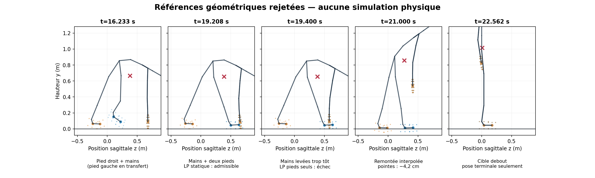

# Transfert d'appuis numérique : refus avant simulation — 12 octobre 2026

**Résultat : aucun relevage physique nouveau ni candidat admis.** Cette extension
de la [préparation fermée à 15:17 UTC](intermediate-transfer-preparation-2026-10-12.md)
a produit un programme moteur numérique exploratoire de 25 s, mais les
contrôles préalables l'ont rejeté. La récupération reste désactivée par défaut
et non qualifiée. Aucun seuil anatomique, de couple, de friction, de contact ou
de livraison n'a été relâché. Le programme rejeté et ses scripts d'essai
restent hors du code livré, dans
`evidence/intermediate-transfer-numeric-2026-10-12/` du workspace local.
Le [reçu mesuré](evidence/intermediate-transfer-numeric-2026-10-12/rejected-target-audit.json)
contient les empreintes des entrées et les résultats numériques ; la
[figure](media/intermediate-transfer-numeric-2026-10-12/unsupported-handoff.png)
montre uniquement des cibles cinématiques, jamais des images d'une simulation.

## Ce que le calcul a réellement établi

Le témoin physique archivé sur `main` tombait en avant et terminait en Brace.
L'essai mains/tibias archivé arrivait sur la tête à 1,525 s avec un centre de
masse encore descendant à environ 2,013 m/s et avançant à 1,255 m/s ; les
coudes atteignaient leurs limites. Ces mesures ne sont **pas** reproduites par
la nouvelle extension : elle compte **zéro pas d'intégration physique** et ne
contient donc ni accélération mesurée du centre de masse, ni contacts ni couples
résolus par le moteur de physique.

Le nouveau calcul part de la fixture native, conserve 25 corps, 46 coordonnées
motorisées, les axes de racine sans commande et une seule horloge à 240 Hz. Il
compose 53 clés sur 6 000 sous-pas, sans vitesse cible supérieure à
0,9412 rad/s analytiquement. Le compilateur de commandes natif a accepté sa
grille ; 194 requêtes **statiques** à 0° et 60° n'ont déclenché aucun refus
géométrique. Cela ne prouve ni appui porteur ni mouvement réalisable. Sur 530
échantillons de maillage, l'aperçu de racine enfouit une pointe jusqu'à
42,36 mm ; le corriger verticalement exigerait jusqu'à 44,36 mm de déplacement
de racine. Les contacts voulus peuvent flotter jusqu'à 27,94 mm après cet
ancrage. La racine virtuelle sert uniquement à l'inspection géométrique, et
non à une commande du bassin.

L'intervention de structure explorée était **mains et tibias → pied droit
chargé → déplacement puis repose du pied gauche → deux pieds et mains →
retrait des mains**. À mi-transfert gauche, la flexion du genou et un roulis de
hanche gauche d'environ 0,65 rad dégagent le pied d'environ 15 mm ; le même
jalon sagittal sans roulis le faisait pénétrer d'environ 10 mm. Les jalons
contrôlés passent le contrôle géométrique natif et un calcul statique sous les
caps originaux. Il s'agit d'une **possibilité de pose**, pas d'une preuve du
transitoire moteur ni d'un appui réel résolu.

À la pose de recouvrement t=19,208 s, mains et deux pieds sont proches du sol.
Un équilibre force/moment **virtuel** avec mains et pieds respecte le plafond
global original de 760 Nm : 196,88 Nm de somme et 36,71 % d'utilisation
anatomique maximale. Sans les mains, le même calcul échoue ; un diagnostic
hors limites demanderait 104,32 Nm au lombaire, pour un maximum réel de
100 Nm. Une pose ultérieure avec bras relevés possède un équilibre statique
sur deux pieds à 98,11 % du cap lombaire et 629,70 Nm de somme. Mais entre
les deux, à t=19,35–19,45 s, les mains ne touchent plus et le calcul pieds
seuls échoue. À t=19,50 s, l'équilibre redevient mathématiquement possible,
avec 99,36 % d'utilisation anatomique et le plafond global de 760 Nm atteint.
Il n'existe donc pas de marge démontrée pour le retrait proposé. Le lombaire
est déjà à 0,31415 rad, presque sa limite de 0,314159 rad : une variante
tentant 0,060 rad de flexion de plus a été refusée par le validateur natif
dès son premier incrément. Elle ne figure pas dans le code livré.

Le support sur **un pied seul**, à cette pose précise, est également impossible
dans le modèle statique utilisé, même lors d'un diagnostic volontairement
élargi à 3 000 Nm et dix fois les caps anatomiques : la projection sagittale
du centre de masse est 39,55 mm derrière les points d'appui du pied gauche et
571,58 mm devant ceux du pied droit. Cette vérification ne démontre pas
l'impossibilité de toute stratégie dynamique pieds seuls ; elle établit que
la pose testée doit garder un autre appui avant de déplacer une semelle.

Enfin, le programme annotait des contacts continus des semelles tout en
déplaçant leurs **points matériels** dans le plan du sol de 0,488 m à droite
et 0,467 m à gauche jusqu'à la cible debout. L'interpolation s'enfonce au sol
et perd le pied gauche près de t=21 s ; le calcul statique échoue à 20, 21 et
22 s. Le jalon mains + deux pieds n'apparaît qu'à 19,208 s, déjà au-delà de
l'échéance contractuelle de retrait des mains à 14 s, et la cible debout à
22,562 s dépasse celle de 20 s. La seule existence de clés initiale et
terminale ne qualifie donc pas ce programme.

## Suite techniquement justifiée

Il faut déplacer et replanter les pieds sous le centre de masse **pendant que
les mains ou les tibias portent encore**, puis prouver la décharge réelle de
chaque appui avec les contacts du moteur physique. Le prochain programme
numérique doit conserver les points matériels des semelles plantées, les
limites d'origine et une pose statiquement admissible pendant tout le retrait
des mains. Un préscreen complet, borné et figé doit précéder toute nouvelle
simulation ; aucun passage géométrique ou LP ne vaut récupération. Les
échéances du contrat existant n'ont pas été modifiées pour faire entrer cet
essai rejeté.

La branche de travail reste `investigate/physical-support`; `main` distant
est toujours `c597959f46f37715035349c8cd0a699b6822111a`. Le reçu fixe
les SHA du modèle, de la fixture, du binaire de contrôle et du programme
exploratoire. Les cinq tests ciblés du préscreen passent, son vérificateur
de clés ne signale aucune anomalie de commande, le reçu JSON est valide et
`git diff --check` ne signale aucune erreur. La suite complète Rust/TypeScript
n'est pas déclarée verte : le témoin Linux possédait déjà un échec hybride et
quatre échecs TypeScript.
