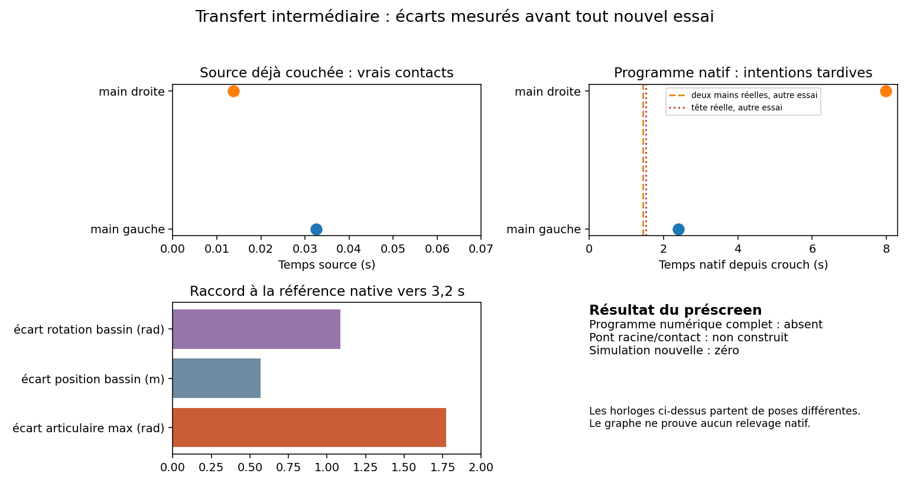

# Préparation du transfert par mains et tibias — 12 octobre 2026

**Décision à 15:17 UTC : aucune nouvelle intégration physique.** Le parcours
d'appuis est choisi, mais sa trajectoire numérique complète depuis la fixture
réelle n'est pas construite. Le préscreen refuse donc un lancement. Cette
préparation reste distincte des campagnes précédentes, dont les budgets et les
registres demeurent fermés. La récupération reste désactivée par défaut et non
qualifiée.

La reprise commence sur `investigate/physical-support` au commit
`c9f07eaf005be5cb952e494c70b052426bafa57c`. La branche distante porte ce
commit ; `main` reste à `c597959f46f37715035349c8cd0a699b6822111a`.
Aucun fichier d'instructions `AGENTS.md` ou `.agents/skills` n'est présent dans
ce checkout. Les preuves sont conservées dans
`evidence/intermediate-transfer-prep-2026-10-12/` et les reçus légers ci-dessous.

## Résultat causal des traces existantes

La référence source commence déjà près du sol : son bassin est à environ
0,0993 m, sa cuisse droite porte à t=0, sa main droite touche à 0,01375 s et
la gauche à 0,0325 s. La fixture native `landed-crouch-left` commence avec le
bassin à 0,9763 m. Ces deux horloges ne représentent pas le même état initial.
Le programme natif adapté de 20,8833 s n'annotait la première main gauche qu'à
2,4 s et la droite à 7,975 s ; il ne déclarait aucun appui de tibia ou cuisse.
L'essai natif distinct aux mains préparées obtenait pourtant les deux mains
persistantes à 1,4417 s, par sa vraie descente, puis la tête touchait à
1,525 s. À 1,4 s son CoM descendait encore à environ 2,013 m/s et avançait à
1,255 m/s. Les coudes pliaient sous l'impact et atteignaient leurs caps.
Le test avait **zéro maintien intermédiaire**. Cette arrivée énergétique et
l'absence d'une séquence de décharge expliquent pourquoi copier les seules
annotations de contact de la source ne reproduit pas son support.

Le corridor antérieur mains/tibias passe ses 61 contrôles géométriques et son
**seul terminal** possède un équilibre statique faisable sous le plafond
original de 760 Nm : 233,27 Nm de somme et 39,80 % d'utilisation anatomique
maximale. Cela ne garantit pas son transitoire : son histoire native échoue sur
la tête. Raccorder son terminal à t=3 s à une clé précoce (2–5 s) du programme
get_up_control laisse au mieux 1,7733 rad d'écart sur un axe. À 1 rad/s, cet
axe exige déjà au moins 1,7733 s de transition. Les poses géométriques
correspondantes placent les bassins à environ 0,5693 m l'un de l'autre et
1,0848 rad d'écart d'orientation. Aucun de ces écarts ne peut être comblé par
un changement instantané de cible ou une écriture du bassin. Il faut produire
un nouveau chemin continu avec supports et effort admissibles.

## Séquence complète retenue comme contrat de conception

Le [contrat de phases](intermediate-transfer-plan-2026-10-12.json) définit un
parcours **mains + tibias → base chargée → pied gauche avancé en gardant le
tibia droit → deux pieds → retrait successif des mains → remontée → handoff
original**. Le modèle ne possède pas de segment « genou » : une éventuelle
charge près du genou doit être identifiée sur le tibia réel. Les temps ci-dessous
sont des **échéances d'arrêt**, jamais des transitions forcées.

| Échéance globale | Passage exigé par les mesures réelles |
|---|---|
| 3 s | Mains et tibias bilatéraux porteurs, tête/torse déchargés, 80 % du poids sur les appuis admis, CoM et capture dans leur enveloppe de 3 mm, calme original pendant 0,55 s. |
| 5,5 s | Brace puis Kneel avec les conditions de posture et persistance originales. |
| 9 s | Avant de libérer la jambe gauche, preuve sur les mains et la jambe droite **en excluant tibia, pied et avant-pied gauches** ; pied gauche ensuite réellement porteur. |
| 12 s | Preuve symétrique avant de libérer la jambe droite ; deux semelles réellement porteuses. |
| 14 s | Chaque main libérée seulement après la preuve de transfert sans cette main : charge résiduelle ≤25 % du poids, appuis conservés ≥80 %, CoM et capture dans l'enveloppe réelle de 3 mm. |
| 20 s | Remontée sur deux pieds, bassin >0,93 m, support debout original et calme des 25 corps. |
| 25 s | Settle, handoff natif 143/144 et maintien original ; le compteur original seul peut reconnaître une récupération. Une seconde d'observation peut finir à 26 s. |

Les mains, tibias et semelles restent des colliders existants, jamais des
contraintes imposées. Les contacts tête/torse restent physiquement résolus ;
leur charge bloque la progression au lieu d'être masquée. Les limites de couple,
la friction (1,2 aux mains/tibias, 4 aux pieds), masses, géométries, segmentation,
collisions et seuils de livraison ne changent pas. Le chemin n'ajoute aucun
effort au bassin, reset, verrouillage, transplantation de pose ou remise à zéro
des horloges. L'appui intermédiaire est une hypothèse testable, pas une nécessité
anatomique démontrée.

Le code livré pour cette étape est un
[préscreen sans physique](../scripts/recovery-intermediate-preflight.py) avec
cinq tests ciblés et une visualisation des données archivées. Il contrôle
l'ordre des phases, la jambe entière exclue lors du transfert, l'échéance de
25 s et une première lecture des limites et vitesses aux clés d'un éventuel
programme numérique. Le compilateur natif devra vérifier les intérieurs de
chaque interpolation. Le préscreen donne un
refus explicite tant que le programme complet et ses frames géométriques
manquent. **Ce n'est pas encore un producteur de moteurs ni une trajectoire
complète validée** ; aucun état de corps n'a été avancé pour cette préparation.

## Admission et budget distinct proposés avant toute future simulation

La préparation ouverte à 15:01 UTC est limitée à **deux heures, donc 17:01 UTC**.
Le registre local compte six lots d'inspection ciblés, neuf fichiers d'entrée
lus par le préscreen final, **zéro inspection d'un nouveau monde statique et
zéro pas natif**. Les contrôles archivés d'autres jalons ne sont pas ajoutés
à ces nombres. La préparation est close avec un refus de lancement, avant
l'échéance ; aucun ancien budget n'est réinitialisé.

Pour rendre la séquence lançable dans un jalon séparé, il faut d'abord :

1. produire depuis la fixture exacte un programme numérique 25 corps couvrant
   toutes les phases et les surfaces d'intention, avec vitesse de cible et slew
   ≤1 rad/s, limites articulaires originales, continuité et aucun axe de racine ;
2. compiler ce programme sur **toute** la grille native de 240 Hz et inspecter
   au maximum 201 poses choisies avec toutes les frontières de phase à 0° puis
   60° (402 inspections au plus), avec sol, auto-collision, ancres et maillages
   d'origine ; conserver séparément toute borne continue d'intercollision ;
3. vérifier les équilibres force/moment et cônes de friction aux sept frontières
   sur les contacts prévus, sous 760 Nm et tous les caps anatomiques, puis un
   budget prospectif de vitesse verticale et de moment avant le premier appui.
   Ce calcul statique est un filtre, pas une preuve de tenue dynamique ;
4. figer programme, surfaces, paramètres, code, binaire, critères de jugement,
   chemins de traces et SHA avant tout lancement. Un prérequis absent ferme le
   prochain candidat sans simulation.

**Budget de simulation proposé, non ouvert ici :** au plus deux histoires à
0° depuis la même fixture, témoin B puis unique candidat ; chacune limitée à
26 s et 6 240 pas natifs, **12 480 pas réservés au total**, un seul processus
mono-thread et **300 s murales depuis le premier lancement**. Le témoin doit
reproduire les 5 013 pas et les empreintes physiques B archivées ; sinon arrêt
sans candidat. Le candidat s'arrête au premier refus natif, à une échéance de
phase manquée, au délai de 25 s ou après le maintien original, sans nouvelle
graine, retouche ni prolongation. Une touche de main, un brace ou une pose
géométrique n'est pas une récupération. Une réussite de ce pilotage demanderait
ensuite des validations séparées à 60°, sur autres fixtures, cycles, impacts,
repos et navigateur, avec un autre budget.

Le [reçu numérique versionné](evidence/intermediate-transfer-prep-2026-10-12/preflight.json)
contient les écarts, empreintes des entrées, résultats d'admission et zéro
intégration. Les essais précédents et leur vidéo restent dans les rapports
[mains/tibias](rust-hand-support-experiment-2026-10-11.md) et
[pieds B/C](foot-coordination-results-2026-10-12.md). Cette figure représente
uniquement des archives et calculs statiques, pas une nouvelle vidéo native.
