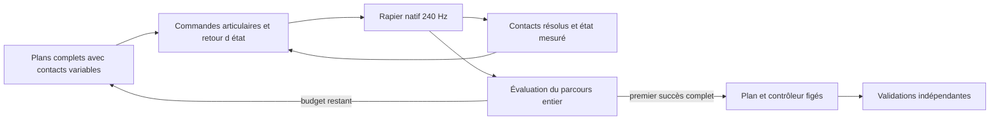

# Planificateur natif de trajectoire et d’appuis — cadrage du 11 octobre 2026

**Décision proposée : un planificateur hybride à contacts variables, recherché
hors ligne par simulations Rapier complètes, exécuté avec un retour d’état du
corps entier.** Une seule architecture, sans apprentissage de politique ni modèle
physique de remplacement. Les forces de contact seront des résultats de Rapier ;
les variables de transfert seront des objectifs de charge, jamais des forces
injectées dans les corps.

Ce document part du checkpoint `dcbcdfabaace5f3fbe91c944cb99efe5687276ac` sur
`investigate/physical-support`. L’autorisation du 11 octobre à 19:02 UTC couvre
le cadrage et sa sauvegarde documentaire. **Aucune nouvelle simulation, campagne,
installation ou modification du contrôleur dans ce tour.** L’implémentation et le
budget ci-dessous sont proposés ; leur lancement attend la présentation de ce
cadrage. La récupération reste désactivée par défaut et non qualifiée.

Cette proposition remplace la décision de référence SLOW avec contacts figés,
conservée dans [le checkpoint précédent](https://github.com/berenif/LaboratoireHumain/blob/dcbcdfabaace5f3fbe91c944cb99efe5687276ac/docs/rust-recovery-architecture-decision-2026-10-11.md).
Le [rapport de clôture](rust-recovery-coordinated-retarget-2026-10-11.md) et tous
les essais rejetés restent inchangés. Leur budget de 96 histoires reste fermé.

**Reprise autorisée à 21:18 UTC :** le premier lot d’implémentation commence par
l’observation native. Le cadrage ci-dessus décrit le tour documentaire historique.
Le [jalon de frontière CCD](rust-recovery-impulse-boundary-2026-10-11.md) isole un
défaut de lecture, sans fermer P1 ni lancer la recherche. Le nouveau registre
`native-hybrid-v1` compte ses vérifications ; l’ancien registre reste clos.
**Clôture P1 :** le budget technique a expiré le 11 octobre à 22:05:43 UTC,
après huit histoires ; aucune recherche lancée. Le [rapport de clôture](rust-recovery-p1-closure-2026-10-11.md)
distingue le diagnostic angulaire, la neutralité acquise et le certificat manquant.
Ce registre ne peut pas être repris ou remis à zéro.

**Décision du 12 octobre :** le propriétaire autorise une comparaison A/B limitée
sur le programme get_up_control existant. La certification exhaustive P1 est
différée pour ce seul jalon ; le solveur reste non certifié, les critères
physiques inchangés, les anciens registres fermés. Cette exception explicite
remplace la dépendance P1 ci-dessous pour A/B seulement, sans autoriser la
recherche hybride : [décision, prérequis ciblés et plafonds](rust-getup-ab-decision-2026-10-12.md).

## Ce que les preuves imposent au nouveau plan

- Les 96 histoires du registre `native-campaign/ledger.json`, identifiants
  `000–095`, sont nouvelles pour la campagne du 11 octobre, distinctes des essais
  locaux antérieurs. Deux rejeux de référence, un témoin local, une variation
  préalable et 92 propositions CEM : zéro récupération complète.
- Les 93 programmes modifiés ne changeaient les clés que de 0,01436 rad au maximum
  et la durée que de 175 ms. Six modes PCA limitaient la coordination ; les
  surfaces et l’ordre des contacts restaient figés. Tous les programmes actifs
  étaient interrompus entre 1,429 et 4,929 s, avant la montée finale.
- L’état initial physique concorde avec la référence géométrique à environ
  0,3 µm. L’erreur de suivi de l’avant-pied droit apparaît dès le premier sous-pas
  enregistré : 0,000751 rad à 4,167 ms, puis 0,0233 rad à 50 ms. À cette dernière
  date, l’appui reste presque linéaire ; aucune charge arrière de talon dans les
  captures initiales. La collision des pieds à 4,883 s est un refus d’intégrité
  ultérieur, pas le premier écart de trajectoire.
- Une géométrie admissible, même 402/402 inspections, ne fournit pas les réactions
  de contact ni les couples nécessaires. Le bilan des charges rapportées présente
  des écarts aux impacts, jusqu’à 6 460,9 N. Les charges ne peuvent piloter une
  nouvelle boucle de transfert avant clarification de leur observation.
- Le prédicteur conservé est exact sous son contrat court et ses commandes
  reconstituées ; il ne clone pas à lui seul toute la logique future du contrôleur.
  Étendre sa constante d’horizon ne créerait pas un planificateur complet.

Références méthodologiques : [Tedrake, Planning and Control through Contact](https://underactuated.mit.edu/contact.html)
présente le caractère hybride des contacts et les difficultés du tir direct près
des changements de mode. [Mordatch et al., Discovery of Complex Behaviors](https://www.roboti.us/lab/papers/MordatchSIGGRAPH12.pdf)
motive la recherche conjointe du mouvement et des contacts, mais utilise une
simplification dynamique. Nous retenons le contact comme variable de décision ;
nous ne reprenons ni cette simplification, ni ses performances comme preuve native.

## Architecture choisie et périmètre

Un `HybridPlan` contient le parcours entier, ses contacts souhaités et les cibles
articulaires de tous les membres. Un optimiseur fait varier ce plan. Chaque
évaluation part de la fixture exacte dans un monde neuf et utilise le même
exécuteur avec retour d’état que le futur rejeu. La simulation détermine les
appuis effectivement acquis, les mouvements de la racine et les couples livrés.
La sélection porte sur la récupération entière, pas sur une chaîne de jalons
locaux dont les réussites ouvriraient de nouveaux budgets.

Le premier problème reste `landed-crouch-left` à 0°, avec ses positions et
vitesses exactes. Cela permet de comparer les résultats historiques ; cela ne
couvre pas toutes les poses au sol. La recherche peut choisir pieds seuls,
main/avant-bras, genou ou retournement : aucune de ces routes n’est présumée
nécessaire ni réussie. Les primitives servent à initialiser la même représentation,
pas à créer plusieurs contrôleurs ou campagnes indépendantes.

Le planificateur hors ligne n’est pas dans la boucle d’affichage. Pendant un rejeu,
un calcul algébrique borné coordonne le corps à 60 Hz ; les contacts, l’enveloppe
de commande, les mesures et les preuves sont actualisés à 240 Hz. Il n’y a ni
simulation prospective par image, ni transfert d’un monde prédit vers le monde
réel. Le temps réel du pipeline complet reste à mesurer, notamment en WASM.

## Variables effectivement recherchées

Première représentation bornée : au plus huit phases de contact, douze clés
articulaires et huit surfaces souhaitées simultanément. Ces limites définissent
une famille de recherche ; un échec ne prouvera pas l’impossibilité du mannequin.

| Variable | Liberté réelle et contrainte |
|---|---|
| Séquence de contacts | Insertion/suppression/remplacement d’un appui, ordre d’acquisition/libération, côté meneur et recouvrement. Les contacts de la source ne sont plus imposés |
| Surface corporelle | Région d’un collider existant, reliée au maillage natif : talon arrière distinct de l’avant-pied, main, avant-bras, tibia proximal, surfaces de tronc nécessaires au retournement. Les autres contacts physiques restent actifs |
| Placement | Triangle/région et barycentriques sur le corps ; coordonnées horizontales du point visé au sol dans le repère initial. Domaine borné par la portée géométrique des chaînes natives |
| Horloge | Durées nominales, fenêtres d’acquisition et recouvrements ; accélération ou ralentissement de phases dans le temps total, pas uniquement ralentissement du clip |
| Posture | Les 46 coordonnées natives indépendantes à dix clés intérieures au maximum, soit 460 variables. Toutes les jambes, les deux bras et le tronc peuvent changer ensemble ; aucune base PCA imposée |
| Transfert de charge | Parts normales souhaitées par surface et par phase, non négatives et de somme un quand un support est demandé. Leur montée et leur décharge se chevauchent ; aucune force réelle n’est prescrite au solveur |

Avec placements, barycentriques, horloges et parts de charge, la représentation
peut approcher 800 variables continues, plus les choix discrets. Le premier
état et la cible terminale restent contraints ; les vitesses des clés dérivent
de la même interpolation. Les articulations non modélisées et la racine n’ont
aucune commande. Les angles gardent les bornes du modèle et la progression de
cible reste limitée à 1 rad/s, y compris après correction par retour d’état.

Les caps anatomiques, l’enveloppe agrégée de 760 Nm, les gains physiques,
l’anatomie, les masses, la friction, les exclusions de collision et le profil
épinglé ne sont pas des variables. La règle d’allocation répond aux demandes du
seul propriétaire des moteurs et reste la même pour tous les candidats.
La non-adhésion et les frottements restent ceux des contacts unilatéraux Rapier.
Un objectif de pied immobile est une demande de commande, jamais un verrouillage
supplémentaire entre le pied et le sol.

La référence tierce n’est plus un prérequis. Les fixtures et chemins géométriques
natifs existants peuvent initialiser des postures. Un chemin géométrique sert
uniquement à proposer des cibles ; ni sa racine ni ses poses ne sont installées
pendant l’intégration. Les fichiers de mouvement SLOW restent privés.

## Interfaces et modules à implémenter

Les chemins nouveaux de ce tableau sont des propositions, pas des fichiers déjà
livrés. Première intégration sous `cfg(test)` ou fonctionnalité expérimentale
inactive ; aucun changement du défaut de production pour obtenir le premier cas.

| Module | Interface et responsabilité |
|---|---|
| `recovery/planner/contact_observation.rs` | `observe_native(state, applied_impulses) -> SupportObservation` : points/régions chargés, normales, impulsions tangentielles, persistance, glissement, état des 25 corps, CoM et vitesses, qualité de mesure |
| `recovery/planner/contact_graph.rs` | `ContactGraph::validate(model)` et transitions observées. Références de surfaces natives, fenêtres, parts de charge ; aucune création de contact/collider |
| `recovery/planner/plan.rs` | `HybridPlan::compile(model, contract) -> CompiledHybridPlan`. Coordonnées, séquence complète, interpolations et enveloppes. Réutilise les conventions de `trajectory_program.rs` et `reference_mapping.rs` |
| `recovery/planner/feedback.rs` | `feedback(plan, observation, runtime, dt) -> MotorCommand`. Solveur borné du corps entier ; état mesuré en lecture seule, sortie q/dq uniquement |
| `recovery/planner/runtime.rs` | Horloge globale, progression monotone, mémoire des contacts et de la commande précédente. Un seul propriétaire des moteurs ; l’installateur commun garde les modèles/gains/caps |
| `recovery/planner/terminal.rs` | Adaptateur aux observations, compteurs et handoff d’origine. Il peut demander le terminal debout ; il ne peut attribuer une récupération |
| `recovery/support_probe/hybrid_history.rs` | Histoire native depuis la fixture via `advance_tick_observed`, refus originaux, télémétrie et preuve complète. Aucun collage de préfixes ni reset intermédiaire |
| `scripts/plan-native-recovery.py` | Recherche hybride reproductible et registre atomique des budgets, seeds et empreintes. Aucun lancement implicite depuis un test ou l’application |

Les structures sérialisées minimales sont `HybridPlan`, `SupportObservation`,
`MotorCommand`, `HistoryOutcome` et `SearchReceipt`. Le reçu porte début/fin UTC,
numéro de lancement, parent du candidat, différences de topologie, paramètres,
binaire, modèle, profil, contrat, seed, sous-pas réellement intégrés et refus.
Une observation ne possède aucun accès mutable aux corps ; un `MotorCommand`
ne peut contenir ni pose globale, ni force externe, ni changement de solveur.

Il faut partager l’installation des cibles avec `full_trajectory.rs`, sans
modifier le comportement du programme historique. Le contrôleur historique ne
doit pas continuer à imposer d’autres cibles pendant que le planificateur possède
les moteurs. En revanche, ses preuves de support, de settle, de handoff et de
maintien doivent rester indépendantes du score de recherche.

`observe_recovery` dépend actuellement de `Controller::standing()`, des ancres
réelles et des phases `Stand/Handoff/Ordinary`. L’adaptateur doit conserver cette
sémantique et ses temporisations : entrée terminale demandée, support effectivement
mesuré, settle 0,30 s, handoff 0,60 s, contrôle ordinaire puis maintien original.
Extraire cette frontière nécessite des non-régressions ; écrire directement le
compteur, forcer `Motion::Upright` ou rebaser la référence CoM serait un refus.

## Retour d’état dès le premier pas

1. Initialiser une fois depuis la fixture. À chaque sous-pas, mesurer les positions,
   vitesses et appuis réellement résolus. Les cibles et la mémoire de commande
   précédente sont continues ; ne pas réinitialiser les cibles sur une pose mesurée.
2. Déterminer les surfaces effectivement porteuses dans leur repère corporel.
   Le segment `Foot` chargé ne suffit pas à déclarer le talon arrière acquis.
   Une acquisition exige les distances, charges et persistances du contrat.
3. Construire à 60 Hz une correction coordonnée des 46 vitesses cibles : suivi
   de posture, placement des membres libres, maintien/glissement des contacts
   observés, erreur de charge et régulation CoM/vitesse. Les Jacobiennes sont
   calculées autour des corps mesurés, pas d’une reconstruction rigide supposée
   identique au monde Rapier.
4. Résoudre un problème de moindres carrés borné en vitesses articulaires.
   Les corrections de charge passent par une admittance des surfaces : une
   erreur de force demande un mouvement limité du membre, transformé par les
   Jacobiennes. Le signe se vérifie par travail virtuel ; les échelles initiales
   dérivent des raideurs/amortissements natifs et sont figées avant recherche.
   Cette approximation génère une commande ; seule son exécution mesure la charge.
5. Combiner nominal et correction dans un unique producteur de q/dq. Vérifier
   bornes anatomiques, vitesse et variation réelle `f32` à chaque 1/240 s, puis
   appliquer exclusivement les moteurs ForceBased avec l’allocation native.
   L’itération du solveur algébrique est bornée et déterministe ; le temps CPU
   est mesuré, pas utilisé pour choisir aléatoirement une autre commande.
6. Avancer dans le graphe selon les appuis observés et les fenêtres du plan.
   Une main absente ne devient pas un point de support parce que son heure est
   arrivée. Une charge décroissante peut libérer un membre sans exiger une pause
   stable à chaque phase. Le temps global de 25 s continue toujours à courir.

Le problème algébrique n’est pas un certificat de dynamique inverse. Il ne
commande pas directement la force au sol, et une part de charge souhaitée n’est
jamais portée au crédit du candidat avant sa résolution physique. Les objectifs
non satisfaits sont enregistrés ; une fenêtre manquée est un échec du plan,
distinct d’un défaut d’intégrité du monde. En cas de solveur invalide, pas de
fallback caché vers un ancien contrôleur : commande bornée conservée pendant
l’arrêt de l’essai, refus explicite, aucune récupération déclarée.

La perte de support de 0,20 s et la stagnation de 3 s gardent leurs durées
originales. Le progrès doit venir de l’état physique observé sur le parcours ;
changer d’indice de phase, de cible ou de propriétaire ne remet pas à zéro un
timer de stagnation. Cette propriété appartient aux tests de la frontière
commande/observation, avant la recherche.

Il n’y a pas de bras figé en attente d’un jalon à 75°, ni de gel permanent d’un
préfixe tombé. Une erreur initiale des avant-pieds intervient immédiatement dans
le retour d’état, les charges observées et le coût de l’histoire. La carte des
contacts souhaités peut elle-même changer entre candidats de recherche.

## Recherche hors ligne et horizon complet

Le temps nominal articulé varie de 8 à 22 s ; le maximum laisse 3 s pour les
observations terminales et le handoff avant la limite originale de 25 s. Chaque
candidat est exécuté jusqu’au succès et à la seconde d’observation supplémentaire,
ou jusqu’à 26 s, sauf refus explicite. Pas d’arrêt sur une réussite de talon, main,
roulis ou hauteur intermédiaire ; aucun horizon local ne remplace ce parcours.

L’optimiseur maintient un faisceau d’au plus six plans complets, avec diversité
de topologie. Les propositions alternent mutations discrètes de contact et
variations continues par blocs temporels/corps entier. Des directions opposées
et des perturbations couvrant une fraction substantielle des plages admissibles
remplacent le voisinage PCA inférieur à un degré. Le compilateur refuse les
commandes hors enveloppe ; il ne les écrête pas pour dissimuler la mutation.

Une population initiale utilise les primitives natives pieds, mains, genoux et
retournement. Insertion/suppression d’appui et changement de côté restent permis
ensuite. Les blocs continus incluent simultanément jambes, bras et tronc ; ils
ne sont pas optimisés sur un sous-test physique séparé. La covariance est bornée
par blocs, sans matrice dense de 800 dimensions. Chaque plan proposé et accepté
par le compilateur consomme une histoire depuis t=0 ; aucun cache de monde
intermédiaire ne remplace une preuve du parcours entier.

PCG64, seed 0, ordre de lancement et règle de sélection sont figés dans le
manifeste avant la première intégration. Les lots contiennent au plus 16
propositions ; les résultats sont réduits dans l’ordre de lancement, pas l’ordre
de fin des travailleurs. Les amplitudes initiales par bloc, leurs bornes et
leur règle d’adaptation sont relues à P0 ; aucune autre seed ne prolonge un échec.

Classement gelé avant le premier essai :

1. Récupération complète originale avec handoff et observation supplémentaire.
2. Histoire entière de 26 s admissible en intégrité, puis résidu terminal mesuré :
   hauteur, verticalité, appuis persistants bilatéraux, vitesses, stabilité et
   état du handoff. Les normalisations lisent les bornes du contrat ; pas de
   modification des poids après un échec de sous-phase.
3. Pour les histoires interrompues : nature/ampleur du refus, temps non exécuté,
   résidu du but au dernier état observé. Ce dernier n’est pas un terminal prédit.
4. À classe terminale égale : erreurs de placement/charge et suivi sur la durée
   exécutée, travail moteur observé, variations de commande et glissement.

Un candidat déclaré incomplet ne reçoit jamais une réussite par extrapolation.
La comparaison des commandes prévues, q/dq réels, caps et livraisons commence à
4,167 ms et se poursuit jusqu’au refus. Les valeurs signées des lignes de solveur
ne sont pas assimilées sans conversion aux couples généralisés sur les enfants.

## Prérequis et portes de décision

**P0 — revue d’implémentation, avant recherche.** Vérifier les interfaces, le
propriétaire unique des moteurs, l’absence de reset/assistance, la séparation
commande/preuve et les conventions q/dq. Les candidats contiennent un terminal
complet et des possibilités distinctes de contact. Si cela exige de modifier
anatomie, caps, profil ou critères, arrêt et nouvelle décision de périmètre.

**P1 — observation et exécution, budget technique fermé.** Expliquer le défaut
de bilan aux impacts. Instrumenter, si nécessaire, les impulsions réellement
appliquées avec leur identifiant et leur frontière temporelle, y compris
frottement, warm-start et sous-pas CCD. Ne pas sommer plusieurs fois des valeurs
accumulées. Vérifier bilan linéaire et angulaire avec gravité/efforts connus.
La borne de résidu doit être calculée à partir des arrondis et des termes
d’intégration natifs explicitement comptabilisés, puis figée avant les relectures.
Un résidu inexpliqué au-delà de cette borne ferme P1 ; augmenter a posteriori une
tolérance pour absorber un impact ne la franchit pas. Aucun seuil de qualification
n’est élargi. Si les charges restent ambiguës, arrêter avant d’optimiser leur
transfert, sans substituer silencieusement un
contrôleur fondé seulement sur la position.

Les vérifications natives comprennent des rejeux indépendants de commandes avec
observation activée/désactivée, changements de phase et appuis chargés. Les corps,
moteurs, contacts et compteurs doivent rester identiques à chaque pas sous la
même entrée. Les tests de refus du terminal restent valables avec la nouvelle
frontière. Le prédicteur court ne suffit pas à couvrir ces propriétés. Tout pas
intégré par un test, une copie ou un diagnostic est compté au budget technique.

**P2 — arrêt précoce à 64 candidats de recherche.** S’il n’existe ni succès
complet ni une seule histoire atteignant les 26 s avec intégrité valide, fermer
la recherche. La collision repoussée, le talon chargé ou un roulis supplémentaire
ne franchissent pas cette porte. Une histoire entière admissible autorise
seulement l’utilisation du reste du budget déjà prévu ; elle n’est pas un relevage.
Les premiers candidats fournissent aussi le débit réel : arrêter si les essais
restants ne tiennent plus raisonnablement dans le plafond mural.

**P3 — but complet.** Au premier succès original, figer plan, exécuteur et toutes
les empreintes, puis passer aux validations réservées. À 192 candidats ou au
plafond de calcul sans succès complet, abandon de cette représentation. Aucun
budget renouvelé pour un sous-jalon, autre graphe, autre seed, correctif de phase
ou meilleur score. Une modification de code pendant la campagne la ferme ; elle
ne transforme pas le solde en une nouvelle campagne automatique.

**P4 — validation figée.** Huit histoires indépendantes maximum : deux répétitions
à 0°, deux à 60°, puis perturbations initiales de +2° et −2° autour de l’axe
horizontal fixé pour chaque cap. Les perturbations font partie de l’initialisation,
pas d’un déplacement des corps après le départ. Même politique dans le repère du
cap, sans retouche. Chaque histoire doit réussir le relevage, le handoff et le
maintien, puis 2 s de stabilisation et 30 s d’idle strict dans le même monde.
Un échec suffit à fermer cette validation ; aucune retouche entre les histoires.

## Budget proposé et coût estimé

Le budget proposé est nouveau et indépendant du registre fermé `000–095`.
Il ne devient exécutable qu’après la décision suivant ce cadrage. Un manifeste
neuf, par exemple `native-hybrid-v1`, comporte des compteurs séparés `contract`,
`search` et `validation`, ainsi qu’un compteur global irréversible. Les crashes,
timeouts et essais interrompus restent débités ; reprise après panne à compteurs
conservés, sans redémarrage automatique d’une histoire incertaine.

| Poste futur | Plafond, au premier atteint |
|---|---|
| Préparation/propositions géométriques | 30 min ; 10 000 inspections/FK ; zéro preuve physique |
| Vérifications techniques avec intégration | 32 histoires maximum, chacune ≤26 s ; 30 min murales |
| Recherche complète | 192 histoires maximum, chacune ≤26 s ; 4 h murales ; porte d’abandon à 64 |
| Validations finales figées | 8 histoires maximum, chacune ≤58 s ; 1 h murale |
| Ensemble | **232 histoires, 1 509 120 sous-pas natifs et 6 h murales maximum** ; aucune intégration prospective hors compteurs |
| Ressources | Au plus 3 processus natifs mono-thread sur le quota précédemment constaté de 4 CPU/16 Gio ; aucune compilation concurrente |
| Preuves | 2 Gio compressés ; commandes/mesures/empreintes par sous-pas, poses détaillées pour premier témoin, meilleur candidat et validations |

Le plafond global de sous-pas est `240 × (32×26 + 192×26 + 8×58)`.
Les bornes murales s’appliquent aussi au temps de proposition, aux rejets du
compilateur et aux attentes du coordinateur. Une paire de directions opposées
consomme deux histoires. Toute future dérivée calculée par intégration devrait
être comptée ; aucune n’est prévue dans la boucle en ligne. Si le stockage prévu
ne tient plus, arrêt propre avant le prochain lancement, pas suppression des
refus ni dépassement caché. Les vidéos sont produites à partir des états archivés.

Coûts réellement mesurés dans l’ancienne campagne : les quatre premières
histoires demandaient 1,294–1,825 s murales par seconde physique ; sur les 96,
médiane 1,672, maximum 3,988. Ces mesures comprennent leur télémétrie et ne sont
pas un benchmark du nouveau contrôleur. Les anciens contrôles par simulations
prospectives coûtaient environ 0,284–0,500 s par décision courte ; ils ne servent
pas de base à une promesse de contrôle interactif.

Pour 192 histoires de 26 s et trois travailleurs, la plage initiale donne environ
**36–51 min**, le maximum observé environ **1 h 51**, avant surcoût du nouveau
retour d’état et de la recherche. Un facteur deux sur cette dernière estimation
consomme presque les 4 h de recherche. Huit validations de 58 s séquentielles
coûteraient environ 13 min à 1,672 et 31 min à 3,988. Le plafond de 6 h est une
limite d’arrêt, pas une promesse de convergence. Le débit est réévalué à partir
des premières histoires déjà comptées, sans benchmark supplémentaire.

Le solveur algébrique 46 variables est nouveau : sa latence est inconnue. Cible
d’ingénierie, non résultat : p95 ≤2 ms par mise à jour à 60 Hz sur le natif, avec
un nombre maximal d’itérations fixé. Les coûts du monde, du rendu et du navigateur
s’ajoutent ; aucune baisse du nombre de sous-pas ou de passes PGS pour tenir cette
cible. Un premier relevage hors ligne ne qualifie pas les performances produit.

Estimation de développement pour une personne connaissant le dépôt :

| Lot | Estimation de travail, hors attente de calcul |
|---|---:|
| Observation des impacts, interfaces et frontière terminale | 3–5 journées |
| Graphe, surfaces, compilateur et retour d’état corps entier | 4–6 journées |
| Recherche hybride, registre et rejets déterministes | 3–5 journées |
| Intégration, non-régressions et restitution de preuves | 2–4 journées |
| Total avant conclusion de faisabilité | **12–20 journées**, incertitude élevée |

Ce chiffrage porte sur l’implémentation et une campagne bornée, pas sur l’obtention
d’un succès. Une incohérence persistante du bilan d’impulsions ou du terminal
peut bloquer le premier lot ; elle doit être signalée avant de construire la
recherche. La qualification générale est un lot distinct, non inclus dans ces
estimations. Aucun GPU, entraînement ou nouveau poids tiers n’est requis.

## Réussite physique, qualification et risques

Le premier relevage exige tous les critères originaux, observés en continu :
25 corps dynamiques possédés par le même monde, mêmes handles/génération ; aucune
force ou couple externe au bassin, aucune écriture de pose, aucun reset ; caps
anatomiques et somme ≤760 Nm ; intégrité à chaque sous-pas. Le contact pied/pied
reste physiquement actif, avec refus à la pénétration originale >5 mm. Sol et
séparation articulaire gardent 80 mm, erreur structurale articulaire 0,06 rad ;
les commandes restent dans les limites anatomiques, notamment cheville 20°.

Le terminal conserve support mesuré bilatéral ≥3 N à distance ≤12 mm avec
persistance native, verticalité ≥0,97, bassin >0,93 m, vitesses des 25 corps
≤0,22 m/s et ≤0,65 rad/s, settle et handoff originaux. `observe_recovery` doit
produire `recoveries == 1` et `Motion::Upright` avant 25 s, puis la seconde
supplémentaire d’observation doit passer. Le témoin initial élevé et son simple
indicateur `standing=true` ne comptent jamais comme une récupération.

La garde expérimentale `minimum_height < 0.60` de la recherche SLOW identifiait
le retour après sa descente imposée ; ce n’est pas une condition du contrat
original. La nouvelle recherche n’impose pas cette descente à une route pieds
seuls. Elle conserve les véritables critères et compteurs ci-dessus, sans
transformer une posture initiale en succès. Les chutes/cycles conservent leurs
propres preuves de descente et leurs délais originaux depuis l’impact.

L’idle des validations garde racine ≤3 cm, pieds plantés ≤1 cm, vitesses ≤0,1 m/s
et ≤0,5 rad/s, pendant 30 s après les 2 s de stabilisation. Les appuis, le compteur
et l’état debout doivent rester valides. Des captures légendées présentent chaque
étape importante ; seule une vidéo issue d’une histoire intégrée complète peut
illustrer une réussite physique.

**Qualification produit ultérieure, sans activation automatique :** 24 fixtures,
répétitions natives, cinq cycles dans le même assemblage, strict steps, WASM et
navigateurs WebGPU/WebGL2, continuité worker et revue des enregistrements. Les
portes de `run-rust-recovery-gates.mjs` et `rust-recovery-tools.mjs` restent
obligatoires. Les cycles comptent leur maintien dans le délai original depuis
l’impact ; la réserve de 26 s du banc de recherche ne modifie pas cette exigence.

Les frappes pendant différentes étapes demandent en plus une matrice figée de
cas : acquisition d’appui, transfert de charge, montée et handoff, dans les deux
caps, avec le striker existant et des déclencheurs observables. Les scripts actuels
ne prouvent pas à eux seuls cette couverture de toutes les étapes. Cette matrice,
son temps d’observation après chaque frappe et son budget devront être présentés
séparément ; aucun changement de critère après observation d’un échec. Un plan
réussissant huit validations ne suffit ni aux 24 poses, ni aux cinq cycles, ni
à cette robustesse aux frappes. Le défaut hybride et les quatre échecs TypeScript
connus du témoin restent également des blocages distincts de qualification.

Risques principaux : recherche de grande dimension avec seulement 192 évaluations,
initialisations géométriques dynamiquement inutiles, transitions de contact non
lisses, retour de charge retardé ou mal observé, approximation des Jacobiennes et
de l’admittance, compétition résiduelle entre propriétaires de moteurs, coût du
solveur et généralisation limitée à la première fixture. Les limites de huit
phases/douze clés peuvent exclure une solution. La fidélité du moteur aux mesures
ne prouve pas qu’un optimiseur puisse la trouver dans ce budget.

Les décisions de clôture seront donc explicites : prérequis non rempli, espace
de recherche sans parcours admissible, aucun relevage dans le budget, validation
figée échouée, ou première faisabilité physique démontrée. Aucune conclusion
d’impossibilité anatomique, aucun succès sur géométrie seule, et aucune suite
automatique de micro-ajustements ne découleront de ces verdicts.
