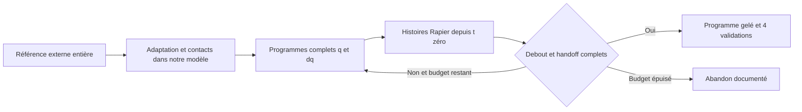

# Décision : une référence complète, ajustée hors ligne dans Rapier

Décision locale sur `investigate/physical-support`, HEAD
`c597959f46f37715035349c8cd0a699b6822111a`. Ce tour inspecte les sources et
les preuves existantes. **Aucune intégration physique, installation, export de
mouvement ou séance d'entraînement n'a été lancé.** Le relevage reste non acquis,
la récupération de production désactivée et non qualifiée. Les corrections
validées et les archives précédentes sont conservées.

## Choix et diagnostic d'architecture

**Choisir une référence numérique de relevage entier, issue du contrôleur SLOW
préentraîné de *Learning to Get Up*, l'adapter au mannequin, en extraire un plan
de contacts, puis optimiser un programme articulaire complet dans le simulateur
natif.** Une seule référence et une seule topologie de contacts seront gelées
avant la recherche. Le premier objectif est le parcours entier depuis
`landed-crouch-left` jusqu'au contrôle debout ordinaire, puis sa répétition et
sa rotation de 60°. Il ne s'agit pas encore d'un contrôleur général pour les
24 poses de qualification.

Le dernier contrôleur ne cherche pas ce problème :

- Son coût regarde charge du bras, charge du torse et moment cinétique à
  **quatre pas, soit 16,7 ms**. Il ne contient aucun état terminal debout ni
  trajectoire future de plantation des pieds et de remontée.
- Il conserve les cibles de position de la posture retenue. Ses 12 variations
  de vitesse ne concernent que lombaires, torse, ceinture scapulaire droite et
  bras droit ; les hanches, genoux, pieds et le bras gauche ne sont pas des
  variables de recherche. Il ne peut donc pas découvrir leur coordination
  complète en poursuivant ce même objectif.
- Il subordonne la suite à un jalon latéral de 75° et à une stabilisation
  intermédiaire. Cela ajoute une obligation de pause à une tâche qui peut
  nécessiter un passage dynamique. L'article de Tao et al. rapporte précisément
  des états où une pause fait perdre l'équilibre ; ce résultat motive ce choix,
  sans prouver quelle transition convient à notre mannequin.
  [Source primaire, §8.3](https://arxiv.org/html/2205.00307v2#S8.SS3).

Les 815 pas d'horizon exacts du dernier essai ferment le défaut de prévision.
Ils ne certifient ni l'optimalité du coût, ni la capacité du petit espace de
commande à contenir un relevage. Le même voisinage 45°/54°, la décharge de
20,8 ms et l'absence de dégagement de chaîne étayent un piège de représentation
et d'objectif. **Ce n'est pas une preuve mathématique que 45°/54° soit le seul
équilibre possible, ni que les pieds seuls soient impossibles.**

La nouvelle voie repart du véritable état initial du témoin. Elle ne fige pas
les dix premières secondes de la descente ratée et ne transplante pas l'état à
45° dans un monde neuf. Le jalon expérimental de 75° n'est plus une condition
obligatoire du parcours ; son sous-test historique demeure échoué. Les seuils
physiques et de qualification, eux, restent inchangés.

## Comparaison des voies praticables

| Voie | Ce qui manque ou limite son intérêt ici | Décision |
|---|---|---|
| Allonger le même MPC et modifier ses poids | Coût terminal absent, jambes non recherchées, cibles retenues figées. Déjà 0,368 s de calcul pour 16,7 ms simulées. À 0,5 s, une extrapolation linéaire donne environ 11 s par décision, sans résoudre la représentation | Écartée |
| Plan de contacts et optimisation directe de dynamique inverse / collocation | CasADi est présent, mais aucun modèle complet différentiable de nos moteurs implicites, contacts, allocation et mises à jour Rapier n'est prêt. Un nouveau substitut réintroduirait un écart modèle/exécution à certifier | Écartée pour ce budget |
| Apprendre une politique entière depuis zéro | Pas de GPU accessible ni de pile d'apprentissage installée. HumanUP utilise Isaac Gym et 4 096 environnements sur GPU ; sa découverte simplifie aussi les collisions, ce que nous ne transposons pas aux preuves natives | Écartée |
| Rejouer une animation seule | Des poses visuellement plausibles ne garantissent ni couple disponible ni appui. Le déplacement direct des corps serait contraire à l'objectif | Référence seulement |
| **Référence complète adaptée + topologie de contacts gelée + recherche de trajectoire native** | Export/retargeting à construire ; faisabilité dans notre anatomie encore inconnue. Réutilise le moteur exact et évalue chaque proposition jusqu'au résultat debout | **Retenue** |

HumanUP confirme l'utilité de découvrir un mouvement complet puis de travailler
son suivi, mais ses résultats portent sur un autre robot et une autre physique.
Nous ne reprenons ni ses performances comme preuves, ni ses simplifications de
découverte. [Article primaire, §III et annexe](https://arxiv.org/html/2502.12152v1).

Cette décision a une chance raisonnable de dépasser les essais locaux parce
qu'elle fournit d'emblée toutes les transitions, des commandes pour tout le
corps et une conséquence terminale à chaque décision de recherche. Aucune
probabilité de réussite chiffrée n'est défendable avant adaptation et rejeu.

## Prérequis réel et source de la référence

Le dépôt possède des poses initiales, des chemins géométriques partiels et des
histoires échouées. Il ne possède **aucune référence numérique de relevage entier
adaptée**. C'est le prérequis manquant, pas un nouveau solveur de QP.

Le [dépôt officiel de Tao et al.](https://github.com/tianxintao/get_up_control)
fournit des politiques teacher/student préentraînées et un export numérique.
Le [code principal](https://raw.githubusercontent.com/tianxintao/get_up_control/main/main.py)
sélectionne explicitement CPU si CUDA est absent et exporte des fichiers NPZ.
Cela rend l'extraction sans entraînement plausible. **Elle n'a pas été exécutée
ici, et aucun clip externe n'a été visionné dans ce tour.**

L'environnement courant est Python 3.12, avec NumPy/SciPy, mais sans Torch,
MuJoCo ni dm_control. Les
[dépendances historiques](https://raw.githubusercontent.com/tianxintao/get_up_control/main/requirements.txt)
demandent notamment Torch 1.5.1 et dm_control 1.0.1 : la compatibilité doit être
résolue dans un environnement isolé. Ne pas lancer naïvement le `main.py` de
publication : son mode test passe aussi par une boucle longue, du rendu GUI et
une infrastructure de replay. Écrire un exporteur CPU borné, sans apprentissage,
sans replay buffer volumineux et sans fenêtre graphique.

L'export doit commencer d'une pose source correspondant à l'accroupi du témoin,
obtenue par correspondance articulaire explicite. Si cette correspondance ou le
contrôleur source ne fournit pas un mouvement entier, ne pas combler la lacune
par une suite inventée de petites expériences natives. Le plan s'arrête.
Les mouvements d'un autre mannequin restent des données de référence : ses
couples, son curriculum et ses contacts ne sont jamais importés comme des
contraintes ou preuves de notre moteur.

## Plan d'implémentation exécutable

Les fichiers et commandes ci-dessous sont **à implémenter**, pas déjà livrés.
Chaque étape produit un artefact vérifiable ; les étapes 1–3 sont terminées
avant la première recherche native. Une erreur d'outillage ne renouvelle aucun
budget de recherche.

| Étape | Implémentation et sortie | Condition de passage ou arrêt |
|---|---|---|
| 1. Exporter une seule référence entière | `scripts/recovery-reference-export.py` : source et poids épinglés par SHA, inférence CPU du SLOW, initialisation source documentée, horloge bornée ; `reference-source.npz` avec poses, rotations, vitesses et contacts source, et courte vidéo légendée « autre mannequin » | Deux exports source au maximum, aucune mise à jour de poids ; mouvement initial→debout entier. Si dépendances/export indisponibles, arrêt avant Rapier |
| 2. Adapter tout le chemin et ses contacts | `scripts/recovery-reference-retarget.py` + helpers FK en lecture seule : correspondance de segments/axes, convention native `2 atan2(q_i,q_w)`, mains/pieds orientés, limites, sol et auto-collision sur tout le chemin ; `reference-native.json`, `contact-plan.json`, résidus et montage géométrique | Le premier état est celui de la fixture réelle, le dernier la référence debout canonique. Aucun simple écrêtage silencieux ; si le chemin complet ne peut être adapté dans le budget, arrêt |
| 3. Unifier programme, exécution et score | `recovery/trajectory_program.rs` et banc opt-in `support_probe/full_trajectory.rs` ; interpolation absolue `f32`, q et dq, allocation native inchangée, observation complète via `advance_tick_observed`. Le même interpréteur sert recherche et rejeu | Tests de contrat : mêmes commandes, corps, impulsions et contacts sur les changements de phase ; absence d'écritures corps/racine, hash modèle/profil/contrat inchangés. Aucun « préfixe exact » utilisé pour annoncer un horizon global exact |
| 4. Optimiser le programme entier | `scripts/optimize-recovery-trajectory.py` orchestre des processus natifs indépendants ; CEM à seed fixe, 16 propositions par génération, 24 générations maximum ; sortie `best-program.json` et registre de toutes les évaluations | Chaque proposition part de t=0 et contient toute la suite jusqu'au handoff. Budget et abandon ci-dessous. Pas de campagne de gains ni de répétition automatique d'une autre topologie |
| 5. Geler et vérifier le résultat entier | Quatre histoires indépendantes, deux à 0° puis deux à 60°, même programme exprimé dans le repère du cap initial ; suivi du contrôle ordinaire et vidéo complète | Toutes les conditions physiques ci-dessous passent. Sinon retour « voie non validée dans le budget », sans correctifs successifs de sous-phases |

Schéma de l'architecture proposée ; aucune exécution nouvelle dans ce tour.

### Contenu du programme

- Référence articulaire pour **toutes** les articulations modélisées ; aucun
  degré de liberté moteur de translation/rotation globale du bassin.
- Plan de contacts extrait du clip observé, puis adapté aux vraies surfaces du
  mannequin. Un « genou » correspond à une région identifiée du tibia ; aucun
  collider artificiel. Déclarer acquisition, appuis coexistants et libération,
  y compris les recouvrements entre phases. Les charges effectives sont toujours
  celles de Rapier ; une annotation de référence ne crée pas un appui.
- Temps nominal complet de 8–18 s, puis handoff existant. Les 25 s partent du
  début de la même histoire ; aucun arrêt/recalage du chronomètre entre phases.
  La progression ne repart pas après un échec de contact.
- Maximum 48 variables : six durées de déformation temporelle monotone et
  42 coefficients de résidu (six modes articulaires × sept fonctions temporelles
  lisses, nulles aux deux extrémités). La commande est la référence complète
  **plus** ce résidu ; la réduction ne supprime aucune articulation du clip.
  Construire les modes sur les coordonnées normalisées par leurs plages, avec
  trois modes symétriques et trois antisymétriques issus de la référence ; si
  le rang est inférieur, utiliser moins de variables. Garder le mapping miroir
  anatomique explicite, les mains et les pieds orientés, sans symétrie forcée. La matrice de base, ses bornes anatomiques, les échelles et le seed
  sont gelés dans `search-spec.json` avant la première évaluation. Si cette
  représentation ne peut reproduire le clip admissible, arrêter avant recherche.
- Commandes de position et vitesse dérivée de la même courbe, avec la limite
  de progression existante de 1 rad/s. Gains, modèle ForceBased, allocation et
  plafonds restent ceux du profil natif ; aucune variable de force au bassin,
  friction, collision, masse, cap ou seuil n'entre dans la recherche.
- Le plan traverse les états dynamiques du clip sans exiger une pause à chacun.
  Les critères originaux de support, intégrité, stagnation et handoff restent
  appliqués. On ne contourne pas une stagnation de 3 s en renommant des phases.
  Les anciens sous-tests latéraux restent archivés comme des échecs.

Le CEM évite de différencier des contacts natifs non lisses sur 18 secondes.
Ses propositions portent sur le programme complet, pas sur de nouvelles
corrections locales à 10 s. Le petit prédicteur quatre pas reste un outil de
non-régression du contrat ; **ne pas simplement porter son `MAX_HORIZON_STEPS`
à plusieurs milliers en oubliant les mises à jour du contrôleur**.

### Objectif terminal et rejet des fausses réussites

Classer lexicographiquement : succès physique complet, validité de l'histoire,
résidu terminal debout/handoff, erreur de trajectoire et de contacts sur tout
l'horizon, puis effort/lissage. Un meilleur suivi local ne doit jamais faire
préférer un échec terminal à un relevage complet.
Le score terminal mesure les écarts aux conditions debout originales : hauteur
du bassin, verticalité, appuis bilatéraux, vitesses des 25 corps et handoff.
Un défaut d'intégrité interdit l'admission, quel que soit le score. Toutes les
normalisations sont gelées et lisent les seuils du contrat ; les poids ne sont
pas ajustés après chaque échec.

Une décharge temporaire n'est plus un but autonome ; elle n'est valorisée que
comme partie de la trajectoire complète. Les erreurs cumulées de suivi restent
secondaires au terminal, pour autoriser une baisse temporaire du bassin, un
contre-mouvement ou un changement d'appui nécessaire. Un candidat interrompu
est enregistré comme incomplet, avec les phases non exécutées ; il ne reçoit
jamais un terminal extrapolé. La meilleure chute n'est pas un succès.

Le contrôle exécuté ensuite se limite à l'interpolation, aux gardes de contacts
et aux moteurs natifs. Aucun CEM ni ensemble de simulations par image dans
l'application. La mesure de coût du navigateur restera nécessaire après succès.

## Ressources et budget fermé

Audit actuel : cinq CPU logiques, quota cgroup équivalent à **quatre CPU**,
**16 Gio**, aucun périphérique GPU détecté. NumPy/SciPy, Rust, FFmpeg sont
présents. CasADi installé ne signifie pas qu'un solveur de dynamique du mannequin
soit prêt. Aucun matériel supplémentaire n'est requis pour la voie retenue.

Ordre de grandeur d'ingénierie : plusieurs livrables, environ **2–4 journées de
développement** pour export/adaptation, interpréteur et recherche ; estimation,
non promesse de réussite. Les bornes de calcul ci-dessous commencent une fois
les outils correspondants implémentés. Les limites d'environnement/export
incluent les tentatives de compatibilité, pour éviter un portage sans fin.

| Travail futur | Limite déclarée |
|---|---:|
| Compatibilité et extraction source | 60 min murales cumulées ; 2 exports bornés à 30 s de mouvement chacun ; 0 entraînement |
| Adaptation géométrique complète | 60 min de calcul ; 10 000 évaluations géométriques maximum ; aucun essai natif de sous-phase |
| Recherche native entière | **384 histoires ou 4 h murales**, au premier plafond atteint ; maximum 26 s physiques par histoire |
| Parallélisme | 3 processus natifs indépendants, 1 thread de simulation chacun ; aucune compilation concurrente |
| Validation du programme gelé | 4 histoires au maximum, séquentielles ; 30 min murales ; pas de retouche entre elles |

Le maintien natif antérieur mesurait environ 32,10 s murales pour 12,05 s
physiques, sans MPC. En prenant prudemment 2,7–4 s murales par seconde simulée,
384 histoires de 26 s représentent 7,5–11,1 heures séquentielles, soit environ
**2,5–3,7 h avec trois processus**, avant surcoûts. Ce sont des extrapolations
des traces, pas un nouveau benchmark. Les quatre premières évaluations font
partie des 384 et mesurent le débit réel ; aucun budget supplémentaire pour un
benchmark. Si 96 histoires ne peuvent raisonnablement tenir dans les 4 h à ce
débit, arrêter au lieu de lancer un calcul trop long.

Chaque évaluation conserve les paramètres, seeds, empreintes source/profil/binaire,
les empreintes des corps, moteurs et contacts à chaque sous-pas, les métriques
et le premier refus. Garder les poses détaillées pour le meilleur programme et
les validations, avec un plafond de 2 Gio pour la campagne. Ne pas conserver
6 240 copies du monde complet par candidat. Le rendu des vidéos se fait après
les intégrations, à partir de leurs traces ; il ne déclenche pas de nouvelle
histoire physique et ne concurrence pas les mesures de calcul.

## Réussite complète et abandon

Une **trajectoire complète démontrée** doit satisfaire dans chacune des quatre
histoires de validation, depuis sa fixture originale et sans transplantation :

1. 25 corps dynamiques et mêmes handles/génération, aucun reset, aucune force
   ou couple direct au bassin ; intégrité, limites articulaires, contacts,
   plafonds individuels et agrégé de 760 Nm respectés à chaque sous-pas de 1/240 s.
2. Retour par le contrôleur existant : `standing_support` satisfait (verticalité
   0,97 et appui réel d'au moins 3 N de chaque côté à distance ≤12 mm), bassin
   >0,93 m au-dessus du support, vitesses des 25 corps ≤0,22 m/s et ≤0,65 rad/s.
   Les étapes de settle/handoff originales sont conservées ; la récupération
   est comptée par `observe_recovery`, jamais attribuée par le score de recherche.
3. `recoveries == 1`, `Motion::Upright` et retour stable au plus tard à 25 s ;
   puis les 240 sous-pas supplémentaires du maintien original de 1 s. Cette
   seconde observation est distincte du maintien déjà nécessaire au compteur.
4. Continuer le même monde sous le contrôle ordinaire : 2 s de stabilisation
   puis 30 s avec les bornes idle existantes (racine 3 cm, pieds plantés 1 cm,
   vitesses 0,1 m/s et 0,5 rad/s). Comparer aussi les répétitions par heading.

**Qualification produit distincte :** conserver intégralement les 24 fixtures,
cinq cycles, strict steps, répétitions natives, WASM et navigateur des scripts
`run-rust-recovery-gates.mjs` / `rust-recovery-tools.mjs`. Le premier mouvement
complet ne permet pas de cocher ces cases. Les échecs unitaires hybrides et
TypeScript du témoin restent des blocages de la qualification tant qu'ils ne
sont pas résolus séparément. Activation par défaut et publication restent exclues.

**Arrêt explicite, sans nouvelle chaîne de sous-tests :**

- Référence entière non exportable/adaptable dans les deux budgets préparatoires,
  ou exigeant une relaxation physique : arrêter avant recherche native.
- À **96 histoires évaluées**, aucun candidat admissible n'atteint les conditions
  debout originales `standing_support` + bassin >0,93 m : abandonner cette
  référence et cette topologie dans cette enveloppe. Un nouveau degré de roulis
  ou une main déchargée ne prolonge pas le budget.
- À 384 histoires ou 4 h, aucun candidat ne remplit le retour debout complet :
  abandon. Si un candidat remplit le retour, arrêter la recherche et le geler.
- Un seul échec des quatre validations : ne pas annoncer une trajectoire robuste,
  clore cette campagne ; aucun changement de poids, nouvelle phase ou retouche
  de gain déclenché automatiquement par cet échec.

Un abandon signifie « cette voie n'a pas abouti dans le budget », jamais
« relevage mécaniquement impossible ». Le résultat reste revue d'échec + sources,
traces et médias légendés. Les seules décisions externes éventuellement
nécessaires seraient **une référence numérique exploitable** si l'export échoue,
ou un environnement CPU compatible pour l'export officiel. Aucun GPU ni
entraînement long n'est demandé pour le plan retenu. Si la campagne native
échoue malgré une bonne référence, toute autre topologie ou apprentissage serait
une nouvelle décision d'architecture et de budget, pas la suite implicite.

## État livré dans ce tour

Ce document, le manifeste d'implémentation `decision.json`, l'audit de ressources,
la conservation SHA-256 du code et les liens primaires sont livrés dans
`evidence/recovery-architecture-decision-2026-10-11/`. Les liens de recherche ont
été consultés ; aucun code tiers exécuté. Aucune nouvelle réussite physique ni
nouveau résultat de tests n'est revendiqué. Les 12 tests ciblés du tour précédent
restent des preuves antérieures, pas une validation de cette architecture.
